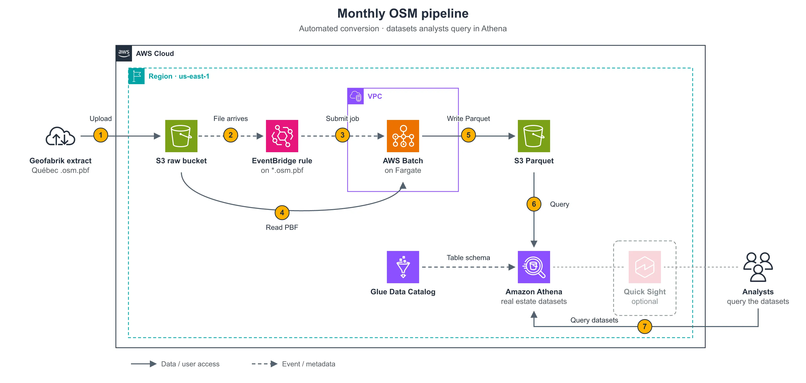

# aws-pbf-dataparser: OpenStreetMap PBF to Parquet on AWS



`aws-pbf-dataparser` converts regional OpenStreetMap `.osm.pbf` extracts into partitioned, Snappy-compressed Parquet datasets in Amazon S3 using **Amazon EventBridge**, **AWS Batch on Fargate**, **PyOsmium / PyArrow**, the **AWS Glue Data Catalog**, and **Amazon Athena**.

It includes an event-driven S3 trigger, private VPC endpoints (`ecr.api`, `ecr.dkr`, `logs`, and the `s3` gateway endpoint), declarative Batch retry rules, and a five-step Athena SQL example (`sql/athena/real_estate/`) that scores real-estate listings against nearby OpenStreetMap amenities.

---

## Architecture

| Component | Purpose |
| --- | --- |
| **Amazon S3 (`raw` & `curated`)** | Stores incoming `.osm.pbf` extracts, temporary `_staging/<run_id>/` parts, published Parquet partitions, and `_manifest.json` |
| **Amazon EventBridge** | Matches `.osm.pbf` uploads in the raw bucket and submits `osm-event-extract` to AWS Batch |
| **AWS Batch on Fargate** | Streams the PBF extract once with PyOsmium, indexes node coordinates on local scratch disk, and writes Parquet batches |
| **Amazon ECR & VPC Endpoints** | Hosts the immutable container image and keeps image pulls, logs, and S3 traffic on the AWS network without a NAT gateway |
| **AWS Glue Data Catalog** | Exposes `osm_catalog.osm_curated` using partition projection (`region`, `year`, `month`, `day`, `entity`) with no crawlers |
| **Amazon Athena** | Queries `osm_curated` and builds the downstream neighborhood POI tables and analyst views under a 10 GiB per-query scan cap |

---

## Prerequisites

- AWS account and authenticated AWS CLI v2 (`aws sts get-caller-identity`)
- Terraform 1.10+
- Docker (with Buildx for `linux/amd64` images)
- Python 3.12 and `make`
- A default VPC in `us-east-1` (or pass `vpc_id` / `subnet_ids` in `infra/terraform.tfvars`)

---

## Quickstart

### 1. Install, deploy infrastructure, and push the container image

```bash
git clone https://github.com/aarigonimi/aws-pbf-dataparser.git
cd aws-pbf-dataparser
python3.12 -m venv .venv && source .venv/bin/activate
make install

cp -n infra/terraform.tfvars.example infra/terraform.tfvars
aws sts get-caller-identity   # verify active AWS account
make deploy                   # terraform init + apply
make build                    # build and push linux/amd64 image to ECR
```

### 2. Run the Monaco smoke test (707 KB)

```bash
make run          # defaults: REGION=monaco YMD=20261108 GEOFABRIK_AREA=europe
make logs         # tail /aws/batch/osm-pbf-data-lake in CloudWatch
make verify       # verify Parquet files and _manifest.json in S3
```

### 3. Run a regional extract (Québec province, 1.17 GB)

```bash
make run REGION=quebec YMD=20261108 GEOFABRIK_AREA=north-america/canada
make logs
make verify REGION=quebec YMD=20261108
```

`make run` downloads the dated extract from Geofabrik and uploads it to `s3://<raw-bucket>/region=<region>/<yyyy>/<mm>/<dd>/<region>-<YYYYMMDD>.osm.pbf`, which triggers the Batch job automatically when `s3_trigger_enabled = true`.

---

## Output Layout & Athena Verification

Published partitions follow this S3 layout:

```text
s3://<curated-bucket>/curated/region=<region>/<yyyy>/<mm>/<dd>/
  entity=nodes/part-00000.parquet
  entity=ways/part-00000.parquet
  entity=relations/part-00000.parquet
  _manifest.json
```

Once `_manifest.json` is present, verify row counts in Amazon Athena (`osm-pbf-workgroup`):

```sql
SELECT entity, count(*) AS records
FROM osm_catalog.osm_curated
WHERE region = 'quebec' AND year = '2026' AND month = '11' AND day = '08'
GROUP BY entity
ORDER BY entity;
```

Always include equality filters on `region`, `year`, `month`, and `day` so Glue partition projection resolves the target prefix directly.

---

## Real-Estate Amenity Scoring Demo (`sql/athena/real_estate/`)

The five SQL scripts in [`sql/athena/real_estate/`](sql/athena/real_estate/README.md) turn a regional partition into three lightweight analyst views:

1. `01_create_neighborhood_pois.sql` — filters `osm_curated` to six amenity categories (`school`, `grocery`, `pharmacy`, `healthcare`, `green_space`, `transit`) inside the Québec City bounding box.
2. `02_create_listings.sql` — registers the sample brokerage listings (`sample_listings.csv`).
3. `03_score_listings.sql` — joins listings against nearby POIs within 800 m using a bounding-box pre-filter and `great_circle_distance`.
4. `04_create_marketing_views.sql` — publishes `re_agent_fact_sheet_quebec_city` and `re_family_friendly_quebec_city`.
5. `05_area_coverage.sql` — buckets POIs into `0.01°` grid cells and publishes `re_director_map_quebec_city`.

> **Note:** Run the CTAS scripts in the `primary` Athena workgroup (since `osm-pbf-workgroup` enforces centralized query-result settings and rejects explicit `external_location` paths), then query the resulting views in `osm-pbf-workgroup`.

---

## Clean Up

To avoid ongoing hourly charges from the three VPC interface endpoints (~$0.72/day in a single AZ), drop the derived Athena views/tables, empty versioned S3 buckets as shown in [`docs/cleanup.md`](docs/cleanup.md), and destroy the Terraform stack:

```bash
make destroy
terraform -chdir=infra state list
aws ec2 describe-vpc-endpoints \
  --filters Name=tag:Project,Values=osm-pbf-data-lake \
  --query 'VpcEndpoints[].VpcEndpointId'
```

---

## Local Development & Tests

```bash
python3.12 -m venv .venv && source .venv/bin/activate
make install
make check   # runs ruff check, ruff format --check, mypy src, pytest, and terraform fmt -check
```

---

## Documentation

- [Architecture & Publication Semantics](docs/ARCHITECTURE.md)
- [Parquet Schema (`osm_curated`)](docs/SCHEMA.md)
- [Deployment Guide](docs/deployment.md)
- [EventBridge S3 Trigger](docs/trigger.md)
- [Execution & Operations](docs/execution.md)
- [Athena Validation](docs/validation.md)
- [Real-Estate SQL Demo](docs/REAL_ESTATE.md)
- [Cost Breakdown](docs/COST.md)
- [Troubleshooting Guide](docs/troubleshooting.md)
- [Cleanup Guide](docs/cleanup.md)

---

## License & Data Attribution

- Code is licensed under the [MIT License](LICENSE).
- Map data © [OpenStreetMap contributors](https://www.openstreetmap.org/copyright), available under the Open Database License (ODbL).
