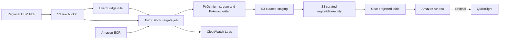

# aws-pbf-dataparser: OpenStreetMap PBF to Parquet on AWS

Repository: <https://github.com/aarigonimi/aws-pbf-dataparser>

```bash
git clone https://github.com/aarigonimi/aws-pbf-dataparser.git
cd aws-pbf-dataparser
```

This project turns a regional OpenStreetMap `.osm.pbf` snapshot into typed,
compressed Parquet datasets in Amazon S3. AWS Batch runs a containerized
PyOsmium/PyArrow processor; AWS Glue catalogs the output and Amazon Athena
queries it.

It is a batch snapshot pipeline and a reproducible engineering example. It is
not a live OSM replication service or a production-readiness claim. The stack
also includes an optional S3 → EventBridge → Batch trigger and a synthetic
Québec real-estate SQL demo; QuickSight is optional and is not deployed.

The article is published as a GitHub Pages site at
<https://aarigonimi.github.io/aws-pbf-dataparser/>. The homepage renders the
short Builder Center field report; the full implementation walkthrough lives
at `/walkthrough/`. Updates to `main` build and deploy through
`.github/workflows/pages.yml`. To preview it locally, use Ruby and Bundler,
then run:

```bash
bundle install
bundle exec jekyll serve --baseurl ""
```

## Quickstart

With the [prerequisites](#step-1--prerequisites) in place (authenticated AWS
CLI, Terraform, Docker, Python), six commands take an empty AWS account to a
verified curated partition:

```bash
make install     # Python runtime and dev dependencies
make deploy      # terraform init + apply (shows the plan, asks to confirm)
make build        # build and push linux/amd64 image, tagged with the commit SHA
make run REGION=monaco YMD=20261108 GEOFABRIK_AREA=europe
make logs         # follow the Batch CloudWatch log group
make verify REGION=monaco YMD=20261108
```

`make run` downloads the dated Geofabrik extract (`YMD` must match the dated
file name, e.g. `20261108` ↔ `monaco-261108.osm.pbf`) and uploads it under the
expected `region=` key. With the trigger enabled (default) the upload starts
the Batch job through EventBridge; with the trigger disabled the target
submits the job manually. `make verify` fails closed until the partition
manifest exists. The [tutorial](#tutorial-reproduce-the-pipeline-end-to-end)
below walks the same flow command by command, including the manual overrides.

## Problem and architecture

PBF extracts can contain hundreds of millions of entities and need substantial
local scratch space. The processor streams entities instead of loading the
whole extract into memory, rotates local Parquet files, uploads them to a
run-specific S3 staging prefix, copies data into the curated layout, then
publishes `_manifest.json` last.



See the [architecture description](docs/ARCHITECTURE.md),
[diagram source](docs/architecture.mmd), and
[architecture decisions](docs/decisions/).

| Service | Role |
| --- | --- |
| Amazon S3 | Separate raw input and curated output; staging and manifests |
| Amazon EventBridge | Optional rule that submits a Batch job when a new `.osm.pbf` lands in the raw bucket |
| AWS Batch on Fargate | Queued, containerized regional processing with retries and timeout |
| Amazon ECR | Versioned processor image with scan-on-push |
| AWS IAM | Separate job, execution, Batch service, EventBridge and optional EC2 roles |
| Amazon CloudWatch Logs | Batch container logs with configurable retention |
| AWS Glue | Explicit schema and partition-projected `osm_curated` table |
| Amazon Athena | SQL validation with a configured workgroup and optional scan cutoff |
| Amazon QuickSight | Optional, not provisioned; can read the example Athena views |

**What is automated:** the Terraform stack creates the optional S3 notification,
EventBridge rule and Batch submit role. An upload to the raw key layout can
start one Batch job with the object key passed as the `raw_key` job parameter.
The pipeline derives `REGION_NAME` and `YMD` from that key and fails fast with
exit code 3 when the key does not match the
`region=<region>/<yyyy>/<mm>/<dd>/<region>-<YYYYMMDD>.osm.pbf` layout; there is
no fallback region or date. `make run` automates the Geofabrik download and
the upload.

**What is not automated:** running the real-estate SQL (a manual Athena step),
refreshing a QuickSight dataset or dashboard, compacting Parquet files, and
applying OSM diffs. This is a monthly-snapshot workflow, not
a live replication service.

The decisions explain why Batch was selected, how PBF data is represented, and
the limits of the S3 publication marker. Readers must check the marker before
querying; direct Athena/S3 readers can see partially published output. No
comparative Lambda/ECS cost or performance test was performed.

## Repository layout

```text
src/                         Python processor, parser, writer, S3 and pipeline
tests/                       Unit tests, including publication, trigger and SQL behavior
infra/                       Terraform for IAM, S3, ECR, Batch, EventBridge, Glue, Athena
scripts/                     Terraform-output environment, image push, extract download/upload, Batch submit, logs, output validation, cleanup
sql/athena/                  Entity count validation and the Québec real-estate demo
docs/                        Architecture, schema, deployment, operations and benchmarks
.github/workflows/           Credential-free Python and Terraform checks
_layouts/ and assets/        Jekyll article layout, styles and motion
```

The existing names are retained; the directory is intentionally small rather
than split into nested application and Terraform modules.

## Tutorial: reproduce the pipeline end to end

Work through the steps in order. Each block of commands is executable as
shown from the repository root. The tutorial run uses the Monaco extract
(~0.7 MB) so you can validate the whole pipeline for a few cents; the
full-scale Quebec benchmark is documented separately in
[verified benchmark evidence](#verified-benchmark-evidence).

### Step 1 — Prerequisites

- An AWS account where you may create S3 buckets, an ECR repository, IAM roles
  and policies (including `iam:PassRole`), Batch compute environments and job
  queues, VPC security groups and endpoints, a CloudWatch log group, a Glue
  database/table and an Athena workgroup. Organizations may require an
  administrator to approve IAM policy creation.
- AWS CLI v2, authenticated through an approved profile or IAM Identity
  Center. For SSO:

  ```bash
  aws configure sso
  aws sso login --profile YOUR_PROFILE
  export AWS_PROFILE="YOUR_PROFILE"
  ```

- Terraform 1.10 or later.
- Docker with Buildx.
- Python 3.11 or later for local checks.
- Git.
- The default region is `us-east-1`; every command below uses it. If you
  change `aws_region` in Step 2, keep the region consistent in AWS CLI and
  application environment variables.

Check your toolchain and identity before starting:

```bash
git --version
aws --version
terraform version
docker version
docker buildx version
python3 --version
aws sts get-caller-identity
```

Expected services and costs: the tutorial consumes seconds of Fargate
(2 vCPU / 8 GiB), megabytes of S3 storage and requests, one ECR image,
Glue catalog objects and a few Athena queries — fractions of a cent. While
the stack exists, the three VPC interface endpoints bill by the hour
(typically ~$0.01/hour each) and the S3 gateway endpoint is free. See
[cost considerations](docs/COST.md); no measured Quebec cost is
claimed in this repository.

Do not place credentials in `.env`, Terraform variables or source control.
Workloads use IAM roles.

### Step 2 — Clone and configure

Clone the repository and set up the Python environment:

```bash
git clone https://github.com/aarigonimi/aws-pbf-dataparser.git
cd aws-pbf-dataparser
python3 -m venv .venv
source .venv/bin/activate
python -m pip install -r requirements-dev.txt
```

Create your Terraform variable file from the example (it is gitignored):

```bash
cp infra/terraform.tfvars.example infra/terraform.tfvars
```

Edit `infra/terraform.tfvars` and set the image tag to your current
commit SHA — this is required, must be immutable and cannot be `latest`:

```bash
git rev-parse HEAD
```

```hcl
image_tag = "<paste the 40-character commit SHA from the command above>"
```

The key variables (all defaults shown; full list with validations in
`infra/variables.tf`):

| Variable | Default | Purpose |
| --- | --- | --- |
| `aws_region` | `us-east-1` | Deployment region; must match your CLI region |
| `s3_trigger_enabled` | `true` | Create the S3 → EventBridge → Batch trigger |
| `network_access` | `vpc_endpoints` | `vpc_endpoints` (default) routes Batch traffic through VPC endpoints; `public_ip` gives tasks a public IP and creates no endpoints (subnet needs an internet route) |
| `raw_bucket_name` / `curated_bucket_name` | `osm-data-raw` / `osm-data-curated` | Bucket base names; a random hex suffix is appended so redeploys never collide |
| `output_prefix` | `curated` | S3 prefix the pipeline writes and Glue/Athena read |
| `batch_compute_type` | `FARGATE` | `FARGATE` or `EC2` (with optional Spot) |
| `batch_vcpus` / `batch_memory_mb` | `2` / `8192` | Per-job compute; Fargate requires a valid combination |
| `batch_ephemeral_storage_gb` | `100` | Local scratch for the PBF, Parquet output and index |
| `batch_timeout_seconds` | `21600` | Per-attempt timeout |
| `overwrite` | `error` | `OVERWRITE` baked into the job definitions (`error`, `skip`, `replace`) |
| `include_way_geometry` | `true` | Reconstruct WKT `LINESTRING` geometry for ways |
| `athena_bytes_scanned_cutoff` | `10737418240` | Per-query Athena scan cutoff (0 disables) |
| `image_tag` | (required) | Immutable ECR tag the job definition references; `make deploy` passes the current commit SHA automatically |

The OSM input is configured at submission time (Step 5) through
`REGION_NAME`, `YMD` and `RAW_KEY`; the pipeline derives the input key from
the `region=<region>/<yyyy>/<mm>/<dd>/<region>-<YYYYMMDD>.osm.pbf` layout when
`RAW_KEY` is not set. Triggered jobs receive `RAW_KEY` from the S3 event and
derive both the region and date from it. All runtime options and their defaults
are documented in [src/config.py](src/config.py) and
[`.env.example`](.env.example) (a credential-free template for local runs).
See [the trigger guide](docs/trigger.md) for the event pattern, parameter
contract and duplicate-event behavior.

### Step 3 — Deploy the infrastructure

Initialize, format-check and validate Terraform:

```bash
terraform -chdir=infra init
terraform -chdir=infra fmt -check -recursive
terraform -chdir=infra validate
```

Review the plan, then apply it:

```bash
terraform -chdir=infra plan -out=tfplan.new
terraform -chdir=infra show tfplan.new
terraform -chdir=infra apply tfplan.new
```

`make deploy` is the shortcut for the same flow: it runs `terraform init` and
then `terraform apply` with `-var image_tag=$(git rev-parse HEAD)`, showing the
plan and asking for confirmation before applying.

What Terraform creates and why:

| Component | Why it is needed |
| --- | --- |
| Raw + curated S3 buckets (versioned, SSE-S3, public access blocked, TLS-only policy) | Separate input from output; lifecycle expires raw extracts, abandoned staging and old versions |
| ECR repository (immutable tags, scan-on-push, lifecycle policy) | Stores the pinned processor image the job pulls |
| Batch compute environment, queue and job definition | Queued, retried execution with explicit vCPU/memory/timeout; the definition bakes the environment defaults and trigger parameters |
| EventBridge rule, S3 notification and submit role | Optional: submit one Batch job when a new `.osm.pbf` appears in the raw bucket, passing the object key as the `raw_key` parameter |
| IAM job/execution/service roles and policies | The job role may only read the raw prefix and manage the curated prefix; the execution role may only pull this image and write this log group |
| VPC endpoints (ECR api/dkr, Logs interface, S3 gateway) in the default `network_access = vpc_endpoints` mode | Lets tasks pull images and reach S3/Logs without a NAT gateway or public IP; `network_access = public_ip` instead assigns public addressing and creates no endpoints |
| CloudWatch log group | Container logs with configured retention |
| Glue database and partition-projected `osm_curated` table | Explicit schema; partition projection replaces a crawler |
| Athena workgroup | Forces the results location, encryption and an optional scan cutoff |

For team use, configure remote state from
`infra/backend.tf.example` before initializing; local state must
never be committed. Retrieve the generated identifiers — the rest of the
tutorial uses them:

```bash
terraform -chdir=infra output
```

### Step 4 — Build and publish the Docker image

The ECR repository now exists. Build and push the exact tag configured in
Step 2:

```bash
export ECR_REPOSITORY_URL="$(terraform -chdir=infra output -raw ecr_repository_url)"
export AWS_REGION="us-east-1"
export TAG="$(git rev-parse HEAD)"   # must equal Terraform's image_tag
./scripts/docker_build_push.sh
```

`make build` runs the same script without the exports: it loads
`ECR_REPOSITORY_URL` and `AWS_REGION` from Terraform outputs
([scripts/env.sh](scripts/env.sh)) and defaults `TAG` to the current commit
SHA. It warns when the working tree is dirty, because the tag then no longer
identifies the exact source.

The script authenticates Docker to ECR with the AWS CLI, builds the root
`Dockerfile` for `linux/amd64` (Fargate architecture) with Buildx, pushes the
tag, and prints the pushed image's `sha256:` digest.

Optional digest pinning: copy the printed digest into
`infra/terraform.tfvars` as `image_digest = "sha256:..."` and apply a
reviewed plan. This creates a new job definition revision that references
`repository@digest` instead of the tag, so a later push to the same tag can
never change what runs. Tags are immutable by default; without a digest the
manifest's digest field is null because AWS does not expose the resolved
digest to the container.

Do not submit a job until the push succeeds.

### Step 5 — Upload and process an OSM dataset

The tutorial uses Geofabrik's Monaco extract — the smallest regular extract
(~0.7 MB, tens of thousands of entities) — so a complete run takes minutes.
OpenStreetMap data is © OpenStreetMap contributors under the ODbL; see
[data attribution](#data-attribution). `make run REGION=monaco YMD=20261108
GEOFABRIK_AREA=europe` automates the download and upload below; the commands
show what it does and how the pieces fit together.

Download the extract and derive its date (`YMD` is both the partition date
and part of the input key, so it must match the extract's real date):

```bash
export REGION_NAME="monaco"
export AWS_REGION="us-east-1"
EXTRACT_URL="$(curl -s -o /dev/null -w '%{redirect_url}' \
  https://download.geofabrik.de/europe/monaco-latest.osm.pbf)"
SHORT="$(basename "$EXTRACT_URL" .osm.pbf)"; SHORT="${SHORT#monaco-}"
export YMD="20${SHORT:0:2}${SHORT:2:2}${SHORT:4:2}"
curl -L -o "monaco-${YMD}.osm.pbf" "$EXTRACT_URL"
```

Geofabrik serves `monaco-latest.osm.pbf` as a redirect to a dated file such
as `monaco-261108.osm.pbf` (`YYMMDD`); the command above resolves that
redirect and maps `261108` to `YMD=20261108`. Any regional extract you are
licensed to use works the same way — adjust `REGION_NAME`, `YMD` and the
file name together.

Upload the extract to the raw bucket using the expected key layout:

```bash
export RAW_BUCKET="$(terraform -chdir=infra output -raw raw_bucket_name)"
export OUTPUT_BUCKET="$(terraform -chdir=infra output -raw curated_bucket_name)"
export OUTPUT_PREFIX="curated"
aws s3 cp "monaco-${YMD}.osm.pbf" \
  "s3://${RAW_BUCKET}/region=${REGION_NAME}/${YMD:0:4}/${YMD:4:2}/${YMD:6:2}/${REGION_NAME}-${YMD}.osm.pbf"
```

#### Automatic trigger

With `s3_trigger_enabled = true` (the default), the upload above matches the
EventBridge rule and submits one Batch job. The rule filters for
`source = aws.s3`, `detail-type = Object Created`, the raw bucket and a key
suffix of `.osm.pbf`. EventBridge rewrites each event into a `SubmitJob`
input that passes the object key as the `raw_key` job parameter; the
container command expands it as `--raw-key`, and the pipeline derives
`REGION_NAME` and `YMD` from the key. A key that does not match the
`region=<region>/<yyyy>/<mm>/<dd>/...` layout still triggers the job, which
then fails fast with exit code 3 instead of writing output.

Confirm the rule exists:

```bash
terraform -chdir=infra output eventbridge_rule_name
aws events list-rules --region "$AWS_REGION" --name-prefix "$(terraform -chdir=infra output -raw eventbridge_rule_name)"
```

Triggered jobs use the event job definition's baked `INCLUDE_WAY_GEOMETRY`,
`MODE`, `PARQUET_COMPRESSION`, `OVERWRITE` and similar settings. Change those
in Terraform and apply a new job-definition revision when the trigger should
use different defaults; the rule targets the latest revision of the event
definition. The baked `OVERWRITE` mode (default `error`) plus the partition
claim make a duplicate S3 event safe: the second job fails fast with exit
code 4 instead of replacing completed output. See
[the trigger guide](docs/trigger.md) for details and limitations.

#### Manual submission

Use manual submission when you want explicit environment overrides or when the
trigger is disabled. If the trigger is enabled and you already uploaded the
object, do not submit again for the same partition: the second job normally
loses the partition claim or skips completed output.

```bash
export JOB_QUEUE="$(terraform -chdir=infra output -raw batch_job_queue_name)"
export JOB_DEFINITION="$(terraform -chdir=infra output -raw batch_job_definition_name)"
export OVERWRITE="error"
./scripts/submit_job.sh
```

The submit script exports the run settings as Batch container environment
overrides and refuses to submit while another `osm-${REGION_NAME}-*` job is
active (set `ALLOW_CONCURRENT=true` to bypass). The job name is
`osm-${REGION_NAME}-${YMD}`; note the `jobId` from the submit response. The
run ID is derived inside the job from the Batch job ID and attempt number, so
manual submissions no longer pass one.
`OVERWRITE=error` protects an existing partition; use `skip` to treat a
completed manifest as done, and `replace` only for controlled recovery (see
[troubleshooting](docs/troubleshooting.md)). Manual overrides take precedence
over the key-derived region and date.

Monitor the execution:

```bash
aws batch describe-jobs --region "$AWS_REGION" --jobs YOUR_JOB_ID \
  --query 'jobs[0].{status:status,statusReason:statusReason,attempts:attempts,startedAt:startedAt,stoppedAt:stoppedAt}'
```

The job transitions through `SUBMITTED`/`PENDING`/`RUNNABLE`/`STARTING`/
`RUNNING` to `SUCCEEDED` or `FAILED`. Retrieve the application logs with
`make logs` or the equivalent CloudWatch Logs tail (the default group is
`/aws/batch/osm-pbf-data-lake`; use
`terraform -chdir=infra output -raw cloudwatch_log_group_name`
if you changed `project_name`):

```bash
aws logs tail /aws/batch/osm-pbf-data-lake --region "$AWS_REGION" --follow --since 30m
```

A successful log ends with `Run complete: status=success records={...}
files=... manifest=s3://<curated-bucket>/curated/region=monaco/2026/11/08/_manifest.json`.

This tutorial run is deliberately small. The full-scale Quebec benchmark
(148.7 M entities, 6.45 GB Parquet, ~1 h 40 m end to end) is documented in
[verified benchmark evidence](#verified-benchmark-evidence); do not treat
Monaco timings as evidence of full-scale performance.

### Step 6 — Verify the output

Run from the repository root; the validator fails closed if the partition
manifest is missing:

```bash
make verify REGION=monaco YMD=20261108   # or: ./scripts/validate_output.sh
```

It lists the partition objects, counts Parquet files, sums bytes and prints
the manifest. Inspect the final state manually:

```bash
aws s3 ls "s3://${OUTPUT_BUCKET}/${OUTPUT_PREFIX}/region=${REGION_NAME}/${YMD:0:4}/${YMD:4:2}/${YMD:6:2}/" --recursive
aws s3 cp "s3://${OUTPUT_BUCKET}/${OUTPUT_PREFIX}/region=${REGION_NAME}/${YMD:0:4}/${YMD:4:2}/${YMD:6:2}/_manifest.json" -
```

Check `status`, `record_counts`, `total_records`, `files`, `source` and
`timings` in the manifest. A successful partition has exactly the files
listed in the manifest's `files` inventory, no `_staging/` objects, and no
`_lock.json` (the claim is released when the run finishes).

Confirm the Glue table exists:

```bash
aws glue get-table --region "$AWS_REGION" \
  --database-name "$(terraform -chdir=infra output -raw glue_database_name)" \
  --name osm_curated --query 'Table.{name:Name,columns:StorageDescriptor.Columns[].Name,partitions:PartitionKeys[].Name}'
```

Query the data with Athena from the CLI (equivalent to the console example in
[sql/athena/validate_entity_counts.sql](sql/athena/validate_entity_counts.sql)):

```bash
export ATHENA_WORKGROUP="$(terraform -chdir=infra output -raw athena_workgroup_name)"
export GLUE_DATABASE="$(terraform -chdir=infra output -raw glue_database_name)"
QUERY_ID="$(aws athena start-query-execution --region "$AWS_REGION" \
  --query-string "SELECT entity, count(*) AS records FROM osm_curated WHERE region = '${REGION_NAME}' AND year = '${YMD:0:4}' AND month = '${YMD:4:2}' AND day = '${YMD:6:2}' GROUP BY entity ORDER BY entity" \
  --query-execution-context "Database=${GLUE_DATABASE}" \
  --result-configuration "OutputLocation=s3://${OUTPUT_BUCKET}/athena-results/" \
  --work-group "$ATHENA_WORKGROUP" \
  --query 'QueryExecutionId' --output text)"
aws athena get-query-execution --region "$AWS_REGION" \
  --query-execution-id "$QUERY_ID" \
  --query 'QueryExecution.{state:Status.State,bytesScanned:Statistics.DataScannedInBytes}'
aws athena get-query-results --region "$AWS_REGION" \
  --query-execution-id "$QUERY_ID" \
  --query 'ResultSet.Rows[].Data[].VarCharValue'
```

**What success looks like:** the query state is `SUCCEEDED`; the rows return
one count per entity (`nodes`, `ways`, `relations`) that exactly matches
`record_counts` in the S3 manifest; `describe-jobs` shows `SUCCEEDED`; and the
log ends with `Run complete`. Partition projection requires equality filters
on `region`, `year`, `month` and `day` — without them the query fails or scans
everything. **Query only after `_manifest.json` exists**; the manifest is the
completion marker and Athena does not gate on it.

**Recognizing failures:** `FAILED` job with exit code 3 means the input key
or bucket is wrong (check `RAW_KEY`); exit code 4 means the partition or claim
already exists (see overwrite modes); exit code 5 means an IAM denial (see
[troubleshooting](docs/troubleshooting.md#s3-access-denied)); empty Athena
rows usually mean `region`/`year`/`month`/`day` filters do not match the
published partition. [Validation details](docs/validation.md).

#### Optional: Québec real-estate demo

The files in
[`sql/athena/real_estate/`](sql/athena/real_estate/README.md) create a
neighborhood POI table, **eight synthetic** listings, 800 m presence-based
amenity scores and three reporting views for the analyst handoff: a
family-friendly shortlist, a per-listing agent fact sheet and an
area-coverage grid for the director's map. Run them in order after a Québec
partition and its manifest exist, uploading `sample_listings.csv` to the
curated bucket first; the README in that directory gives the exact commands
and the bucket-name replacement. The listings are fabricated and the amenity
score is illustrative; see the
[real-estate notes](docs/REAL_ESTATE.md). Analysts read the views with any
tool that speaks Athena; QuickSight is not deployed.

### Step 7 — Troubleshooting

The [troubleshooting guide](docs/troubleshooting.md) documents the real
issues hit while building this project, each with symptom, root cause,
diagnosis and fix:

| Symptom | Root cause | Section |
| --- | --- | --- |
| Job stuck `RUNNABLE`, or fails with `ResourceInitializationError` before logs appear | Fargate cannot reach ECR/Logs without VPC endpoints (or the S3 gateway endpoint is not on the subnet's route table) | [ECR image pull failures](docs/troubleshooting.md#batch-cannot-pull-the-image-from-ecr) |
| `AccessDenied` in logs, exit code 5 | Job/execution role confusion, wrong bucket/prefix in policy, or an SCP | [IAM and S3](docs/troubleshooting.md#s3-access-denied) |
| Exit code 4 on resubmission | Partition manifest, stray output, or another run's `_lock.json` claim exists | [Output conflict](docs/troubleshooting.md#output-conflict) |
| Two jobs, one partition | Pre-claim behavior; publication is now serialized by the S3 claim, losers fail fast | [Concurrent processing](docs/troubleshooting.md#two-jobs-published-the-same-partition) |
| Athena cannot see rows | Missing injected `region`/`year`/`month`/`day` equality filters, or querying before the manifest exists | [Athena projection](docs/troubleshooting.md#athena-cannot-resolve-projected-partitions) |
| Upload does not start a job | Trigger disabled, key not ending `.osm.pbf`, missing S3 EventBridge notification, or submit-role permission | [Trigger not firing](docs/trigger.md#trigger-not-firing) |
| Two jobs for one upload | S3/EventBridge can deliver duplicate events; the baked `OVERWRITE` mode (default `error`) and the partition claim make the duplicate safe | [Duplicate events](docs/trigger.md#duplicate-events) |
| Way centroids missing in Athena | `include_way_geometry=false`; ways have no coordinates without reconstructed geometry | [Trigger guide](docs/trigger.md#geometry-and-manual-overrides) |
| Retried non-retryable failures | Retry rules must end with a catch-all `EXIT`; see the job definition | [Retry behavior](docs/troubleshooting.md#batch-retry-behavior) |
| Docker build/push failures | Architecture must be `linux/amd64`; tag must exist and match `image_tag` | [Image build](docs/deployment.md#build-and-push-the-image) |
| Terraform drift or stale plans | Live state vs configuration; never apply stale plans | [Terraform recovery](docs/TERRAFORM_RECOVERY.md) |

### Step 8 — Clean up AWS resources

All commands below are destructive; review them before running. First stop
anything still running:

```bash
aws batch list-jobs --job-queue "$JOB_QUEUE" --region "$AWS_REGION" --status RUNNING
aws batch terminate-job --job-id YOUR_JOB_ID --reason "tutorial cleanup"
```

Destroy the Terraform-managed infrastructure through the interactive script
(it shows a destroy plan first and requires typing `DESTROY INFRASTRUCTURE`),
or run `make destroy`:

```bash
./scripts/cleanup.sh
```

The buckets are created with `force_destroy = false`, so Terraform refuses to
delete them while they contain objects or versions — by design, so a destroy
never silently purges data. To purge everything before destroying (this
deletes the raw PBF, curated Parquet, manifests, versions and delete markers
permanently):

```bash
for BUCKET in "$RAW_BUCKET" "$OUTPUT_BUCKET"; do
  aws s3api list-object-versions --bucket "$BUCKET" --output json > "/tmp/${BUCKET}.versions.json"
  python3 - "$BUCKET" <<'EOF'
import json, subprocess, sys
bucket = sys.argv[1]
doc = json.load(open(f"/tmp/{bucket}.versions.json"))
objects = [{"Key": v["Key"], "VersionId": v["VersionId"]}
           for field in ("Versions", "DeleteMarkers") for v in doc.get(field, [])]
for i in range(0, len(objects), 1000):
    subprocess.run(["aws", "s3api", "delete-objects", "--bucket", bucket,
                    "--delete", json.dumps({"Objects": objects[i:i+1000], "Quiet": True})],
                   check=True)
print(f"purged {len(objects)} object versions from {bucket}")
EOF
done
export ECR_REPOSITORY="${ECR_REPOSITORY_URL##*/}"
aws ecr batch-delete-image --repository-name "$ECR_REPOSITORY" --region "$AWS_REGION" \
  --image-ids "imageTag=$(git rev-parse HEAD)"
./scripts/cleanup.sh
```

Then confirm nothing billable remains: `aws s3 ls`, `aws ecr describe-images`,
the CloudWatch log group (deleted with the stack — export first if needed),
Athena result objects under `athena-results/`, and the three VPC interface
endpoints (destroyed with the stack). Full guidance, including how to retain
data while removing compute, is in [cleanup](docs/cleanup.md). Terraform state
and backups are not cleanup targets; preserve them per your recovery policy.

## Output contract

```text
s3://<curated-bucket>/curated/region=<region>/<yyyy>/<mm>/<dd>/
  entity=nodes/part-00000.parquet
  entity=ways/part-00000.parquet
  entity=relations/part-00000.parquet
  _manifest.json
```

Each entity file uses the shared explicit schema in [docs/SCHEMA.md](docs/SCHEMA.md).
The directory layout provides Hive-style `region` and `entity` values plus a
zero-padded `yyyy/mm/dd` date path.
Tags are canonical JSON strings; relation members are JSON strings in an array;
geometry is WKT text. Way geometry is optional. Relation geometry is not
reconstructed. Empty entity outputs have no Parquet file but are represented
in the manifest.

The manifest lists counts, source bytes, file keys/sizes, codec, run ID and
timings. Its `duration_seconds` is recorded before S3 publication completes;
use the CloudWatch completion log and AWS Batch timestamps for total runtime.
The manifest path starts with `_`; read it directly from S3 instead of relying
on Athena to scan it. Query a partition only after its final manifest exists.
The manifest does not block direct Athena queries or S3 listings from seeing
partial data while final keys are being copied.

`OVERWRITE=error` protects an existing partition; `skip` treats a manifest as
completion; `replace` republishes and removes stale keys before publishing.
Publication is serialized per `region`/date partition by an S3
conditional-write claim (`_lock.json`): a second concurrent run fails fast
with exit code 4 instead of interleaving its copies. The claim is released
when the run finishes; a stale claim from a terminated run is recovered with
`OVERWRITE=replace`. Failed replacement does not restore prior versions
automatically. Review [publication semantics](docs/ARCHITECTURE.md) before
using `replace`.

## Verified benchmark evidence

| Region | Run ID | Entities | Parquet | Parse / Batch duration |
| --- | --- | ---: | ---: | ---: |
| Quebec | `quebec-20261108233711` | 148,698,370 | 497 files, 6.454 GB | 5,530.778 / 5,922.575 s |
| Monaco | `monaco-20261110T023307Z` | 48,469 | 3 files, 2.563 MB | 2.369 / 30.418 s |

Derived parse throughput is 26,885.6 entities/s for Quebec
(`148,698,370 / 5,530.778`). This rate uses manifest parse seconds and excludes
download and publication; two runs are not a scaling study.

Quebec used the older writer, which rotated at 300,000 rows. The
current code rotates at 250,000 rows and was run in AWS for the Monaco
tutorial validation above; each Monaco entity fit in a single file, so the
rotation threshold itself remains unexercised in AWS.

Quebec Athena entity counts matched the S3 manifest. Two Quebec jobs overlapped
on that partition, so these figures are not a single-job cost baseline. Account-specific S3 bucket names, ECR registry ID and Batch job IDs
are omitted from the publishable benchmark records. Details and provenance are
in [benchmark index](docs/benchmarks/benchmark-index.json) and
[benchmark notes](docs/benchmarks/README.md).

## Local development and CI

```bash
python3 -m venv .venv
source .venv/bin/activate
python -m pip install -r requirements-dev.txt
make check
terraform -chdir=infra validate
```

GitHub Actions runs Python tests, lint/format/type checks and Terraform
format/validation without AWS credentials and without deploying resources.
See [Contributing](CONTRIBUTING.md) for the local workflow. Build the runtime
image locally (no push) with:

```bash
docker build --platform linux/amd64 -t osm-pbf-batch:local .
docker run --rm osm-pbf-batch:local --help
```

`tests/test_end_to_end.py` generates a tiny PBF with
`scripts/generate_sample_pbf.py` and runs the full pipeline against an
in-memory S3 fake; it is skipped when PyOsmium is not installed.

A complete draft AWS Builder Center article, its architecture figure, and a
strict [Quality Explainer assessment](docs/article/quality-bar-assessment.md)
are in [`docs/article/`](docs/article/). The article includes the implementation
walkthrough and troubleshooting history; its review checklist records the
remaining publication and live-verification steps.

## Costs, troubleshooting and cleanup

- [Cost considerations](docs/COST.md): service meters, sizing and cost capture.
- [Trigger guide](docs/trigger.md): EventBridge filtering, Batch parameters,
  duplicate events and manual overrides.
- [Real-estate demo](docs/REAL_ESTATE.md): synthetic listings, amenity views and
  QuickSight caveats.
- [Troubleshooting](docs/troubleshooting.md): ECR/VPC endpoints, IAM, output
  conflicts, trigger and Athena validation.
- [Cleanup](docs/cleanup.md): interactive infrastructure destroy, S3 version
  retention, delete markers and continuing charges.
- [Security policy](SECURITY.md): credentials, state and vulnerability reports.

The S3 gateway endpoint is associated with every route table in the VPC, so it
covers the main table used by default subnets and any explicit associations.
In the default `network_access = vpc_endpoints` mode Batch traffic stays on
those endpoints; with `network_access = public_ip` tasks get public
addressing instead and no endpoints are created. Glue partition projection is
configured for `osm_curated`: queries must filter
on `region`, `year`, `month` and `day`, while `entity` is projected from its
three-value enum.
This table replaced the retired Glue crawler and was deployed and queried via
Athena during the 2026-11-10 Monaco tutorial validation above. The project
processes full snapshots; it does not apply OSM diffs, compact files or
reconstruct relation geometry.

The EventBridge trigger is optional and enabled by default; set
`s3_trigger_enabled = false` to deploy only the manual submission path. QuickSight
is not deployed. The real-estate SQL uses synthetic listings and an illustrative
amenity score, so it must not be presented as real inventory or a validated
housing index. The end-to-end test exercises the parser, writer and
publication path against a synthetic PBF and an in-memory S3 fake; it does
not replace an AWS integration test.

## Data attribution

OpenStreetMap data is © OpenStreetMap contributors and available under the
Open Database License (ODbL). Derived databases must preserve attribution and
share-alike obligations. The processor software uses the existing MIT License;
the software license does not change the OSM data license.
