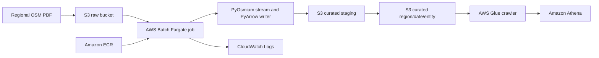

# aws-pbf-dataparse: OpenStreetMap PBF to Parquet on AWS

Repository: <https://github.com/aarigonimi/aws-pbf-dataparser>

```bash
git clone https://github.com/aarigonimi/aws-pbf-dataparser.git
cd aws-pbf-dataparse
```

This project turns a regional OpenStreetMap `.osm.pbf` snapshot into typed,
compressed Parquet datasets in Amazon S3. AWS Batch runs a containerized
PyOsmium/PyArrow processor; AWS Glue catalogs the output and Amazon Athena
queries it.

It is a batch snapshot pipeline and a reproducible engineering example. It is
not a live OSM replication service or a production-readiness claim.

## Problem and architecture

PBF extracts can contain hundreds of millions of entities and need substantial
local scratch space. The processor streams entities instead of loading the
whole extract into memory, rotates local Parquet files, uploads them to a
run-specific S3 staging prefix, copies data into the curated layout, then
publishes `_manifest.json` last.



See the [architecture description](docs/ARCHITECTURE.md),
[diagram source](docs/architecture.mmd), and
[architecture decisions](docs/decisions/).

| Service | Role |
| --- | --- |
| Amazon S3 | Separate raw input and curated output; staging and manifests |
| AWS Batch on Fargate | Queued, containerized regional processing with retries and timeout |
| Amazon ECR | Versioned processor image with scan-on-push |
| AWS IAM | Separate job, execution, Batch service, EC2 and Glue roles |
| Amazon CloudWatch Logs | Batch container logs with configurable retention |
| AWS Glue | Database and on-demand crawler for curated Parquet |
| Amazon Athena | SQL validation with a configured workgroup and optional scan cutoff |

The decisions explain why Batch was selected, how PBF data is represented, and
what the S3 publication marker guarantees. No comparative Lambda/ECS cost or
performance test was performed.

## Repository layout

```text
src/                         Python processor, parser, writer, S3 and pipeline logic
tests/                       Unit tests, including publication and schema behavior
infrastructure/              Terraform for IAM, S3, ECR, Batch, networking, Glue, Athena
scripts/                      Image push, Batch submit, output validation, cleanup
sql/athena/                   Example entity count validation
docs/                         Architecture, schema, deployment, operations and benchmarks
.github/workflows/            Credential-free Python and Terraform checks
```

The existing names are retained; the directory is intentionally small rather
than split into nested application and Terraform modules.

## Prerequisites and configuration

- AWS account with deployment permissions for the resources listed in
  [deployment prerequisites](docs/deployment.md), including `iam:PassRole`.
- AWS CLI v2 authenticated through an approved profile or IAM Identity Center.
- Terraform 1.6+, Docker with Buildx, and Python 3.11+ for local checks.
- A regional OSM PBF extract you are licensed to use. The project does not
  download extracts automatically.

Terraform defaults to `us-east-1`, Fargate, 2 vCPU, 8 GiB memory and 100 GiB
ephemeral storage. Copy `infrastructure/terraform.tfvars.example` to the
gitignored `infrastructure/terraform.tfvars` and choose a unique image tag.
Runtime options include `REGION_NAME`, `YMD`, `RAW_KEY`, `RUN_ID`,
`OUTPUT_PREFIX`, `MODE`, `OVERWRITE`, `PARQUET_COMPRESSION`,
`INCLUDE_WAY_GEOMETRY`, `MAX_RECORDS_PER_FILE`, and `ROW_GROUP_SIZE`.
Defaults and validation are in [src/config.py](src/config.py); a credential-free
environment template is [`.env.example`](.env.example). Terraform's sample
variables are in `infrastructure/terraform.tfvars.example`.

No credentials belong in `.env`, Terraform variables or source control. The
example infrastructure uses existing VPC networking and creates no NAT
gateway. The cost drivers include Fargate runtime and ephemeral storage, VPC
interface endpoint hours, S3 storage/requests, CloudWatch Logs, Glue, Athena
and ECR. No actual Quebec or London cost was captured; see
[cost considerations](docs/COST.md) rather than treating an illustrative
price as measured.

## Reproduce the implementation

Follow these guides in order:

1. [Deploy infrastructure](docs/deployment.md): configure Terraform, inspect
   the plan, apply it yourself, and inspect outputs.
2. [Build and push the image](docs/deployment.md#build-and-push-the-image):
   push an explicit image tag matching the job definition.
3. [Upload an extract and submit a job](docs/execution.md): select a region,
   extract date, raw S3 key and unique run ID; use `OVERWRITE=error` for a new
   partition.
4. [Validate output](docs/validation.md): inspect S3, read the manifest, run
   the Glue crawler, and compare Athena counts.
5. [Clean up](docs/cleanup.md): review the destroy plan and confirm
   infrastructure removal. S3 object versions are not removed by the cleanup
   script.

The job can also be run locally against S3 using environment variables, but
AWS Batch is the documented full-size execution path. The historical Quebec
partition must not be used as a test input.

## Output contract

```text
s3://<curated-bucket>/curated/region=<region>/ymd=<YYYYMMDD>/
  entity=nodes/part-00000.parquet
  entity=ways/part-00000.parquet
  entity=relations/part-00000.parquet
  _manifest.json
```

Each entity file uses the shared explicit schema in [docs/SCHEMA.md](docs/SCHEMA.md).
The directory layout provides Hive-style `region`, `ymd` and `entity` values.
Tags are canonical JSON strings; relation members are JSON strings in an array;
geometry is WKT text. Way geometry is optional. Relation geometry is not
reconstructed. Empty entity outputs have no Parquet file but are represented
in the manifest.

The manifest lists counts, source bytes, file keys/sizes, codec, run ID and
timings. Its `duration_seconds` is recorded before S3 publication completes;
use the CloudWatch completion log and AWS Batch timestamps for total runtime.
The manifest path starts with `_`; read it directly from S3 instead of relying
on Athena to scan it.

`OVERWRITE=error` protects an existing partition; `skip` treats a manifest as
completion; `replace` republishes and removes stale keys. There is no
distributed partition lock, and failed replacement does not restore prior
versions automatically. Enforce one job per `region`/`ymd`; `scripts/submit_job.sh`
refuses to submit while another `osm-<region>-*` job is active in the queue
unless `ALLOW_CONCURRENT=true`. Review
[publication semantics](docs/ARCHITECTURE.md) before using `replace`.

## Verified benchmark evidence

| Region | Run ID | Entities | Parquet | Parse / Batch duration |
| --- | --- | ---: | ---: | ---: |
| Quebec | `quebec-20261108233711` | 148,698,370 | 497 files, 6.454 GB | 5,530.778 / 5,922.575 s |
| London | `london-20261109142209` | 13,346,901 | 46 files, 588.846 MB | 549.270 / 604.629 s |

Quebec Athena entity counts matched the S3 manifest. Two Quebec jobs overlapped
on that partition, so these figures are not a single-job cost baseline. London
was already present in AWS during the audit; its Athena counts were not
queried. Account-specific S3 bucket names, ECR registry ID and Batch job IDs
are omitted from the publishable benchmark records. Details and provenance are
in [benchmark index](docs/benchmarks/benchmark-index.json) and
[benchmark notes](docs/benchmarks/README.md).

## Local development and CI

```bash
python3 -m venv .venv
source .venv/bin/activate
python -m pip install -r requirements-dev.txt
make check
terraform -chdir=infrastructure validate
```

GitHub Actions runs Python tests, lint/format/type checks and Terraform
format/validation without AWS credentials and without deploying resources.
See [Contributing](CONTRIBUTING.md) for the local workflow. Build the runtime
image locally (no push) with:

```bash
docker build --platform linux/amd64 -t osm-pbf-batch:local .
docker run --rm osm-pbf-batch:local --help
```

`tests/test_end_to_end.py` generates a tiny PBF with
`scripts/generate_sample_pbf.py` and runs the full pipeline against an
in-memory S3 fake; it is skipped when PyOsmium is not installed.

A complete draft AWS Builder Center article, its architecture figure, and a
strict [Quality Explainer assessment](docs/article/quality-bar-assessment.md)
are in [`docs/article/`](docs/article/). The article includes the implementation
walkthrough and troubleshooting history; its review checklist records the
remaining publication and live-verification steps.

## Costs, troubleshooting and cleanup

- [Cost considerations](docs/COST.md): service meters, sizing and cost capture.
- [Troubleshooting](docs/troubleshooting.md): ECR/VPC endpoints, IAM, output
  conflicts and Glue crawler behavior.
- [Cleanup](docs/cleanup.md): interactive infrastructure destroy, S3 version
  retention, delete markers and continuing charges.
- [Security policy](SECURITY.md): credentials, state and vulnerability reports.

The S3 gateway endpoint is associated with the VPC main route table; custom
subnets may need explicit endpoint routing. Batch egress is open by default.
The Glue crawler creates leaf-level tables, not a unified partitioned table
across all dates. The project processes full snapshots; it does not apply OSM
diffs, compact files or reconstruct relation geometry.

## Data attribution

OpenStreetMap data is © OpenStreetMap contributors and available under the
Open Database License (ODbL). Derived databases must preserve attribution and
share-alike obligations. The processor software uses the existing MIT License;
the software license does not change the OSM data license.
