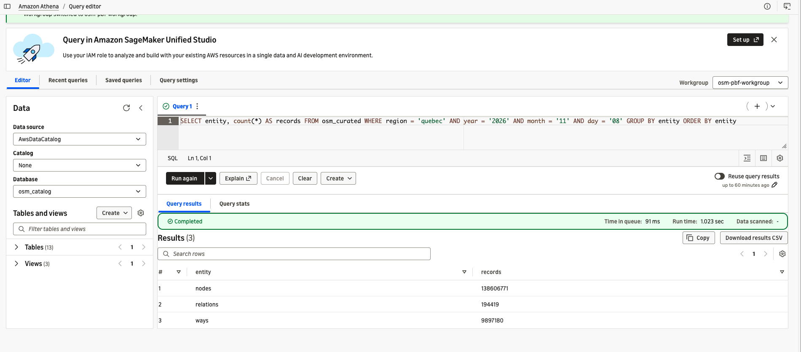
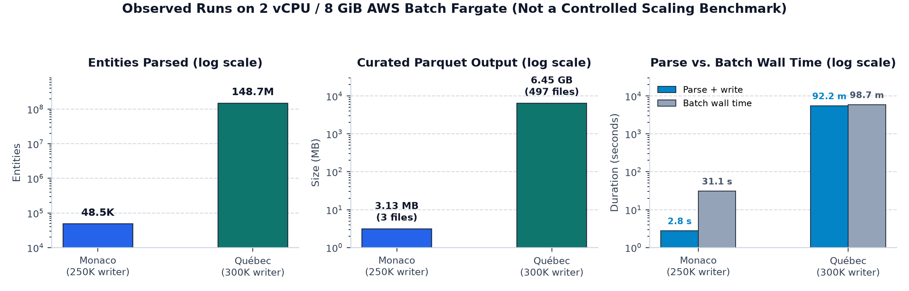
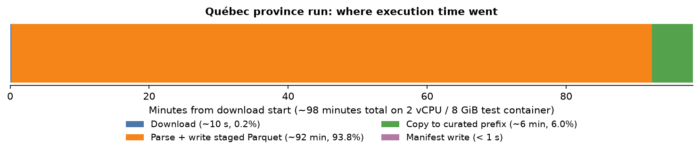
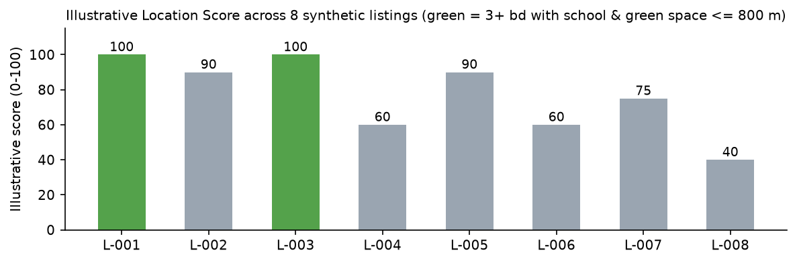
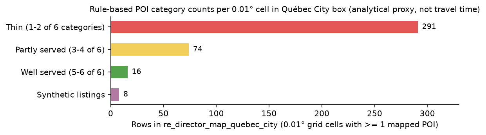

# What's Around This House? Querying OpenStreetMap with SQL on AWS

> **Repository:** <https://github.com/aarigonimi/aws-pbf-dataparser> (Python processor, Dockerfile, Terraform, Athena SQL and operating guide)

## Enriching Property Listings with OpenStreetMap

Real-estate teams and property analysts frequently need to answer location questions around a listing:

- Which schools, parks, grocery stores, transit stops and clinics sit within 800 m of a property?
- Which three-bedroom listings have both a school and a green space nearby?
- How are mapped amenities distributed across different parts of a city?

OpenStreetMap (OSM) maps those features globally, but regional snapshots are distributed as compressed binary `.osm.pbf` files rather than relational tables. If the data stays in PBF format, every analytical question requires custom Python or C++ parsing code. Once a regional extract is converted into partitioned Parquet files in Amazon S3 and registered in the AWS Glue Data Catalog, an analyst can filter amenities and join them against property listings using standard SQL in Amazon Athena.

This article walks through the batch pipeline I built to convert regional OSM `.osm.pbf` snapshots into Parquet on AWS, followed by an illustrative Québec City real-estate analysis built on top of the curated table:

1. **Automated ingestion:** Uploading a `.osm.pbf` file to an S3 landing bucket triggers an Amazon EventBridge rule that submits an AWS Batch job on AWS Fargate. The container streams the PBF file with PyOsmium, writes Snappy-compressed Parquet batches with PyArrow and publishes a completion manifest (`_manifest.json`).
2. **SQL analytics:** Five Athena queries in `sql/athena/real_estate/` filter the provincial snapshot to Québec City points of interest (POIs), join them with a CSV table of eight synthetic property listings and create views for agents, marketing and leadership.

The AWS pipeline, Batch runs, CloudWatch logs and Athena query measurements come from my AWS account. The real-estate brokerage scenario and the eight listings in `sample_listings.csv` are synthetic examples used to show how downstream SQL consumers query the curated Parquet table; they do not estimate property valuations or market prices.

## Why Not Query OpenStreetMap Directly?

For a single address lookup, the public Overpass API works well, but it is a shared community service with rate limits rather than a backend for recurring batch joins across hundreds of listings. Regional PBF extracts from [Geofabrik](https://download.geofabrik.de/) let you process an entire region offline. Because Geofabrik does not publish a standalone file for Québec City, the smallest extract covering the city is the province of Québec (`quebec-261108.osm.pbf`, 1.17 GB).

A PBF file is a sequential Protocol Buffers stream containing three OSM primitive types:

- **Nodes:** point features with a 64-bit `osm_id`, `latitude`, `longitude` and a key-value `tags` map (for example `highway=bus_stop` or `shop=supermarket`).
- **Ways:** ordered lists of node IDs (`node_refs`) representing polylines or closed boundaries such as streets, parks or school buildings. Ways do not store coordinates directly; reconstructing their geometry requires looking up the coordinates of every referenced node.
- **Relations:** ordered lists of member references (`type:ref:role`) grouping nodes, ways and other relations into routes, administrative boundaries or multipolygons.

Athena cannot read `.osm.pbf` files. Converting the snapshot once into a flat, typed Parquet schema (`osm_id`, `osm_type`, common tag columns such as `name`, `amenity`, `shop`, `highway`, `latitude`, `longitude`, WKT `geometry`, `node_refs`, `members` and a JSON `tags` string) turns repeated spatial lookups into columnar scans.

## Architecture and AWS Service Trade-Offs


`src/osm_parser.py` streams entities through a `pyosmium.SimpleHandler` (`_Handler`), and `src/parquet_writer.py` buffers records in memory up to `max_records_per_file` (`250,000` rows in the current code, written in `100,000`-row Arrow row groups) before closing each local Parquet file and uploading it to S3. When `include_way_geometry = true`, PyOsmium maintains a disk-backed node-location index (`sparse_file_array`) on container scratch storage so ways can look up node coordinates as they stream past.

That single-stream, disk-backed access pattern shaped the compute and catalog choices:

- **AWS Lambda:** Caps execution at 15 minutes and `/tmp` storage at 10 GB. Streaming a provincial extract like Québec runs for over an hour on 2 vCPU and needs tens of gigabytes of scratch disk for the PBF, the disk-backed node index and local Parquet parts.
- **AWS Glue ETL or Amazon EMR:** Distributed Spark jobs help when input files split across executors. Because PyOsmium reads a single PBF stream sequentially to populate the local node index before ways arrive, a multi-node cluster leaves extra executors idle unless you pre-tile the extract.
- **AWS Batch on Fargate vs. standalone Amazon ECS tasks:** Both run the same container on Fargate without EC2 instances to manage. AWS Batch adds a job queue and declarative `evaluate_on_exit` retry rules based on exit codes and ECS status reasons.
- **On-demand Fargate vs. Spot and array jobs:** An interrupted parse loses the entire sequential pass, so for a monthly job costing roughly \$0.21 in Fargate compute, on-demand Fargate avoids mid-run Spot interruptions (the Terraform stack also supports EC2 Spot via `batch_compute_type = "EC2"`). Batch array jobs are not used because one regional extract is a single stream.
- **AWS Glue Data Catalog vs. AWS Glue ETL:** This project uses only the **AWS Glue Data Catalog** (with Athena partition projection) to register the external S3 Parquet schema (`osm_catalog.osm_curated`) for **Amazon Athena**. It does not use AWS Glue ETL jobs or Glue Crawlers.

For the runs in this article, the Fargate container used **2 vCPU, 8 GiB RAM and 100 GiB of ephemeral storage** (`batch_vcpu`, `batch_memory` and `batch_ephemeral_storage_gib` in Terraform).

### Geometry Representation and Its Limits

Inspecting `src/osm_parser.py` and `src/transformations.py` shows what the processor reconstructs and what it omits:

- **Nodes** populate `latitude` and `longitude` (`double`) when `node.location.valid()` is true.
- **Ways** always populate `node_refs` (`array<bigint>`). When `include_way_geometry = true`, `linestring_wkt()` writes a WKT `LINESTRING (lon lat, ...)` string into `geometry` whenever at least two referenced nodes have valid coordinates. A closed way (such as a building footprint or park perimeter) is stored as a closed `LINESTRING`, not a validated `POLYGON`.
- **Relations** populate `members` (`array<string>`) and `tags`, while `geometry` is always `NULL`. Multipolygon relations (such as large parks with inner clearings or administrative boundaries) are not reconstructed.

In downstream Athena queries, `COALESCE(latitude, TRY(ST_Y(ST_Centroid(ST_GeometryFromText(geometry)))))` uses a node's coordinates or the centroid of a way's `LINESTRING`. The centroid of a polyline's vertices is an approximation: it is not guaranteed to fall inside a concave boundary or align with a street entrance.

## Reproducing the Pipeline End to End

### Step 1 - Prerequisites

You need an AWS account (default region `us-east-1` with a default VPC), AWS CLI v2 with permissions to create S3, ECR, IAM, Batch, EventBridge, VPC endpoint, CloudWatch, Glue and Athena resources, Terraform >= 1.10, Docker with Buildx (`linux/amd64`), Python >= 3.11 and `make`.

```bash
git clone https://github.com/aarigonimi/aws-pbf-dataparser.git
cd aws-pbf-dataparser
python3 -m venv .venv && source .venv/bin/activate
make install
cp -n infra/terraform.tfvars.example infra/terraform.tfvars
aws sts get-caller-identity   # verify target AWS account
```

In `infra/terraform.tfvars`, `include_way_geometry = true`, `s3_trigger_enabled = true` and `network_access = "vpc_endpoints"` are enabled by default.

### Step 2 - Deploy the Terraform Infrastructure

`make deploy` runs `terraform init` and `apply` in `infra/` (prompting for confirmation) to create the raw and curated S3 buckets, ECR repository, IAM roles, four VPC endpoints (`ecr.api`, `ecr.dkr`, `logs` interface endpoints at \$0.01/h each plus a free `s3` gateway endpoint), Batch compute environment, job queue, job definitions, EventBridge rule, Glue catalog table and Athena workgroup (`osm-pbf-workgroup`):

```bash
make deploy
terraform -chdir=infra output
```

### Step 3 - Build and Push the Processor Image

`make build` runs `scripts/docker_build_push.sh` to build the multi-stage `Dockerfile` for `linux/amd64`, tag it with `git rev-parse HEAD`, push it to ECR (where tag immutability is enabled) and record `image_tag` and `image_digest` in `infra/terraform.tfvars`:

```bash
make build
```

### Step 4 - Trigger the AWS Batch Job

Run the 707 KB Monaco extract first to verify the EventBridge trigger, VPC endpoints and IAM permissions in ~30 seconds, then run Québec:

```bash
make run REGION=monaco YMD=20261108 GEOFABRIK_AREA=europe
make logs
make run REGION=quebec YMD=20261108 GEOFABRIK_AREA=north-america/canada
make logs
```

`make run` downloads the dated extract from Geofabrik and uploads it to `s3://<raw-bucket>/region=<region>/2026/11/08/<region>-20261108.osm.pbf`. S3 sends an `Object Created` notification to EventBridge, where rule `osm-pbf-data-lake-raw-pbf-uploaded` (`infra/trigger.tf`) maps `$.detail.object.key` into Batch `Parameters.raw_key` and submits job `osm-event-extract`.

### Step 5 - Verify the Output in S3 and Athena

`make verify` checks that `_manifest.json` exists and confirms that manifest `record_counts` match `processor_counts`:

```bash
make verify REGION=monaco YMD=20261108
make verify REGION=quebec YMD=20261108
```

Then run `sql/athena/validate_entity_counts.sql` in Athena workgroup `osm-pbf-workgroup`:

```sql
SELECT entity, count(*) AS records
FROM osm_catalog.osm_curated
WHERE region = 'quebec' AND year = '2026' AND month = '11' AND day = '08'
GROUP BY entity
ORDER BY entity;
```

Because `osm_curated` uses Glue partition projection (`infra/glue.tf`), queries must include equality predicates on `region`, `year`, `month` and `day`. For Québec `2026-11-08`, Athena returned **138,606,771** nodes, **9,897,180** ways and **194,419** relations (**148,698,370** total), matching `_manifest.json` exactly while scanning **0 bytes** in 1.02 s (read from Parquet metadata).



## Observed Runs and Benchmark Caveats

The repository records two regional runs in `docs/benchmarks/` (`quebec-20261108.json` and `monaco-20261108.json`), plus the EventBridge-triggered Monaco run verified during this deployment:

| Region (`2026-11-08`) | Input PBF | Entities parsed | Parquet output | Parse + write | Batch wall time | Writer / run notes |
|---|---:|---:|---:|---:|---:|---|
| **Québec** (`quebec-20261108233711`) | 1.17 GB | 148.7M (138.6M nodes, 9.9M ways, 194K rels) | 497 files, **6.454 GB** | **92.2 min** (5,531 s) | **98.7 min** (5,923 s) | Historical manual run; 300K-row rotation; `include_way_geometry=false` |
| **Monaco** (`monaco-20261110T023307Z` / trigger) | 707 KB | 48.5K (41.8K nodes, 6.3K ways, 351 rels) | 3 files, **2.56-3.13 MB** | **2.4-2.8 s** | **30.4-31.1 s** | Current 250K-row writer (2.56 MB with way geometry off; 3.13 MB with way geometry on) |



Three caveats apply to these measurements:

1. **Writer rotation differences:** Québec ran with an earlier writer configuration that rotated files at `300,000` rows and had `include_way_geometry = false`. Current repository code rotates at `250,000` rows (`max_records_per_file = 250_000`) and defaults to `include_way_geometry = true`. Only Monaco ran with the 250K writer, and because all 41.8K Monaco nodes fit in one file, the 250K rotation boundary was not exercised in AWS.
2. **Observations, not a controlled scaling benchmark:** These runs were not performed under identical controlled conditions (two Québec jobs overlapped during the initial historical run before partition locking was added, and ~28 s of Monaco's 31 s Batch time is Fargate task startup). Do not infer linear scaling or throughput curves from them.
3. **Why Parquet output is larger than the input PBF:** Québec's 1.17 GB PBF expands to 6.454 GB of Snappy-compressed Parquet. PBF uses dense protobuf delta encoding for coordinates and shared string tables for tags, whereas the Parquet schema writes explicit columns (`osm_id`, extracted tag columns, `node_refs`/`members` arrays and a full JSON `tags` string) per row so Athena can project individual columns without decoding protobuf blocks.



## Engineering Issues Encountered in AWS

### 1. Fargate Tasks Timing Out on ECR Pull (`ResourceInitializationError`)

My first Québec Batch job stayed in `STARTING` for several minutes before failing with empty CloudWatch logs. Inspecting `attempts[].statusReason` via `aws batch describe-jobs` showed:

```text
ResourceInitializationError: unable to pull secrets or registry auth: ...
There is a connection issue between the task and Amazon ECR. ... i/o timeout
```

By default, an AWS Batch Fargate compute environment sets `assignPublicIp = DISABLED`. Without a public IP or NAT gateway, the task network interface in the default VPC had no route to ECR or CloudWatch Logs. Keeping `assignPublicIp = DISABLED` avoids exposing backend tasks to the public internet, so `infra/endpoints.tf` provisions four VPC endpoints:

- **Three interface endpoints (`ecr.api`, `ecr.dkr`, `logs`):** AWS PrivateLink exposes ECR authentication, the Docker registry data plane and CloudWatch Logs as separate services.
- **One S3 gateway endpoint (`s3`):** ECR stores Docker image layers in Amazon S3. Without the S3 gateway endpoint attached to the subnet's route table, `GetAuthorizationToken` succeeds over `ecr.api` and the layer download times out.

### 2. Retry Classification and Catch-All Exit Rules

When retries are enabled in AWS Batch, any non-zero exit code without a matching `evaluate_on_exit` rule is retried up to `attempts`. Initially, two issues occurred:

1. Without a final wildcard `EXIT` rule, Batch retried deterministic failures such as bad configuration (exit code `2`), corrupt input (`3`) and output conflicts (`4`).
2. `process_pbf()` caught every exception during parsing and wrapped it in `InputError` (exit code `3`). Because `ParquetSink` uploads closed part files to S3 *during* parsing (`on_file_closed=upload_closed_artifact`), a transient S3 throttle was misclassified as corrupt input and skipped retries.

`src/errors.py` and `infra/batch.tf` separate retryable failures (`TransientError` / `JobCancelled` on exit code `75`, plus `Host EC2*` and `ResourceInitializationError*`) from terminal exit codes (`AccessDeniedError` on `5` and a catch-all `* -> EXIT`):

```hcl
retry_strategy {
  attempts = var.batch_retry_attempts
  evaluate_on_exit {              # 75: transient S3/network or SIGTERM
    on_exit_code = "75"
    action       = "RETRY"
  }
  evaluate_on_exit {              # image pull failed before container start
    on_status_reason = "ResourceInitializationError*"
    action           = "RETRY"
  }
  evaluate_on_exit {              # 2 config, 3 input, 4 conflict, 5 IAM
    on_exit_code = "*"
    action       = "EXIT"
  }
}
```

### 3. Staging, Partition Locking and Non-Atomic S3 Publication

During initial Québec testing, I submitted a second manual job while the first was retrying its ECR timeout; both succeeded and wrote to the same S3 partition 24 seconds apart. `src/pipeline.py` now coordinates publication in three steps, though **S3 publication is not an atomic transaction**:

1. **Conditional partition claim (`_lock.json`):** Before downloading the PBF, `_claim_partition()` writes `region=<region>/<yyyy>/<mm>/<dd>/_lock.json` with `If-None-Match: *`. If another run holds the lock - or if `_manifest.json` already exists under `OVERWRITE=error` - the job exits immediately with `OutputConflictError` (exit code `4`, no retry). Uploading the Monaco PBF a second time verified this: the second `osm-event-extract` job (`1d8cf2db-af93-4a8e-ab65-bff17a77afc7`) exited with code `4` on attempt 1 and left the existing manifest (`ETag: "49ab7626dfc816826055ebb840f476a9"`) untouched. Because `_lock.json` is not a timed lease, a hard container crash that skips `finally` requires `OVERWRITE=replace` to clear the stale lock.
2. **Run-scoped staging (`_staging/<region>/<ymd>/<run_id>/`):** Closed Parquet files upload to a run-specific staging prefix during the parse pass so an interrupted run never leaves partial files under `curated/`.
3. **Copy-then-manifest publication:** After parsing finishes, the pipeline copies all part files from `_staging/` into `curated/` and writes `_manifest.json` last (deleting newly copied keys on copy failure). Because S3 has no multi-object atomic transaction and Athena does not check `_manifest.json`, an Athena query run during the 6-minute copy window can still read partial data. Always verify `_manifest.json` exists (`make verify`) before querying a new partition.

## Step 6 - Querying with Athena: The Real-Estate Example

Once `_manifest.json` is present, the five scripts in `sql/athena/real_estate/` build the Québec City datasets. Two Athena Engine v3 details apply when running them:

- Use Trino's `TRY(ST_GeometryFromText(geometry))` rather than Presto's `ST_GeomFromText`.
- Because `osm-pbf-workgroup` enforces a centralized output location (`enforce_workgroup_configuration = true`), Athena rejects `CREATE TABLE ... WITH (external_location = ...)` inside that workgroup. Run the CTAS creation statements (`01`, `03`, `05`) in a workgroup without enforced output location (such as `primary`) or omit `external_location`, and use `osm-pbf-workgroup` for analyst `SELECT` queries.

### 1. Filter to Québec City POIs (`01_create_neighborhood_pois.sql`)

The first script filters the `quebec` partition to six amenity categories inside the Québec City bounding box (`lat BETWEEN 46.72 AND 46.99 AND lon BETWEEN -71.56 AND -71.12`):

```sql
CREATE TABLE osm_catalog.re_pois_quebec_city_20261108
WITH (
  external_location = 's3://<curated-bucket>/derived/re_pois/area=quebec_city/2026/11/08/',
  format = 'PARQUET',
  write_compression = 'SNAPPY'
) AS
...
SELECT entity, osm_id, name,
  CASE
    WHEN amenity IN ('school', 'kindergarten') THEN 'school'
    WHEN shop IN ('supermarket', 'convenience', 'greengrocer', 'bakery')
      THEN 'grocery'
    WHEN amenity = 'pharmacy' THEN 'pharmacy'
    WHEN amenity IN ('hospital', 'clinic', 'doctors') THEN 'healthcare'
    WHEN json_extract_scalar(tags, '$.leisure')
      IN ('park', 'playground', 'garden') THEN 'green_space'
    WHEN highway = 'bus_stop'
      OR json_extract_scalar(tags, '$.public_transport') = 'platform'
      OR json_extract_scalar(tags, '$.railway') = 'station' THEN 'transit'
  END AS category,
  COALESCE(
    latitude,
    TRY(ST_Y(ST_Centroid(ST_GeometryFromText(geometry))))
  ) AS lat,
  COALESCE(
    longitude,
    TRY(ST_X(ST_Centroid(ST_GeometryFromText(geometry))))
  ) AS lon
FROM osm_catalog.osm_curated
WHERE region = 'quebec' AND year = '2026' AND month = '11' AND day = '08'
  AND entity IN ('nodes', 'ways')
...
```

This CTAS scanned **1.80 GB** in 8.7 s and wrote **2,994 POIs** (`2,332` transit, `283` grocery, `165` green space, `118` pharmacy, `59` healthcare and `37` school) into a 50 KB Parquet table. Because the historical `2026-11-08` Québec partition was generated with `include_way_geometry = false`, all 9.9M ways in that snapshot have `geometry = NULL`; all 2,994 POIs therefore came from OSM nodes, and parks or schools mapped only as ways are absent from this snapshot.

### 2. Join Synthetic Listings and Compute an Illustrative Location Score (`02`-`04`)

Upload `sample_listings.csv`, create `osm_catalog.re_listings` (`02_create_listings.sql`), and run `03_score_listings.sql` and `04_create_marketing_views.sql`:

```bash
source scripts/env.sh
aws s3 cp sql/athena/real_estate/sample_listings.csv \
  "s3://${OUTPUT_BUCKET}/derived/re_listings/"
```

`03_score_listings.sql` pre-filters POIs in a +/- 0.0072° box around each listing (widening longitude by `1 / cos(radians(l.lat))`), filters `great_circle_distance(...) <= 0.8` km (**81.3 KB** scanned in 1.56 s), and sums category presence weights (school 25, grocery 20, transit 20, green space 15, healthcare 10, pharmacy 10) when `nearby_count >= 1`.

> **Qualification - Illustrative Location Score:** This 0-100 score is an **illustrative location heuristic** built from simple business rules to show how OSM POI proximity can be summarized in SQL. The weights have not been statistically validated, distances are straight-line great-circle distances rather than walking routes, and the score does not estimate property value or serve as an official measure of neighborhood quality.



Querying `re_agent_fact_sheet_quebec_city` (959 bytes scanned) and `re_family_friendly_quebec_city` (533 bytes scanned) shows:

- **L-001 (73 Rue des Jardins, 3 bd, \$449K)** and **L-003 (118 Avenue Cartier, 4 bd, \$589K)** score **100** and qualify for `re_family_friendly_quebec_city` (`bedrooms >= 3` with both a school and green space within 800 m).
- **L-004 (515 Chemin Sainte-Foy, 5 bd, \$749K)** scores **60** (grocery at 332 m, transit at 182 m, no school or green space within 800 m).
- Auditing the raw OSM nodes within 800 m of **L-001** (95.7 KB scanned) shows why analysts should inspect underlying features: L-001's only `school` within 800 m is *CPE Les Petits Cheminots* (`osm_id = 12518043022` at 783 m), a daycare tagged `amenity=kindergarten`; its nearest `green_space` at 170 m is an unnamed node (`osm_id = 2660480874`, shown as `'unnamed'`); and 5 POI nodes in the city box have `access=private`.

### 3. Grid-Based Geographical Coverage as an Analytical Proxy (`05_area_coverage.sql`)

`05_area_coverage.sql` buckets the 2,994 POIs into 0.01° x 0.01° cells (~1.1 km x 0.76 km, **50.2 KB** scanned in 1.69 s) and creates `re_director_map_quebec_city`:

```sql
SELECT map_layer, count(*) AS points
FROM osm_catalog.re_director_map_quebec_city
GROUP BY map_layer
ORDER BY points DESC;
```




> **Qualification - Geographical Coverage Proxy:** The classifications `Well served (5-6 of 6)`, `Partly served (3-4 of 6)` and `Thin (1-2 of 6)` are rule-based summaries produced by this query's 0.01° grid resolution and six selected POI categories, not urban-planning standards. Cells without mapped POIs are omitted, and a "Thin" cell can reflect either few physical amenities or incomplete OSM node tagging (particularly with way geometries null in this snapshot). This grid proxy does not account for population density, street or pedestrian networks, physical barriers, service quality, opening hours or travel times.

## Cost Observations and Step 7 - Clean Up

The table below separates derived runtime estimates (using `us-east-1` public rates: Fargate \$0.04048/vCPU-hour, \$0.004445/GB-hour, \$0.000111/GB-hour for the 80 GiB of ephemeral storage above 20 GiB, PrivateLink \$0.01/endpoint-hour, and Athena \$5.00/TB scanned) from uncollected billing records:

| Component | Observed usage | Derived cost (`us-east-1` list rates) | Cost note |
|---|---|---|---|
| **Batch on Fargate (Québec run)** | 5,922.6 s (1.65 h) on 2 vCPU, 8 GiB RAM, 100 GiB disk | **~\$0.21** (\$0.1254/h) | Derived from runtime; historical run had a second overlapping job |
| **Batch on Fargate (Monaco run)** | 31.1 s on 2 vCPU, 8 GiB RAM, 100 GiB disk | **~\$0.001** | Single-attempt EventBridge-triggered run |
| **Athena queries (validation + CTAS)** | 11.88 GB total scanned across all recorded queries | **~\$0.06** | Views over derived tables scan < 1 KB per query |
| **3 VPC interface endpoints** | `ecr.api`, `ecr.dkr`, `logs` in 1 AZ (\$0.03/h total) | **\$0.72 / day** (~\$22 / month) | Billed every hour the stack remains deployed |
| **S3 gateway endpoint & storage** | ~7.6 GB (1.17 GB PBF + 6.45 GB Parquet) | Gateway **free**; storage **< \$0.18 / month** | Standard S3 storage rate (\$0.023/GB-month) |

To avoid ongoing hourly charges from the three VPC interface endpoints after testing, drop the derived Athena views/tables (see [`docs/cleanup.md`](../cleanup.md)) and run `make destroy`, which executes `scripts/cleanup.sh` to purge all S3 object versions and delete markers before running `terraform destroy`:

```bash
make destroy                                   # purges versioned buckets & destroys stack
terraform -chdir=infra state list              # verify empty state
aws ec2 describe-vpc-endpoints \
  --filters Name=tag:Project,Values=osm-pbf-data-lake \
  --query 'VpcEndpoints[].VpcEndpointId'       # verify [] (no active endpoints)
```

## Conclusion

Converting regional OpenStreetMap `.osm.pbf` snapshots into partitioned Parquet with AWS Batch on Fargate and registering them in the Glue Data Catalog turns a binary format that requires custom parsing into a table any SQL analyst can query in Athena. On AWS, the main engineering work came down to four details: provisioning the three PrivateLink interface endpoints alongside the S3 gateway endpoint so Fargate tasks without public IPs can pull images from ECR, separating retryable transport errors (`75`) from terminal exit codes (`* -> EXIT`), coordinating partition publication with an S3 conditional lock (`_lock.json`) and staging prefix, and auditing the OSM tags and geometry coverage before relying on downstream SQL views.

---

*Map data © OpenStreetMap contributors, available under the [Open Database License](https://www.openstreetmap.org/copyright).*

**References:** [Lambda quotas](https://docs.aws.amazon.com/lambda/latest/dg/gettingstarted-limits.html) · [Batch on Fargate](https://docs.aws.amazon.com/batch/latest/userguide/fargate-compute-environments.html) · [EventBridge Batch targets](https://docs.aws.amazon.com/eventbridge/latest/userguide/eb-targets.html#targets-specifics-batch) · [Batch retry strategy](https://docs.aws.amazon.com/batch/latest/userguide/job_definition_parameters.html) · [ECR VPC endpoints](https://docs.aws.amazon.com/AmazonECR/latest/userguide/vpc-endpoints.html) · [S3 conditional writes](https://docs.aws.amazon.com/AmazonS3/latest/userguide/conditional-writes.html) · [Athena partition projection](https://docs.aws.amazon.com/athena/latest/ug/partition-projection.html) · [Athena workgroup data usage controls](https://docs.aws.amazon.com/athena/latest/ug/workgroups-setting-control-limits-cloudwatch.html)
