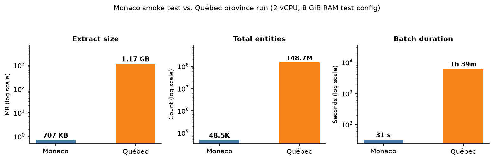
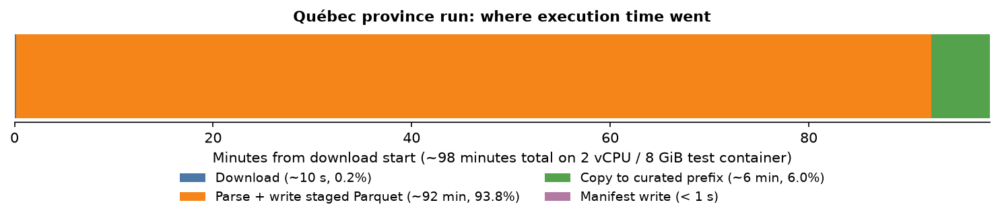
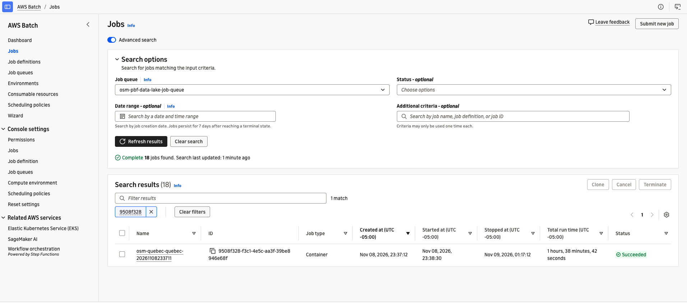
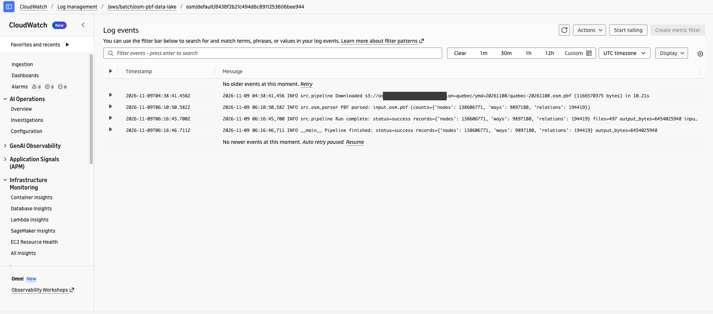
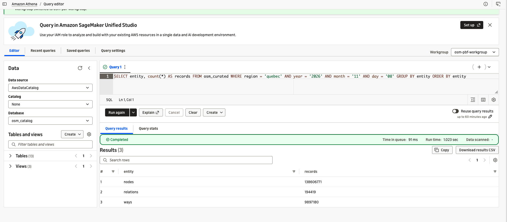
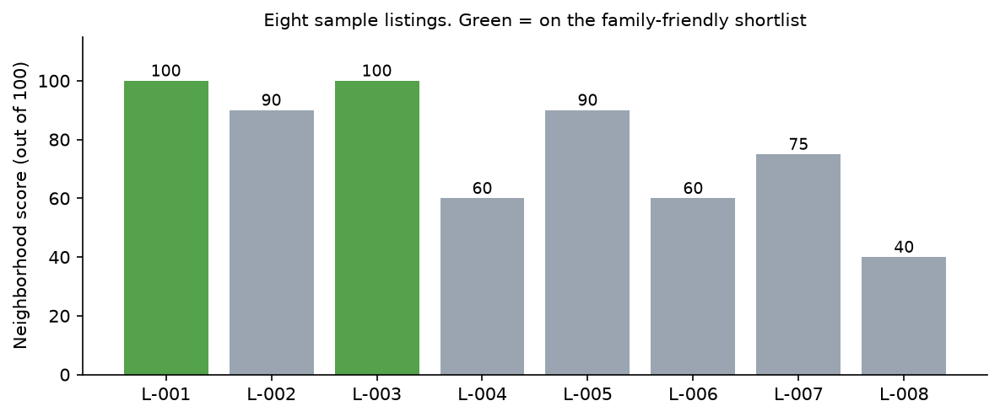
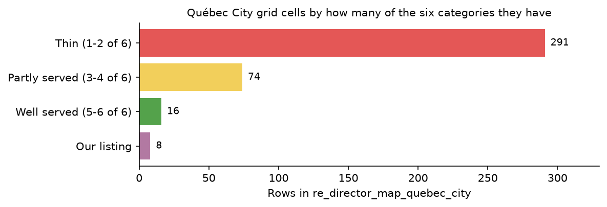

# What's Around This House? Querying OpenStreetMap with SQL on AWS

> **Repository:** https://github.com/aarigonimi/aws-pbf-dataparser (processor, Dockerfile, Terraform, SQL and operating guide)

## What the brokerage needs to know

Picture a Québec City brokerage with a few hundred listings, a marketing team, an analyst and one data engineer: me. Three questions keep coming back to the analyst:

- Agents ask how their listings compare for nearby schools, parks, grocery stores and transit.
- Marketing wants the homes with three bedrooms or more that have a school and a park within 800 m.
- The director wants to see how mapped amenities are distributed across the city alongside the brokerage's listings.

OpenStreetMap (OSM) maps those amenities across the province. I wanted the people asking those questions to answer them with SQL: when a new OSM extract for the province of Québec lands in S3, the pipeline converts it into Parquet tables an analyst can query in Amazon Athena without anyone running a script by hand.

When the extract lands in the raw S3 bucket, an Amazon EventBridge rule submits an AWS Batch job on AWS Fargate that converts the binary `.osm.pbf` file into partitioned Parquet and writes a completion manifest (`_manifest.json`).

In Athena, five SQL scripts narrow the provincial table to Québec City points of interest, join them with the brokerage's listings and publish three views: an agent fact sheet, a family-campaign shortlist and a city-wide grid view for the director.

My work ends at the datasets, which the analyst queries in Athena, adjusts in SQL or exports to CSV. The brokerage scenario and the eight listings in `sample_listings.csv` are synthetic examples used to illustrate how downstream SQL queries consume the curated table. All Batch executions, Athena measurements and deployment issues below come from actual runs in my AWS account.

## Why bother with SQL at all?

An analyst lives in SQL and spreadsheets. They don't know what an OpenStreetMap `.osm.pbf` binary file is, and they shouldn't have to. When raw map data stays in its native format, every ad-hoc question ("which listings are within 500 m of a pharmacy?") becomes a ticket for the data engineer.

Once the extract is in S3 as Parquet and registered in the AWS Glue Data Catalog, "what's near this house" becomes a standard SQL join. The analyst can inspect the category rules, change an 800 m radius to 500 m or audit which specific map features matched a listing in minutes.

You could query the public Overpass API for a single address, but Overpass is a shared community service with rate limits, not a backend for recurring batch joins across hundreds of listings. Instead, you download a regional snapshot from [Geofabrik](https://download.geofabrik.de/). Because Geofabrik does not publish an extract for Québec City alone, the smallest file covering the city is the province of Québec (`quebec-261108.osm.pbf`, 1.17 GB).

A PBF file is a sequential Protocol Buffers stream rather than a flat table. It stores three kinds of OSM primitives, which the parser maps into a single Parquet schema:

- **Nodes:** single points with a 64-bit `osm_id`, point `latitude` and `longitude` coordinates and a JSON `tags` map (a bus stop, a convenience store, a bench).
- **Ways:** ordered lists of node IDs (`node_refs`) forming a line or boundary (a street, a park perimeter, a school building). A way does not store coordinates of its own; when `include_way_geometry = true`, PyOsmium resolves each referenced node's coordinates from a disk-backed index and writes a WKT `LINESTRING` into `geometry`. Closed ways are stored as closed `LINESTRING` geometries rather than validated `POLYGON` objects.
- **Relations:** ordered member lists (`members`) and `tags` grouping nodes, ways and other relations (a bus route, a large park with inner clearings, a city boundary). Their `geometry` column is always `NULL`; multipolygon relations are not reconstructed.

Athena cannot query a PBF file directly. The Batch container streams through the file once with PyOsmium, writes Snappy-compressed Parquet files partitioned by `region`, `year`, `month`, `day` and `entity` (`nodes`, `ways`, `relations`), and publishes `_manifest.json` when the partition is ready.

If an existing public OSM dataset already fits your workflow, you may not need your own ingestion pipeline. I built this one because I wanted dated regional snapshots, an explicit schema I control and repeatable monthly refreshes.

## Picking the services

PyOsmium reads a PBF extract sequentially, and PyArrow writes bounded Parquet batches to disk before uploading them to S3. Resolving way geometries also requires fast local scratch disk for the node-location index (`sparse_file_array`).

That single-stream, disk-backed access pattern points to one long-running container rather than short-lived functions or a distributed cluster:

- **AWS Lambda** caps invocations at 15 minutes and 10 GB of ephemeral storage. Streaming a provincial PBF extract and indexing its node coordinates takes roughly an hour and a half on 2 vCPU and needs tens of gigabytes of scratch disk.
- **AWS Glue ETL or Amazon EMR** shine when input data splits across executors, but a PBF file is read as a single stream so node coordinates are indexed before ways arrive. Paying for a multi-node Spark cluster while one reader does the work buys nothing.
- **Amazon ECS on Fargate** runs the exact same container, but you have to wire up job queueing and exit-code retry classification yourself.
- **AWS Batch on Fargate** gives you a managed queue, declarative exit-code retry rules and zero EC2 instances to patch.

I also skipped two Batch features on purpose. **Array jobs** fan work out across containers, which only helps if you first split the PBF into overlapping geographic tiles. **Fargate Spot** is cheaper, but an interruption mid-parse loses the entire sequential pass. For a monthly job costing about twenty-one cents on demand, paying the on-demand rate is a better trade than restarting a long-running job from scratch (if you run small extracts where restarts are cheap, the repo also supports EC2 Spot via `batch_compute_type = "EC2"`).

On the query side, the Parquet files stay in S3, registered in the **AWS Glue Data Catalog** with partition projection (no Glue Crawlers are needed) and queried with **Amazon Athena**. Because the scoring queries run once a month when a new snapshot arrives, there is no reason to pay for an always-on database. The analyst queries views in an Athena workgroup with a 10 GiB per-query scan cap.

For this walkthrough test, I sized the container at 2 vCPU, 8 GiB of memory and 100 GiB of ephemeral storage. That is a small starting configuration rather than a fixed ceiling - the downloaded PBF, staged Parquet files and node-location index share that scratch disk, and you can step up the vCPUs, memory or disk for larger extracts.

## A new file starts the conversion


When a monthly delivery writes a `.osm.pbf` object under `region=quebec/YYYY/MM/DD/` in the raw S3 bucket, S3 sends an `Object Created` event to Amazon EventBridge. A rule in [`infra/trigger.tf`](../../infra/trigger.tf) matches the `.osm.pbf` suffix and submits the Batch job directly:

```hcl
event_pattern = jsonencode({
  source        = ["aws.s3"]
  "detail-type" = ["Object Created"]
  detail = {
    bucket = { name = [aws_s3_bucket.raw.id] }
    object = { key = [{ suffix = ".osm.pbf" }] }
  }
})
...
batch_target {
  job_definition = aws_batch_job_definition.osm_job["event"].arn_prefix
  job_name       = "osm-event-extract"
}
input_transformer {
  input_paths    = { raw_key = "$.detail.object.key" }
  input_template = "{\"Parameters\": {\"raw_key\": <raw_key>}}"
}
```

The input transformer maps `$.detail.object.key` into Batch `Parameters.raw_key`. The `event` job definition passes `--raw-key Ref::raw_key` to the container entrypoint, which extracts the region and snapshot date from the S3 key itself. There is no Lambda function or Step Functions state machine in the middle because Batch already handles queuing and retries.

## Deploy the stack

You need an AWS account, AWS CLI v2, Terraform 1.10+, Docker with Buildx (`linux/amd64`), Python 3.12, `make` and a default VPC in `us-east-1`.

Before deploying, check `include_way_geometry = true` in `infra/terraform.tfvars`. Turning on way geometry tells the parser to look up each way's referenced node coordinates on local disk and write a WKT `LINESTRING(...)` string into the `geometry` column, so Athena can compute line centroids for parks and school buildings mapped as ways. EventBridge-triggered jobs read this setting from the Terraform job definition.

Clone the repository, configure the local environment, deploy the Terraform stack and push the container image to Amazon ECR:

```bash
git clone https://github.com/aarigonimi/aws-pbf-dataparser.git
cd aws-pbf-dataparser
python3.12 -m venv .venv && source .venv/bin/activate
make install

cp -n infra/terraform.tfvars.example infra/terraform.tfvars
aws sts get-caller-identity   # check active AWS account
make deploy                   # terraform plan and apply
make build                    # build and push image to ECR
```

The default configuration deploys to `us-east-1` with the S3 trigger enabled (`s3_trigger_enabled = false` turns it off). To keep container traffic inside the AWS network without public IPs or a NAT gateway, the stack creates four VPC endpoints:

1. **`ecr.api` (Interface endpoint):** lets Fargate call the ECR control plane (`GetAuthorizationToken`) to authenticate before pulling the container image.
2. **`ecr.dkr` (Interface endpoint):** lets Fargate reach the Docker registry data plane to pull the image manifest.
3. **`logs` (Interface endpoint):** lets the Fargate task send container logs to CloudWatch Logs privately.
4. **`s3` (Gateway endpoint, free):** lets Fargate download the PBF, write Parquet to S3 and fetch ECR's Docker image layers from S3 at no hourly charge.

Why three interface endpoints instead of one? AWS PrivateLink puts each service under its own endpoint name (`com.amazonaws.us-east-1.ecr.api`, `ecr.dkr` and `logs`), and each interface endpoint bills $0.01 per hour (about $0.72 per day total for all three).

## Drop an extract in the bucket

Start with Monaco. The extract is 707 KB, so if an IAM permission or VPC endpoint is misconfigured you find out in thirty seconds instead of waiting on a provincial file:

```bash
make run          # defaults: REGION=monaco YMD=20261108
make logs
make verify
```

Once Monaco writes its `_manifest.json`, run the province of Québec:

```bash
make run REGION=quebec YMD=20261108 GEOFABRIK_AREA=north-america/canada
make logs
make verify REGION=quebec YMD=20261108   # check files and manifest
```

`make run` downloads `quebec-261108.osm.pbf` from Geofabrik and uploads it to `s3://<raw-bucket>/region=quebec/2026/11/08/quebec-20261108.osm.pbf`. That upload triggers the Batch job. `make verify` confirms that `_manifest.json` exists and that the published Parquet files match the manifest counts; the SQL data validation happens next in Athena.

### What the runs did

Both runs executed on the 2 vCPU, 8 GiB RAM Fargate configuration:

- **Monaco smoke test:** Uploading the 707 KB extract triggered EventBridge and submitted `osm-event-extract`. The container downloaded the file in under 0.1 s, parsed **48.5K entities** (41.8K nodes, 6.3K ways and 351 relations) in 2.8 s, wrote 3 Parquet files totaling **3.1 MB** and finished in **31 s** of Batch wall-clock time (nearly 28 s of which was Fargate task startup).
- **Québec provincial run:** Processing the **1.17 GB** provincial extract read **148.7M entities** in a single pass (**138.6M nodes**, **9.9M ways** and **194K relations**). It wrote **497 Parquet files** (463 for nodes, 33 for ways and 1 for relations) totaling **6.454 GB**, taking **92.2 minutes** to parse and write staged Parquet and **1 h 39 m** (98.7 minutes) of total Batch wall-clock time.



Treat these numbers as observed execution records rather than a controlled scalability benchmark:

- **Different datasets and run conditions:** Two Québec jobs overlapped on the same partition during the initial run before partition locking was added, and ~28 s of Monaco's 31 s Batch wall-clock duration is Fargate startup overhead. Do not extrapolate linear scaling or throughput curves from these runs.
- **Why Parquet is larger than the PBF input:** Québec's 1.17 GB PBF expands to 6.454 GB of Snappy-compressed Parquet because PBF uses dense protobuf delta encoding and shared string tables, whereas the Parquet table writes explicit columns (`osm_id`, promoted tag columns, `node_refs`, `members` and a JSON `tags` string) per row so Athena can prune columns without decoding protobuf blocks.

Where did the execution time go during the Québec run? The CloudWatch logs split the ~98 minutes of application runtime (plus ~28 s of Fargate startup and teardown) into four stages:



- **Download from S3 (~10 s, 0.2%):** pulling the 1.17 GB PBF over the S3 gateway endpoint into container scratch storage.
- **Stream parse and write staged Parquet (~92 min, 93.8%):** streaming 148.7M entities through PyOsmium, flushing PyArrow batches to local Parquet files and uploading each part to a run-specific `_staging/<run_id>/` prefix in S3.
- **Publish copy to curated prefix (~6 min, 6.0%):** copying all 497 Parquet parts from `_staging/` into `curated/region=quebec/2026/11/08/` before deleting the staging objects and writing `_manifest.json` last. S3 multi-object copy is not an atomic transaction, so writing `_manifest.json` last serves as the completion signal for downstream jobs.
- **Manifest write and exit (< 1 s):** writing `_manifest.json`, releasing the partition lock and exiting with code 0.





## Check the output in Athena

Because Athena reads Parquet files directly under the partition prefix without inspecting `_manifest.json`, always verify in Athena (`osm-pbf-workgroup`) that the table row counts match `_manifest.json` before building downstream datasets:

```sql
SELECT entity, count(*) AS records
FROM osm_catalog.osm_curated
WHERE region = 'quebec' AND year = '2026' AND month = '11' AND day = '08'
GROUP BY entity
ORDER BY entity;
```

Because `osm_curated` uses Glue partition projection, every query must include equality filters on `region`, `year`, `month` and `day`. Athena returned **138.6M** nodes, **9.9M** ways and **194K** relations for **148.7M** total records, matching the manifest down to the last row. Because `count(*)` grouped only by a partition column is answered from Parquet footers, Athena scanned **0 bytes** and finished in 1.0 s.



Matching row counts don't prove the coordinates are usable, so run a quick geometry audit on the nodes and ways:

```sql
SELECT count(*) AS ways,
       count_if(geometry IS NOT NULL) AS ways_with_geometry
FROM osm_catalog.osm_curated
WHERE region = 'quebec' AND year = '2026' AND month = '11' AND day = '08'
  AND entity = 'ways';
```

Auditing all 138.6M nodes scanned 2.73 GB in 2.0 s and found **0** nodes missing coordinates and **0** values outside valid latitude/longitude bounds.

## Issues to watch out for

Getting a container to parse a file locally is easy. Getting AWS Batch on Fargate to pull the image privately inside a VPC and handle retries cleanly is where things break.

### The job never starts, and there are no logs

My first Québec Batch job sat in `STARTING` for minutes, failed and retried. The CloudWatch log group was completely empty because the container never started. Inspecting `attempts[].statusReason` with `aws batch describe-jobs` showed the real cause:

```text
ResourceInitializationError: unable to pull secrets or registry auth: ...
There is a connection issue between the task and Amazon ECR. ... i/o timeout
```

By default, an AWS Batch Fargate compute environment does not assign a public IP to tasks (`assignPublicIp = DISABLED`), even when launching into a default VPC's subnets. Keeping public IPs disabled is good practice - a backend batch job has no reason to be on the public internet - but without a NAT gateway, the Fargate network interface had no route to Amazon ECR or CloudWatch Logs.

Adding the three interface endpoints (`ecr.api`, `ecr.dkr` and `logs`) plus the `s3` gateway endpoint in [`infra/endpoints.tf`](../../infra/endpoints.tf) fixed it while keeping all traffic on the AWS private network. **Do not skip the S3 gateway endpoint:** ECR authenticates over the interface endpoints, but Docker image layers live in S3. Without the S3 gateway endpoint attached to the subnet's route table, `GetAuthorizationToken` succeeds and the layer download times out.

Once all four endpoints were `available`, the next attempt pulled the image in seconds and ran to completion.

### Retry only what a retry can fix

If you enable retries in AWS Batch without exit-code rules, Batch retries *every* non-zero exit code up to `attempts`. If a job fails because a partition was already published or a config variable is wrong, retrying three times on a Fargate container just burns money for the exact same failure.

The Python processor maps exceptions to distinct exit codes, and [`infra/batch.tf`](../../infra/batch.tf) pairs them with `evaluate_on_exit` rules:

```hcl
retry_strategy {
  attempts = var.batch_retry_attempts
  evaluate_on_exit {              # 75: transient S3/network or SIGTERM
    on_exit_code = "75"
    action       = "RETRY"
  }
  evaluate_on_exit {              # EC2 host reclaimed (EC2 mode)
    on_status_reason = "Host EC2*"
    action           = "RETRY"
  }
  evaluate_on_exit {              # image pull failed before start
    on_status_reason = "ResourceInitializationError*"
    action           = "RETRY"
  }
  evaluate_on_exit {              # 5: IAM denial, do not retry
    on_exit_code = "5"
    action       = "EXIT"
  }
  evaluate_on_exit {              # 2 config, 3 input, 4 output exists
    on_exit_code = "*"
    action       = "EXIT"
  }
}
```

I tested this behavior on Monaco by uploading the same PBF file a second time. EventBridge submitted a second `osm-event-extract` job, which checked the target partition at startup, saw the existing `_manifest.json`, logged `OutputConflictError` and exited with code `4`. Because the `retry_strategy` ends with a catch-all `on_exit_code = "*"` set to `action = "EXIT"`, Batch stopped immediately after one attempt and zero retries, leaving the published partition untouched. Without that final catch-all `EXIT` rule, Batch falls back to retrying any unmatched exit code - including exit code `2` (bad config), `3` (corrupt input) and `4` (`OutputConflictError` when `_manifest.json` or an active `_lock.json` conditional-write claim already exists).

Separating transient errors in Python was just as important. An early version of `process_pbf()` caught every exception during parsing and wrapped it in `InputFileError` (exit code `3`). Because Parquet parts upload to S3 *during* parsing, a transient S3 throttle would have exited with code `3` and skipped the retry rule. Raising `TransientError` (exit code `75`) before the generic catch block keeps S3 transport errors retryable.

## From Parquet to datasets

Once `_manifest.json` is present, the five SQL scripts in `sql/athena/real_estate/` turn the provincial partition into the brokerage's datasets. Replace `<curated-bucket>` with your curated bucket name and run the scripts in order.

Querying the entire 6.45 GB province partition on every analyst lookup would be wasteful, so `01_create_neighborhood_pois.sql` scans the `quebec` partition once and writes a filtered table (`re_pois_quebec_city_20261108`) containing only the six amenity categories inside the Québec City bounding box:

```sql
CASE
  WHEN amenity IN ('school', 'kindergarten') THEN 'school'
  WHEN shop IN ('supermarket', 'convenience', 'greengrocer', 'bakery')
    THEN 'grocery'
  WHEN amenity = 'pharmacy' THEN 'pharmacy'
  WHEN amenity IN ('hospital', 'clinic', 'doctors') THEN 'healthcare'
  WHEN json_extract_scalar(tags, '$.leisure')
    IN ('park', 'playground', 'garden') THEN 'green_space'
  WHEN highway = 'bus_stop'
    OR json_extract_scalar(tags, '$.public_transport') = 'platform'
    OR json_extract_scalar(tags, '$.railway') = 'station' THEN 'transit'
END AS category
...
COALESCE(
  latitude,
  TRY(ST_Y(ST_Centroid(ST_GeometryFromText(geometry))))
) AS lat
...
-- Québec City bounding box + ~800 m padding
WHERE lat BETWEEN 46.72 AND 46.99
  AND lon BETWEEN -71.56 AND -71.12
```

For ways that carry a WKT `LINESTRING`, `ST_Centroid(ST_GeometryFromText(geometry))` uses the polyline's vertex centroid as a point approximation, which may not sit inside a concave boundary or at a park's street entrance. This CTAS scanned 1.80 GB in 8.7 s and wrote **~3K POIs** (2.3K transit stops, 283 grocery stores, 165 green spaces, 118 pharmacies, 59 healthcare facilities and 37 schools) into a 50 KB Parquet table. Every downstream query reads this 50 KB table instead of rescanning the 6.45 GB province partition.

With the city POIs materialized, upload the sample listings CSV to S3 and run `02_create_listings.sql` to register `osm_catalog.re_listings`:

```bash
source scripts/env.sh
aws s3 cp sql/athena/real_estate/sample_listings.csv \
  "s3://${OUTPUT_BUCKET}/derived/re_listings/"
```

To match each property against nearby amenities, `03_score_listings.sql` joins `re_listings` against `re_pois_quebec_city_20261108` within 800 m. It pre-filters with a bounding box (widening the longitude window by `cos(radians(lat))` since longitude degrees narrow going north) before computing exact great-circle distance:

```sql
JOIN osm_catalog.re_pois_quebec_city_20261108 p
  -- ~800 m latitude and longitude pre-filter
  ON p.lat BETWEEN l.lat - 0.0072 AND l.lat + 0.0072
 AND p.lon BETWEEN l.lon - 0.0072 / cos(radians(l.lat))
               AND l.lon + 0.0072 / cos(radians(l.lat))
WHERE great_circle_distance(l.lat, l.lon, p.lat, p.lon) <= 0.8
```

To show how nearby POIs can be summarized in SQL, each category awards points once if at least one feature sits within 800 m (school 25, grocery 20, transit 20, green space 15, healthcare 10, pharmacy 10), so ten bus stops don't outweigh a missing school. These weights are illustrative business rules rather than statistically validated weights; the score does not estimate property value and is not an official measure of neighborhood quality. The query scanned **81 KB** and finished in 1.6 s.

Two scripts then shape those scored results for the three teams. `04_create_marketing_views.sql` defines `re_agent_fact_sheet_quebec_city` (one summary row per listing with nearest distances and names) and `re_family_friendly_quebec_city` (listings with 3+ bedrooms and both a school and green space within 800 m). `05_area_coverage.sql` buckets the POIs into 0.01° latitude/longitude cells (roughly 1.1 km × 0.76 km, 50 KB scanned in 1.7 s) and creates `re_director_map_quebec_city`, combining the grid cells and listings into one view with a `map_layer` column.

Before handing those views to anyone, inspect the raw features matched behind at least one listing so you can verify what the score actually counted:

```sql
SELECT p.category, p.osm_id, p.name,
       round(
         great_circle_distance(l.lat, l.lon, p.lat, p.lon) * 1000
       ) AS distance_m
FROM osm_catalog.re_listings l
CROSS JOIN osm_catalog.re_pois_quebec_city_20261108 p
WHERE l.listing_id = 'L-001'
  AND great_circle_distance(l.lat, l.lon, p.lat, p.lon) <= 0.8
ORDER BY distance_m;
```

### What the datasets showed

Querying `re_agent_fact_sheet_quebec_city` (< 1 KB scanned in 0.7 s) gives agents a single line per property:

- **L-001 (73 Rue des Jardins, 3 bd, $449K):** score **100** - `school 783 m; park 170 m; grocery 115 m; transit 64 m` (nearest school: *CPE Les Petits Cheminots*; nearest park: *unnamed*).
- **L-003 (118 Avenue Cartier, 4 bd, $589K):** score **100** - `school 489 m; park 241 m; grocery 300 m; transit 113 m` (nearest school: *CPE Les Petits Cheminots*; nearest park: *Parc Gilles-Lamontagne*).
- **L-004 (515 Chemin Sainte-Foy, 5 bd, $749K):** score **60** - `grocery 332 m; transit 182 m` (no school or park within 800 m).



Querying `re_family_friendly_quebec_city` (< 1 KB scanned) narrows the eight properties to the two that fit the family campaign: **L-001** and **L-003**. L-004 has five bedrooms but lacks a nearby school or park, and three-bedroom L-007 (score 75) has a school at 452 m (*École secondaire Samuel-De Champlain*) but no park within 800 m.

Inspecting the audit rows returned for **L-001** surfaced three details in the underlying OpenStreetMap data that were not obvious from the summary scores alone.

L-001's only school-category feature within 800 m is *CPE Les Petits Cheminots* at 783 m. In Québec, a CPE (*Centre de la petite enfance*) is an early-childhood daycare tagged `amenity=kindergarten`. Because `01_create_neighborhood_pois.sql` groups `school` and `kindergarten` together, it qualifies; if marketing wants elementary and high schools only, dropping `kindergarten` from the `CASE` expression changes L-001's result immediately.

The audit also explained why L-001's nearest park showed up as `unnamed` at 170 m. That green space is a mapped park node whose `name` tag is `NULL` in OpenStreetMap, followed by *Place de l'Assemblée-Nationale* at 620 m and *Parc Gilles-Lamontagne* at 800 m. Using `coalesce(nearest_green_name, 'unnamed')` in the view keeps unnamed parks visible instead of silently dropping them.

Across the broader city table, repeated names turned out to be retail chains rather than duplicate OSM nodes (32 *Couche-Tard*, 22 *Familiprix*, 19 *Jean Coutu*), which is why awarding points once per category works better than summing raw feature counts. At the same time, 5 POI nodes inside the bounding box carry `access=private` in their JSON tags; filtering out `json_extract_scalar(tags, '$.access') = 'private'` in `01_create_neighborhood_pois.sql` is a one-line adjustment if you want strictly public amenities.

## Hand the datasets to the analyst

Once the views exist in `osm_catalog`, the analyst works inside `osm-pbf-workgroup` (which enforces a 10 GiB scan limit per query) and queries three views:

- `osm_catalog.re_agent_fact_sheet_quebec_city` - one row per listing with its illustrative score, distances and amenity names.
- `osm_catalog.re_family_friendly_quebec_city` - the filtered 3+ bedroom family campaign shortlist.
- `osm_catalog.re_director_map_quebec_city` - one row per 0.01° grid cell or listing with `lat`, `lon` and `map_layer`.

Running the director's summary query in Athena:

```sql
SELECT map_layer, count(*) AS points
FROM osm_catalog.re_director_map_quebec_city
GROUP BY map_layer
ORDER BY points DESC;
```



The query scanned **0.68 KB** and returned **381 populated grid cells** across the city (`16` well served with 5-6 categories, `74` partly served with 3-4 categories and `291` thin with 1-2 categories) alongside the **8 listings**.

This grid-based view is an analytical proxy for mapped amenity presence rather than an urban-planning standard. Its classifications depend on the six selected POI categories, the `0.01°` grid resolution (~1.1 km × 0.76 km) and the category thresholds, and cells with zero matching POIs are omitted. It does not account for population density, pedestrian street networks, physical barriers such as highways, rivers or Québec City's cliffside topography, service quality, opening hours or actual travel times.


Because the views sit on top of the small derived Parquet tables in `derived/`, routine analyst queries scan less than a kilobyte and cost fractions of a cent. Any map or report built from these tables must display the credit *"© OpenStreetMap contributors"*.

## What it cost me

Here is the cost summary from my measured runtimes and `us-east-1` public pricing ([Fargate](https://aws.amazon.com/fargate/pricing/), [PrivateLink](https://aws.amazon.com/privatelink/pricing/) and [Athena](https://aws.amazon.com/athena/pricing/)):

| Component | Measured usage | Unit rate (`us-east-1`) | Cost | Billing model |
|---|---|---|---|---|
| **Batch on Fargate (Québec)** | 1 h 39 m on 2 vCPU, 8 GiB RAM, 100 GiB disk | ~$0.125 / hour | **$0.21** | Per second while the container runs |
| **Batch on Fargate (Monaco)** | 31 s on 2 vCPU, 8 GiB RAM, 100 GiB disk | ~$0.125 / hour | **$0.001** | Smoke test run |
| **Athena queries** | ~11.9 GB scanned across all verification and CTAS queries | $5.00 / TB scanned | **$0.06** | Per query; analyst views scan < 1 KB |
| **3 VPC interface endpoints** | 1 day (24 hours) for `ecr.api`, `ecr.dkr`, `logs` | $0.01 / endpoint-hour ($0.03 / hr total) | **$0.72 / day** | Hourly while deployed (~$22 / month) |
| **S3 gateway endpoint + storage** | 7.6 GB total (1.17 GB PBF + 6.45 GB Parquet) | Gateway free; $0.023 / GB-month | **< $0.18 / mo** | Storage bills while objects remain in S3 |

**Converting 148.7M OpenStreetMap entities on Fargate and building the Athena datasets cost $0.27 in compute and queries.** The only ongoing hourly charge comes from the three VPC interface endpoints ($0.72 per day), which is why tearing down the stack after a test matters.

## Clean up

When you finish testing, drop the derived Athena views and tables listed in [`docs/cleanup.md`](../cleanup.md). Because the S3 buckets have versioning enabled, `aws s3 rm --recursive` leaves object versions behind; run the cleanup script or `make destroy` to empty all versions and destroy the Terraform stack:

```bash
make destroy                                   # empty buckets and destroy stack
terraform -chdir=infra state list              # expect no resources
aws ec2 describe-vpc-endpoints \
  --filters Name=tag:Project,Values=osm-pbf-data-lake \
  --query 'VpcEndpoints[].VpcEndpointId'       # expect []
```

Always run that final `describe-vpc-endpoints` check to confirm the interface endpoints are gone.

## Wrapping up

We started with three questions from a real estate brokerage and a 1.17 GB binary OpenStreetMap extract that no SQL analyst could query directly. Pairing an EventBridge S3 trigger with AWS Batch on Fargate converted the raw PBF into 6.454 GB of partitioned Parquet for twenty-one cents of compute, and five Athena queries narrowed 148.7M provincial map entities into a 50 KB city-level POI table and three sub-kilobyte views for agents, marketing and leadership.

Two practical lessons stood out from building and running this stack. First, the PyOsmium streaming parser worked on the first try, whereas private Fargate networking (`ecr.api`, `ecr.dkr`, `logs` and the `s3` gateway endpoint for image layers) and explicit Batch exit-code rules (`RETRY` on `75` and `ResourceInitializationError*`, catch-all `EXIT` on `*`) determined whether jobs actually started and failed cleanly in AWS. Second, materializing the filtered city-level POI table once per monthly snapshot kept every downstream spatial join and analyst query under two seconds and a few kilobytes scanned. Instead of dealing with raw `.osm.pbf` files, the analyst can now compare listings, adjust radius thresholds and explore nearby amenities directly in SQL.

---

*Map data © OpenStreetMap contributors, available under the [Open Database License](https://www.openstreetmap.org/copyright).*

**References:** [Lambda quotas](https://docs.aws.amazon.com/lambda/latest/dg/gettingstarted-limits.html) · [Batch on Fargate](https://docs.aws.amazon.com/batch/latest/userguide/fargate-compute-environments.html) · [EventBridge Batch targets](https://docs.aws.amazon.com/eventbridge/latest/userguide/eb-targets.html#targets-specifics-batch) · [Batch retry strategy](https://docs.aws.amazon.com/batch/latest/userguide/job_definition_parameters.html) · [ECR VPC endpoints](https://docs.aws.amazon.com/AmazonECR/latest/userguide/vpc-endpoints.html) · [S3 conditional writes](https://docs.aws.amazon.com/AmazonS3/latest/userguide/conditional-writes.html) · [Athena partition projection](https://docs.aws.amazon.com/athena/latest/ug/partition-projection.html) · [Athena workgroup data usage controls](https://docs.aws.amazon.com/athena/latest/ug/workgroups-setting-control-limits-cloudwatch.html)
