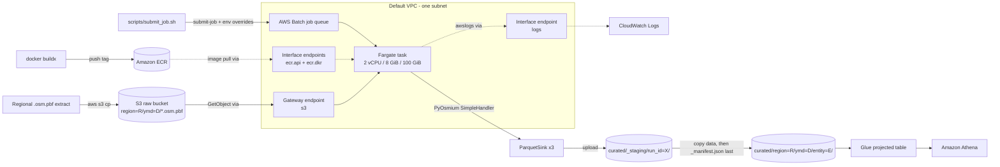

> **Repository:** https://github.com/aarigonimi/aws-pbf-dataparser
>
> All code and configuration below come from that repository. All measurements come from one Quebec run on 2026-11-09. I say where each number came from (the S3 manifest, the AWS Batch API, CloudWatch Logs or Athena query history). No cost figure appears anywhere, because I never collected one.

---

## 1. The engineering problem

OpenStreetMap publishes its data as **PBF** (Protocolbuffer Binary Format) files. A PBF file is a sequence of compressed blocks. Each block holds one of three entity types:

- **Nodes**: a point with an ID, a latitude/longitude and optional tags (`amenity=cafe`, `name=...`).
- **Ways**: an ordered list of node IDs plus tags. A road, a building outline or a river is a way. A way has **no coordinates of its own**. To draw it you must look up every referenced node.
- **Relations**: an ordered list of members (nodes, ways or other relations), each with a role (`outer`, `inner`, `stop`, ...) plus tags. Multipolygons, bus routes and administrative boundaries are relations.

PBF is excellent for distribution. Delta-encoded IDs and coordinates make it very compact. It is a poor format for analytics:

1. **You cannot query it in place with the target analytics services.** Glue and Athena do not read `.osm.pbf` as a native table format, so this pipeline decodes the snapshot and writes a queryable representation first.
2. **Size grows fast once decoded.** The Quebec extract used here is **1,166,570,375 bytes** (1.17 GB) on disk. It decodes to **148,698,370 entities**. Materializing that as Python objects at once is not an option on a reasonably sized machine.
3. **The work is long, sequential and disk-heavy.** The Quebec decode took about 92 minutes on 2 vCPUs. That rules out short-lived serverless functions and suggests a queue-based batch service with local scratch storage.

The goal is a pipeline that turns one regional PBF snapshot into **typed, compressed Parquet files** in Amazon S3, partitioned by `region`, `ymd` (extract date) and `entity`. The files are cataloged by AWS Glue and queried with standard SQL in Amazon Athena.

### What you will build

By the end of this article you will have:

- A Python processor that **streams** a PBF file with PyOsmium into memory-bounded PyArrow Parquet writers.
- A non-root Docker image for that processor, pushed to Amazon ECR.
- Terraform for S3 (raw and curated buckets), ECR, AWS Batch on Fargate, IAM, VPC endpoints, CloudWatch Logs, a Glue Data Catalog table and an Athena workgroup.
- A safe publication protocol: stage, copy, then write the manifest last.
- A validation loop: S3 manifest → projected Glue table → Athena counts compared with the manifest.

The verified end state for Quebec looks like this:

```text
s3://<curated-bucket>/curated/region=quebec/ymd=20261108/
  entity=nodes/part-00000.parquet ... part-00462.parquet      (463 files)
  entity=ways/part-00000.parquet ... part-00032.parquet       (33 files)
  entity=relations/part-00000.parquet                         (1 file)
  _manifest.json
```

```text
entity     records       (Athena, query 97ba421d..., SUCCEEDED)
nodes      138,606,771
ways         9,897,180
relations      194,419
```

Those three counts match `record_counts` in `_manifest.json` exactly.

---

## 2. Architecture and engineering decisions

The diagram below is drawn from the Terraform resources and Python modules in the repository (`docs/article/figures/architecture.mmd`):



| Service | Responsibility in this project | Why this service | Alternatives considered | Trade-off accepted |
| --- | --- | --- | --- | --- |
| **Amazon S3 (raw)** | Holds the input PBF under `region=<r>/ymd=<d>/` | Durable, cheap, readable by Batch through a gateway endpoint | EFS, or downloading from the OSM mirror inside the job | One extra upload step. In return, the job never depends on an external mirror. |
| **AWS Batch (Fargate)** | Queues and runs one container per extract, with retries and a timeout | A long, single-process job; built-in queue, retry rules and job status | Lambda (a standard invocation is limited to 15 minutes), ECS `RunTask` (no Batch queue or retry semantics), EMR/Glue Spark (PBF is not splittable without extra tooling) | No auto-parallelism: one extract is one task. This stack uses standard Fargate, not Fargate Spot. Its Terraform also supports EC2/Spot, with instance and capacity-management trade-offs. |
| **Python + PyOsmium** | Streaming PBF decode with callbacks per node/way/relation | The C++ libosmium parser behind a simple Python handler API; no full materialization | `osmium-tool` CLI export, Java/Osmosis, Spark readers | Single-threaded Python callbacks become the throughput limit (see §10). |
| **PyArrow** | Explicit-schema Parquet with Snappy, row groups and file rotation | Standard columnar format readable by Athena and Glue | GeoParquet, ORC, CSV | Geometry stored as WKT text, not native geometry. |
| **Amazon S3 (curated)** | Staging prefix, final partitions, manifest, Athena results | Single bucket with lifecycle rules per prefix | Separate buckets per stage | Prefix-scoped IAM and lifecycle rules must stay in sync. |
| **AWS Glue Data Catalog** | Stores the explicit `osm_curated` schema and projected partitions | One stable table covers all region/date/entity prefixes | A crawler or manual partition registration | Projection avoids crawler-created leaf tables; `region` and `ymd` must be constrained in each query. This Terraform change is not deployed or AWS-verified yet. |
| **Amazon Athena** | SQL validation and analytics | Serverless, pay per query, reads the Glue catalog | Redshift Spectrum, local DuckDB | Athena results land in S3 and need their own lifecycle rule. |
| **CloudWatch Logs** | Application logs with run ID, timings and counts | Native `awslogs` driver on Batch | Firehose to S3 | Logs are text, so metrics are extracted by reading the log lines. |
| **ECR** | Stores the job image | Same-region pulls through private endpoints | Docker Hub | Needs endpoints or internet egress, which is exactly what failed first (§7). |
| **Terraform** | Everything above, as code | Reviewable plans, reproducible stacks | CDK, CloudFormation | Local state by default; a remote backend example is provided (`infrastructure/backend.tf.example`). |

Three design rules shape the code:

1. **Stream everything.** Never hold the PBF, or a whole entity type, in memory.
2. **Make failures classifiable.** Each failure class maps to a process exit code, and AWS Batch retries only the transient ones.
3. **Publish with a completion marker.** Readers that check for `_manifest.json` before querying can use it to identify a completed partition. The marker does not gate direct S3 listings or Athena queries; they can see copied objects before publication finishes. S3 has no transaction across these keys. In `replace`, the old marker is removed before copies and rollback leaves pre-existing objects in place; replacement is still not an atomic snapshot swap.

---

## 3. Implementing the Python PBF processor

The processor lives in `src/`:

```text
src/
  config.py          JobConfig: environment parsing and validation, S3 key layout
  errors.py          Exception classes mapped to exit codes
  main.py            CLI entrypoint, signal handling, exit-code mapping
  osm_parser.py      PyOsmium handler and process_pbf()
  transformations.py Record builders for nodes, ways, relations
  parquet_writer.py  Explicit Arrow schema and the rotating ParquetSink
  s3_utils.py        boto3 wrapper with retries and error translation
  pipeline.py        run_pipeline(): download, parse, write, stage, publish
```

### 3.1 Configuration is environment-only and validated up front

AWS Batch passes per-run parameters as container environment overrides, so `JobConfig.from_env()` is the single source of configuration. It validates enumerations and S3 path tokens before any network call:

```python
VALID_COMPRESSIONS: Final = frozenset({"snappy", "gzip", "brotli", "lz4", "zstd", "none"})
VALID_OVERWRITE: Final = frozenset({"error", "skip", "replace"})
VALID_MODES: Final = frozenset({"all", "nodes", "ways", "relations"})
VALID_LOG_LEVELS: Final = frozenset({"DEBUG", "INFO", "WARNING", "ERROR", "CRITICAL"})
_ALLOWED_PATH_TOKEN: Final = re.compile(r"^[A-Za-z0-9._-]+$")
```

The S3 layout is derived from the configuration, so it can never drift between writer, manifest and IAM policy:

```python
@property
def curated_prefix(self) -> str:
    return f"{self.output_prefix}/region={self.region_name}/ymd={self.ymd}"
```

The defaults that matter for memory are `MAX_RECORDS_PER_FILE=250000` and `ROW_GROUP_SIZE=100000`.

### 3.2 Exit codes are the contract with AWS Batch

`src/errors.py` defines one exception per failure class. `src/main.py` converts each class into a process exit code:

| Exception | Exit code | Meaning | Batch action |
| --- | ---: | --- | --- |
| `ConfigError` | 2 | Bad or missing environment variable | Exit |
| `InputError` | 3 | Missing, empty or unparseable PBF | Exit |
| `OutputConflictError` | 4 | Partition already exists (`OVERWRITE=error`) | Exit |
| `AccessDeniedError` | 5 | AWS authorization denied | Exit |
| `TransientError` | 75 | S3/network failure after botocore retries | **Retry** |
| `JobCancelled` | 75 | SIGTERM/SIGINT received (e.g. Spot reclaim) | **Retry** |

Exit code 75 is `EX_TEMPFAIL` from `sysexits.h`. You will see it again in the Batch retry strategy (§6).

You can check the exit-code contract locally without Docker or AWS. `tests/test_main.py` verifies that missing required configuration returns exit code 2:

```bash
python -m pytest tests/test_main.py::test_missing_required_env_returns_config_error
```

### 3.3 Streaming the PBF with a PyOsmium handler

`osmium.SimpleHandler` calls `node()`, `way()` and `relation()` once per entity while it walks the file. The handler never keeps the entity. It converts the entity into a plain dict and hands it to the sink for that entity type (`src/osm_parser.py`):

```python
        def node(self, node: Any) -> None:
            _check_cancelled(self._cancel_token)
            if "nodes" not in self._entity_types or "nodes" not in self._sinks:
                return
            latitude = longitude = None
            try:
                if node.location.valid():
                    latitude = node.location.lat
                    longitude = node.location.lon
            except Exception:  # pragma: no cover - location may be missing
                pass
            self._sinks["nodes"].add(build_node_record(node.id, latitude, longitude, node.tags))
            self._counts["nodes"] += 1

        def way(self, way: Any) -> None:
            _check_cancelled(self._cancel_token)
            if "ways" not in self._entity_types or "ways" not in self._sinks:
                return
            references: list[int] = []
            coordinates: list[tuple[float, float]] | None = (
                [] if self._include_way_geometry else None
            )
            for node_ref in way.nodes:
                references.append(node_ref.ref)
                if coordinates is not None:
                    try:
                        if node_ref.location.valid():
                            coordinates.append((node_ref.location.lon, node_ref.location.lat))
                    except Exception:  # pragma: no cover
                        continue
            self._sinks["ways"].add(build_way_record(way.id, way.tags, references, coordinates))
            self._counts["ways"] += 1

        def relation(self, relation: Any) -> None:
            _check_cancelled(self._cancel_token)
            if "relations" not in self._entity_types or "relations" not in self._sinks:
                return
            members = [(member.type, member.ref, member.role) for member in relation.members]
            self._sinks["relations"].add(build_relation_record(relation.id, relation.tags, members))
            self._counts["relations"] += 1
```

Three implementation details are worth copying:

- **Copy, don't keep.** PyOsmium objects are only valid inside the callback. `build_*_record` copies IDs, tags and member tuples into plain Python values immediately.
- **Cancellation is checked per entity.** `_check_cancelled` raises `JobCancelled` once the SIGTERM handler in `main.py` has set the token. AWS Batch sends SIGTERM before SIGKILL on cancellation, termination or Spot reclaim. The job exits with 75 and Batch retries it.
- **Way geometry is opt-in.** A way stores only node IDs. Producing a `LINESTRING` requires a node-location index during the parse. For a large extract that index must not live in RAM, so `_apply_file` uses a disk-backed sparse file index on the task's ephemeral storage:

```python
    # A disk-backed index keeps large extracts from blowing up memory.
    try:
        handler.apply_file(
            str(pbf_path),
            locations=True,
            idx=f"sparse_file_array,{index_path}",
        )
```

The Quebec benchmark ran with `INCLUDE_WAY_GEOMETRY=false`. Way geometry is covered by the end-to-end test (§3.8), but this run did not measure its performance.

### 3.4 One explicit schema for all three entity types

`src/parquet_writer.py` defines a single Arrow schema shared by nodes, ways and relations. Columns that do not apply to an entity are null. The reason is practical: every partition has the same columns, so Glue infers identical schemas and Athena queries can `UNION ALL` entities without casts.

| Column | Type | Nodes | Ways | Relations |
| --- | --- | --- | --- | --- |
| `osm_id` | int64 | ✓ | ✓ | ✓ |
| `osm_type` | string | `node` | `way` | `relation` |
| `name`, `amenity`, `shop`, `tourism`, `building`, `highway`, `surface` | string | promoted from tags | promoted | promoted |
| `latitude`, `longitude` | double | ✓ | null | null |
| `geometry` | string (WKT) | `POINT (lon lat)` | `LINESTRING (...)` if enabled | null |
| `node_refs` | list<int64> | null | ✓ | null |
| `members` | list<string> (JSON) | null | null | ✓ |
| `tag_count` | int32 | ✓ | ✓ | ✓ |
| `tags` | string (canonical JSON) | ✓ | ✓ | ✓ |

The common tags are promoted to typed columns because they are what most queries filter on. Athena can then prune columns instead of parsing JSON. The full tag set is kept as canonical JSON, so nothing is lost.

### 3.5 A bounded, rotating Parquet writer

Each entity type gets one `ParquetSink`. The sink flushes its Python buffer at `row_group_size` or when it reaches `max_records_per_file`, then rotates to a new file:

```python
    def add(self, record: dict[str, Any]) -> None:
        self._buffer.append(record)
        self.total_records += 1
        reached_row_group = len(self._buffer) >= self.row_group_size
        reached_file_limit = (
            self._current_file_records + len(self._buffer) >= self.max_records_per_file
        )
        if reached_row_group or reached_file_limit:
            self._flush_buffer()
        if self._current_file_records >= self.max_records_per_file:
            self._close_current_file()
```

```python
    def _flush_buffer(self) -> None:
        if not self._buffer:
            return
        if self._writer is None:
            self._open_writer()
        table = pa.Table.from_pylist(
            [
                {key: _normalize_for_arrow(value) for key, value in row.items()}
                for row in self._buffer
            ],
            schema=self.schema,
        )
        self._current_file_records += len(self._buffer)
        assert self._writer is not None
        self._writer.write_table(table, row_group_size=self.row_group_size)
        self._buffer.clear()
```

Memory implications:

- Each sink retains at most one incomplete buffer, and each flush temporarily creates an Arrow table from that buffer. Depending on input ordering, more than one entity sink can retain a partial buffer at once.
- `pa.Table.from_pylist(..., schema=self.schema)` enforces the schema on every row group. A type drift fails the job instead of producing a file Glue would infer differently.
- Files are closed and sized as soon as they rotate, so the manifest's per-file `bytes` and `records` are exact.

This bounds writer buffers; it does not prove a total peak-memory ceiling. The Quebec run did not record peak RSS, so treat the 8 GiB setting as a measured successful configuration for this extract, not a capacity guarantee for every PBF.

> **A real bug, visible in the production data.** The Quebec manifest lists 462 node files and 32 way files with exactly **300,000** records each, not the configured 250,000. The writer that produced Quebec only checked the file limit *after* flushing whole 100,000-row groups (100k → 200k → 300k). The `reached_file_limit` condition above was added during the repository audit so that the buffer flushes exactly at the limit. The Quebec objects were not rewritten. `tests/test_parquet_writer.py` covers the rotation boundaries.

### 3.6 S3 access with retries and translated errors

`src/s3_utils.py` wraps boto3 with the standard retry mode and explicit timeouts:

```python
Config(
    retries={"max_attempts": max_attempts, "mode": "standard"},
    connect_timeout=connect_timeout,
    read_timeout=read_timeout,
)
```

Errors are translated at this boundary. A missing input becomes `InputError` (exit 3). Authorization codes (`AccessDenied`, `AllAccessDisabled`, `InvalidAccessKeyId`, and `SignatureDoesNotMatch`) become `AccessDeniedError` (exit 5, not retried); throttling, server errors and botocore transport failures become `TransientError` (exit 75, retried). The mapping is covered by fake-client tests but has not been verified under the deployed AWS IAM policy. Downloads and uploads use boto3's managed transfer (`download_file`/`upload_file`), so large objects use multipart transfers automatically. Publication uses `copy_object`, which is a server-side copy limited to 5 GB per object. That limit is irrelevant here because a Quebec file averages about 13 MB.

### 3.7 The pipeline: download, parse, manifest, stage, publish

`run_pipeline()` in `src/pipeline.py` orchestrates one run. It first checks whether the target partition already exists, according to `OVERWRITE`:

```python
    if config.overwrite == "error":
        if existing_manifest:
            raise OutputConflictError(
                f"Output manifest already exists at s3://{config.output_bucket}/"
                f"{manifest_key}. Set OVERWRITE=skip or OVERWRITE=replace."
            )
        existing = s3.list_keys(config.output_bucket, config.curated_prefix + "/")
        if existing:
            raise OutputConflictError(
                f"Output already exists under s3://{config.output_bucket}/"
                f"{config.curated_prefix}/. Set OVERWRITE=skip or OVERWRITE=replace."
            )
```

It then downloads the PBF to ephemeral storage, creates one sink per entity type and streams the file:

```python
        for entity in config.entity_types:
            sinks[entity] = ParquetSink(
                local_curated / f"entity={entity}",
                compression=config.compression,
                max_records_per_file=config.max_records_per_file,
                row_group_size=config.row_group_size,
            )

        parse_started = time.monotonic()
        try:
            processor_counts = process(
                input_path,
                sinks=sinks,
                entity_types=config.entity_types,
                include_way_geometry=config.include_way_geometry,
                cancel_token=token,
                index_dir=work_dir / ".osmium-index",
            )
        finally:
            for sink in sinks.values():
                sink.close()
```

After parsing, it builds the **manifest**. The manifest is a JSON document that records what was produced, from what input, and how long each phase took:

```python
        manifest = {
            "status": "success" if total_records > 0 else "empty",
            "schema_version": SCHEMA_VERSION,
            "pipeline_version": PIPELINE_VERSION,
            "region": config.region_name,
            "ymd": config.ymd,
            "run_id": config.run_id,
            "started_at": started_at.isoformat(),
            "finished_at": finished_at.isoformat(),
            "duration_seconds": round(time.monotonic() - run_started, 3),
            "source": {
                "bucket": config.raw_bucket,
                "key": config.raw_partition_key,
                "bytes": input_bytes,
            },
```

The rest of the manifest holds `output` settings, `record_counts`, `total_records`, `total_output_bytes`, a `files` inventory with per-file key/bytes/records, the parser's own `processor_counts`, and `timings` (`download_seconds`, `parse_seconds`).

Publication is the part to get right. S3 has no multi-object transaction, so the pipeline uses these steps:

1. Upload every Parquet file **and** the manifest to a run-scoped staging prefix: `curated/_staging/run_id=<run_id>/...`
2. In `OVERWRITE=replace`, record the pre-existing final keys and delete the old manifest before copying data. Refuse to continue if that manifest remains.
3. Server-side copy each data file. Rollback candidates include only keys that did not exist before this run.
4. Copy the manifest **last**, then remove stale keys. Its presence is a completion marker only for readers that check it.

```python
        preexisting_final_keys = set()
        if config.overwrite == "replace":
            preexisting_final_keys = set(
                client.list_keys(config.output_bucket, config.curated_prefix + "/")
            )
            if manifest_key in preexisting_final_keys:
                client.delete_keys(config.output_bucket, [manifest_key])
                if client.exists(config.output_bucket, manifest_key):
                    raise RuntimeError("Could not remove the old manifest; refusing to replace.")

        try:
            for item in files:
                final_key = _final_key(config, item["relative_key"])
                if final_key not in preexisting_final_keys:
                    published_keys.append(final_key)
                client.copy(
                    config.output_bucket,
                    config.staging_key(item["relative_key"]),
                    final_key,
                )
            if manifest_key not in preexisting_final_keys:
                published_keys.append(manifest_key)
            client.copy(config.output_bucket, manifest_staging_key, manifest_key)
        except Exception:
            rollback_keys = [key for key in published_keys if key not in preexisting_final_keys]
            client.delete_keys(config.output_bucket, rollback_keys)
            raise
```

The `finally` block always deletes the staging keys and the local work directory, whether the run succeeded or failed:

```python
    finally:
        client.delete_keys(config.output_bucket, staging_uploaded)
        if owns_work_dir:
            shutil.rmtree(work_dir, ignore_errors=True)
```

If the container is killed before `finally` runs (timeout, SIGKILL), staging objects are left behind. A one-day S3 lifecycle rule on `curated/_staging/` is the backstop (§11).

### 3.8 Testing it without AWS

The GitHub Actions workflow is configured to run the suite on Python 3.11 and 3.12 without AWS credentials. The current suite has 51 tests across 8 files; all 51 passed in the local Python 3.12 run recorded during this review. The most useful test for readers is `tests/test_end_to_end.py`. It generates a tiny PBF with `scripts/generate_sample_pbf.py` (three nodes, one way, one relation) and runs the full `run_pipeline()` against an in-memory S3 fake:

```python
@pytest.mark.parametrize("include_way_geometry", ["false", "true"])
def test_pbf_to_published_parquet(tmp_path: Path, sample_pbf: bytes, include_way_geometry: str):
    s3 = FakeS3({INPUT_KEY: sample_pbf})
    config = _config(tmp_path, INCLUDE_WAY_GEOMETRY=include_way_geometry)

    result = run_pipeline(config, s3=s3)

    assert result.record_counts == {"nodes": 3, "ways": 1, "relations": 1}
```

It asserts that the manifest is published, staging is empty, the three expected keys exist, and the way's `node_refs` and optional `LINESTRING (7.42 43.737, 7.423 43.739, 7.426 43.741)` are correct. Run the whole local gate with:

```bash
python3.12 -m venv .venv && source .venv/bin/activate
python -m pip install -r requirements-dev.txt
pip check
ruff check src tests scripts && ruff format --check src tests scripts
mypy src
python -m pytest
```

---

## 4. Building the Docker image

The image is a two-stage build on `python:3.12-slim`. This is the complete `Dockerfile`:

```dockerfile
# syntax=docker/dockerfile:1

# Build wheels in a disposable stage so the runtime image stays small.
FROM python:3.12-slim AS builder

ENV PIP_NO_CACHE_DIR=1 \
    PIP_DISABLE_PIP_VERSION_CHECK=1

RUN apt-get update \
    && apt-get install -y --no-install-recommends \
        build-essential \
        cmake \
        libosmium2-dev \
        libexpat1-dev \
        zlib1g-dev \
    && rm -rf /var/lib/apt/lists/*

WORKDIR /build
COPY requirements.txt ./
RUN pip wheel --no-cache-dir --wheel-dir /wheels -r requirements.txt


FROM python:3.12-slim AS runtime

ENV PYTHONDONTWRITEBYTECODE=1 \
    PYTHONUNBUFFERED=1 \
    PIP_NO_CACHE_DIR=1 \
    PIP_DISABLE_PIP_VERSION_CHECK=1

RUN apt-get update \
    && apt-get install -y --no-install-recommends \
        libexpat1 \
        zlib1g \
        libbz2-1.0 \
    && rm -rf /var/lib/apt/lists/*

RUN groupadd --system app \
    && useradd --system --gid app --home-dir /app --shell /usr/sbin/nologin app

WORKDIR /app
COPY requirements.txt ./
COPY --from=builder /wheels /wheels
RUN pip install --no-cache-dir --no-index --find-links=/wheels -r requirements.txt \
    && rm -rf /wheels

COPY --chown=app:app src ./src

USER app
STOPSIGNAL SIGTERM

# src/main.py installs SIGTERM/SIGINT handlers and exits cleanly so AWS Batch
# can retry interrupted (for example Spot) jobs.
ENTRYPOINT ["python", "-m", "src.main"]
```

What each choice buys you:

- **The builder stage** has a C++ toolchain and libosmium headers, in case `pip wheel` must compile `osmium==4.0.0` from source for the target platform. The runtime stage installs only the wheels from `/wheels` (`--no-index`), so compilers never reach the final image.
- **Pinned Python dependencies** (`boto3==1.35.77`, `botocore==1.35.77`, `osmium==4.0.0`, `pyarrow==17.0.0`) live in `requirements.txt`, which the Dockerfile and `pyproject.toml` share. The base image and apt packages are *not* digest-pinned. For bit-for-bit rebuilds, pin `python:3.12-slim@sha256:...`.
- **A non-root `app` user** and `COPY --chown=app:app src` follow least privilege inside the task.
- **`PYTHONUNBUFFERED=1`** makes log lines reach CloudWatch immediately, which matters when a 90-minute job dies.
- **`STOPSIGNAL SIGTERM` + `ENTRYPOINT ["python", "-m", "src.main"]`** (exec form) make Python PID 1, so it receives the SIGTERM that Batch sends on cancellation.
- **`.dockerignore`** excludes `.git`, `docs/`, `tests/`, `scripts/`, `infrastructure/`, `*.osm.pbf`, `*.parquet`, `data/` and `output/`. A stray 1 GB extract in your working copy never gets sent to the build context.

There are no command-line parameters. Everything is passed as environment variables, which is how Batch job overrides work.

### Build and smoke-test locally (no AWS needed)

```bash
docker build --platform linux/amd64 -t osm-pbf-batch:local .
docker run --rm osm-pbf-batch:local --help
docker run --rm osm-pbf-batch:local; echo "exit=$?"   # ConfigError -> exit=2
```

The Docker daemon was unavailable during this review, so the image build and the two container smoke commands above were not run. ECR reported the compressed image used for the historical Quebec run as 194,769,184 bytes; that is historical registry evidence, not a measurement of a local rebuild.

### Publish to ECR

Terraform creates the repository (§5), so publishing happens after the first `apply`. `scripts/docker_build_push.sh` logs in, builds for `linux/amd64` with Buildx, pushes and prints the digest:

```bash
export ECR_REPOSITORY_URL="$(terraform -chdir=infrastructure output -raw ecr_repository_url)"
export AWS_REGION="us-east-1"
export TAG="$(git rev-parse --short HEAD)"   # must equal image_tag in terraform.tfvars
./scripts/docker_build_push.sh
```

The essential lines of the script:

```bash
REGISTRY="${ECR_REPOSITORY_URL%%/*}"

aws ecr get-login-password --region "$AWS_REGION" \
  | docker login --username AWS --password-stdin "$REGISTRY"

docker buildx build \
  --platform "$PLATFORM" \
  --file "$PROJECT_ROOT/Dockerfile" \
  --tag "${ECR_REPOSITORY_URL}:${TAG}" \
  --push \
  "$PROJECT_ROOT"
```

**Use immutable tags.** The Quebec run used `osm-pbf-batch:latest` on a `MUTABLE` repository, because those are the defaults in `infrastructure/variables.tf` and no `terraform.tfvars` overrode them. As a result I cannot prove from the job definition alone which image digest processed Quebec. `infrastructure/terraform.tfvars.example` sets `ecr_image_tag_mutability = "IMMUTABLE"` and an explicit `image_tag`. Copy it and set a commit SHA.

AWS Batch runs the image as follows. The job definition references `${repository_url}:${image_tag}`. The Fargate agent uses the **execution role** to call `ecr:GetAuthorizationToken` and pull layers, and the container then runs `python -m src.main` with the job definition's environment plus the overrides from `submit-job`. Section 7 shows what happens when that first `GetAuthorizationToken` call cannot leave the VPC.

---

## 5. Provisioning AWS with Terraform

All infrastructure lives in `infrastructure/`. It needs Terraform `>= 1.6.0`, the AWS provider `~> 5.0` and the random provider `~> 3.6`:

```text
infrastructure/
  versions.tf  providers.tf  variables.tf  locals.tf  outputs.tf
  s3.tf        ecr.tf        iam.tf        batch.tf
  networking.tf  endpoints.tf  glue.tf     athena.tf
  terraform.tfvars.example   backend.tf.example
```

### 5.1 S3: two buckets, lifecycle controls and TLS only

A `random_id` suffix makes the bucket names globally unique (`osm-data-raw-<hex>`, `osm-data-curated-<hex>`). Both buckets get a public access block, versioning, SSE-S3 (`AES256`) and a bucket policy that denies non-TLS access. This is the exact `Statement` from `aws_s3_bucket_policy.curated_tls_only`; the surrounding `policy = jsonencode(...)` wrapper is omitted:

The actual bucket resources set `force_destroy = false`, so Terraform will not silently empty a bucket during cleanup:

```hcl
resource "aws_s3_bucket" "raw" {
  bucket        = local.raw_bucket_name
  force_destroy = false

  tags = var.tags
}

resource "aws_s3_bucket" "curated" {
  bucket        = local.curated_bucket_name
  force_destroy = false

  tags = var.tags
}
```

```hcl
    Statement = [{
      Sid       = "DenyInsecureTransport"
      Effect    = "Deny"
      Principal = "*"
      Action    = "s3:*"
      Resource = [
        aws_s3_bucket.curated.arn,
        "${aws_s3_bucket.curated.arn}/*",
      ]
      Condition = {
        Bool = { "aws:SecureTransport" = "false" }
      }
    }]
```

Each lifecycle rule is tied to a specific failure mode or cost leak:

| Bucket | Rule | Prefix | Default | Why |
| --- | --- | --- | --- | --- |
| raw | `expire-raw-extracts` | `region=` | 30 days | PBFs can be re-downloaded; don't pay to keep every snapshot |
| raw + curated | `abort-incomplete-multipart` | all | 7 days | Killed uploads leave invisible, billable parts |
| curated | `expire-staging` | `curated/_staging/` | 1 day | Backstop when a container dies before its `finally` block |
| curated | `expire-noncurrent-parquet` | `curated/` | 30 days | Versioning protects `OVERWRITE=replace`, but old versions must not live forever |
| curated | `expire-athena-results` | `athena-results/` | 14 days | Every Athena query writes a result object |

Both buckets set `force_destroy = false`. Terraform refuses to delete a bucket that still holds data, which matters in §12.

### 5.2 ECR

```hcl
resource "aws_ecr_repository" "batch" {
  name                 = var.ecr_repository_name
  image_tag_mutability = var.ecr_image_tag_mutability

  image_scanning_configuration {
    scan_on_push = true
  }

  encryption_configuration {
    encryption_type = "AES256"
  }
  tags = var.tags
}
```

A lifecycle policy expires untagged images after `ecr_untagged_retention_days` (14) and keeps the last `ecr_max_image_count` (30) tagged images.

### 5.3 IAM: five roles, each with one job

| Role | Trusted principal | Permissions |
| --- | --- | --- |
| `*-batch-execution-role` | `ecs-tasks.amazonaws.com` | `ecr:GetAuthorizationToken` (account-wide by API design), pull from **this** repository only, write to **this** log group only |
| `*-batch-job-role` | `ecs-tasks.amazonaws.com` | What the Python code needs: read `raw/region=*`, read/write/delete `curated/<output_prefix>/*` |
| `*-batch-service-role` | `batch.amazonaws.com` | AWS managed `AWSBatchServiceRole` |
| `*-ecs-instance-role` | `ec2.amazonaws.com` | `AmazonEC2ContainerServiceforEC2Role` (only used in EC2 mode) |

The split between **execution role** and **job role** is the part people most often get wrong. The execution role is used by the Fargate agent *before* your code starts, to pull the image and create log streams. The job role is the credential boto3 sees *inside* the container. These are the actual S3 statement fragments from `aws_iam_policy.batch_job_policy`:

```hcl
      {
        Sid      = "ReadRawObjects"
        Effect   = "Allow"
        Action   = ["s3:GetObject"]
        Resource = "${aws_s3_bucket.raw.arn}/region=*"
      },
      {
        Sid      = "ListCuratedOutputPrefix"
        Effect   = "Allow"
        Action   = ["s3:ListBucket"]
        Resource = aws_s3_bucket.curated.arn
        Condition = {
          StringLike = { "s3:prefix" = ["${var.output_prefix}/*"] }
        }
      },
      {
        Sid    = "ManageCuratedObjects"
        Effect = "Allow"
        Action = [
          "s3:PutObject",
          "s3:GetObject",
          "s3:DeleteObject",
          "s3:AbortMultipartUpload",
          "s3:ListMultipartUploadParts",
        ]
        Resource = "${aws_s3_bucket.curated.arn}/${var.output_prefix}/*"
      },
```

The job can write staging and final keys, because both live under `curated/`. It cannot touch `athena-results/`. Glue only needs read access.

### 5.4 Networking: default VPC, one subnet, VPC endpoints, no NAT

`networking.tf` discovers the default VPC and its subnets, unless you set `vpc_id`/`subnet_ids`, and creates a Batch security group with open egress. For Fargate, `locals.tf` deliberately pins tasks to **one** subnet: the first of the sorted subnet IDs. The interface endpoints live in that same subnet:

```hcl
  is_fargate         = var.batch_compute_type == "FARGATE"
  default_subnet_ids = length(var.subnet_ids) > 0 ? var.subnet_ids : sort(data.aws_subnets.default.ids)
  fargate_subnet_id  = local.default_subnet_ids[0]
  subnet_ids         = local.is_fargate ? [local.fargate_subnet_id] : local.default_subnet_ids
```

`endpoints.tf` creates the private paths a Fargate task without a public IP needs. You'll see why in §7:

```hcl
resource "aws_vpc_endpoint" "ecr_api" {
  count = local.is_fargate ? 1 : 0

  vpc_id              = local.vpc_id
  service_name        = "com.amazonaws.${var.aws_region}.ecr.api"
  vpc_endpoint_type   = "Interface"
  subnet_ids          = [local.fargate_subnet_id]
  security_group_ids  = [aws_security_group.vpc_endpoints[0].id]
  private_dns_enabled = true

  tags = var.tags
}
```

The same block is repeated for `ecr.dkr` and `logs`. S3 uses a free **gateway** endpoint attached to the VPC's main route table:

```hcl
resource "aws_vpc_endpoint" "s3" {
  count = local.is_fargate ? 1 : 0

  vpc_id            = local.vpc_id
  service_name      = "com.amazonaws.${var.aws_region}.s3"
  vpc_endpoint_type = "Gateway"
  route_table_ids   = [data.aws_vpc.selected.main_route_table_id]

  tags = var.tags
}
```

The endpoint security group accepts TCP 443 only from the Batch security group.

The trade-off is explicit. One subnet means one Availability Zone: lower endpoint cost and simpler routing, but no AZ failover for the job. For a batch job that can simply be retried later, I accepted that. If your subnets use custom route tables, add them to `route_table_ids`. The main route table is only correct for subnets without an explicit association.

### 5.5 Batch: compute environment, queue, job definition

```hcl
resource "aws_batch_compute_environment" "osm_compute" {
  compute_environment_name = "${var.project_name}-compute"
  type                     = "MANAGED"
  state                    = "ENABLED"
  service_role             = aws_iam_role.batch_service_role.arn

  compute_resources {
    type = local.compute_resource_type

    max_vcpus     = var.batch_max_vcpus
    min_vcpus     = local.is_fargate ? null : var.batch_min_vcpus
    desired_vcpus = local.is_fargate ? null : var.batch_desired_vcpus

    subnets            = local.subnet_ids
    security_group_ids = [aws_security_group.batch.id]

    instance_type       = local.is_fargate ? null : var.batch_instance_types
    instance_role       = local.is_fargate ? null : aws_iam_instance_profile.ecs_instance_profile.arn
    allocation_strategy = local.is_fargate ? null : (var.batch_use_spot ? "SPOT_CAPACITY_OPTIMIZED" : "BEST_FIT_PROGRESSIVE")
    spot_iam_fleet_role = local.is_fargate ? null : (var.spot_iam_fleet_role_arn != "" ? var.spot_iam_fleet_role_arn : null)
  }

  depends_on = [
    aws_iam_role_policy_attachment.batch_service_policy,
    aws_iam_role_policy_attachment.ecs_instance_policy,
    aws_security_group.batch,
  ] # tflint-ignore: terraform_unused_depends_on
}
```

`batch_max_vcpus` defaults to 32. With 2-vCPU jobs, that allows up to 16 regions in parallel. The same resource supports `batch_compute_type = "EC2"` with optional Spot (`SPOT_CAPACITY_OPTIMIZED`), which is why the EC2-only arguments are conditional.

The container definition is assembled in `locals.tf`. It wires the image tag, both roles, default environment values, the `awslogs` driver and Fargate ephemeral storage:

```hcl
  container_properties = merge(
    {
      image = "${aws_ecr_repository.batch.repository_url}:${var.image_tag}"
      resourceRequirements = [
        { type = "VCPU", value = tostring(var.batch_vcpus) },
        { type = "MEMORY", value = tostring(var.batch_memory_mb) },
      ]
      jobRoleArn       = aws_iam_role.batch_job_role.arn
      executionRoleArn = aws_iam_role.batch_execution_role.arn
      environment      = local.container_environment
      logConfiguration = {
        logDriver = "awslogs"
        options = {
          "awslogs-group"         = aws_cloudwatch_log_group.batch.name
          "awslogs-region"        = var.aws_region
          "awslogs-stream-prefix" = "osm"
        }
      }
    },
    local.is_fargate ? {
      ephemeralStorage = { sizeInGiB = var.batch_ephemeral_storage_gb }
    } : {},
  )
```

Note what is **absent**: there is no `networkConfiguration`. On Fargate, `assignPublicIp` therefore defaults to `DISABLED`. Section 7 shows what that did to us.

The job definition adds the retry strategy and a per-attempt timeout (21,600 s = 6 h):

```hcl
  retry_strategy {
    attempts = var.batch_retry_attempts

    evaluate_on_exit {
      on_exit_code = "75"
      action       = "RETRY"
    }

    evaluate_on_exit {
      on_status_reason = "Host EC2*"
      action           = "RETRY"
    }

    # Image pull / registry auth failures happen before the container starts.
    evaluate_on_exit {
      on_status_reason = "ResourceInitializationError*"
      action           = "RETRY"
    }

    # Without a final rule, Batch retries every unmatched failure, including
    # the non-retryable config (2), input (3) and output-conflict (4) exits.
    evaluate_on_exit {
      on_exit_code = "*"
      action       = "EXIT"
    }
  }
```

The last two rules came out of this audit. The deployed revision (`osm-pbf-data-lake-job:9`) has only the first two. Under the AWS Batch semantics, a failure that matches *no* `evaluate_on_exit` condition is retried. So the deployed job would have retried a config error (exit 2) three times. It is also why the ECR timeouts in §7 were retried at all. The new rules make both behaviors explicit. They pass `terraform validate`, but no job has run against them yet.

### 5.6 The deployment workflow

```bash
git clone https://github.com/aarigonimi/aws-pbf-dataparser.git
cd aws-pbf-dataparse

aws sts get-caller-identity                     # confirm the account and identity first

cp infrastructure/terraform.tfvars.example infrastructure/terraform.tfvars
# edit: aws_region, image_tag (e.g. a git SHA), ecr_image_tag_mutability = "IMMUTABLE", sizes

terraform -chdir=infrastructure init
terraform -chdir=infrastructure fmt -check -recursive
terraform -chdir=infrastructure validate
terraform -chdir=infrastructure plan -out=tfplan.new
terraform -chdir=infrastructure show tfplan.new   # read every resource before applying
terraform -chdir=infrastructure apply tfplan.new
terraform -chdir=infrastructure output
```

Then build and push the image with the **same** tag (§4). The job definition can reference a tag that does not exist yet. A job submitted before the push will fail with an image-pull `ResourceInitializationError`.

`terraform.tfvars`, `*.tfstate*`, `*.tfplan` and `.terraform/` are in `.gitignore`. Local state contains bucket names, ARNs and role IDs. For a team, start from `infrastructure/backend.tf.example`, an S3 backend with encryption and lockfile.

The outputs you will use next are `raw_bucket_name`, `curated_bucket_name`, `batch_job_queue_name`, `batch_job_definition_name`, `ecr_repository_url`, `glue_database_name`, `glue_table_name`, `athena_workgroup_name` and `cloudwatch_log_group_name`.

The deployment identity needs permission to create and manage the stack's S3, ECR, IAM, Batch, EC2 security-group/VPC-endpoint, CloudWatch, Glue and Athena resources, plus `iam:PassRole` for the roles it creates. Organizations commonly constrain role creation with permission boundaries or service control policies; have an account administrator review those requirements before running `apply`. The Batch execution role and job role are runtime identities and do not need long-lived credentials in the container.

---

## 6. Configuring and executing AWS Batch

### 6.1 Upload the extract

The raw key layout is a contract shared by the job role policy (`region=*`), the lifecycle rule (`region=`) and `JobConfig`:

```bash
export AWS_REGION="us-east-1"
export RAW_BUCKET="$(terraform -chdir=infrastructure output -raw raw_bucket_name)"
export OUTPUT_BUCKET="$(terraform -chdir=infrastructure output -raw curated_bucket_name)"
export JOB_QUEUE="$(terraform -chdir=infrastructure output -raw batch_job_queue_name)"
export JOB_DEFINITION="$(terraform -chdir=infrastructure output -raw batch_job_definition_name)"

export REGION_NAME="monaco"           # start small; Quebec took ~1h40 end to end
export YMD="20261108"                 # the extract's date, also the output partition
export RUN_ID="${REGION_NAME}-$(date -u +%Y%m%dT%H%M%SZ)"
export RAW_KEY="region=${REGION_NAME}/ymd=${YMD}/${REGION_NAME}-${YMD}.osm.pbf"
export OUTPUT_PREFIX="curated"
export MODE="all"                     # all | nodes | ways | relations
export OVERWRITE="error"              # error | skip | replace
export PARQUET_COMPRESSION="snappy"
export INCLUDE_WAY_GEOMETRY="false"

aws s3 cp "/path/to/${REGION_NAME}-${YMD}.osm.pbf" "s3://${RAW_BUCKET}/${RAW_KEY}"
```

Get extracts from a provider you are licensed to use. OSM data is © OpenStreetMap contributors under the ODbL, and derived datasets keep that attribution.

### 6.2 Submit the job

`scripts/submit_job.sh` turns the environment into Batch container overrides. Building the JSON in Python avoids shell-quoting bugs:

```bash
CONTAINER_OVERRIDES="$(RAW_BUCKET="$RAW_BUCKET" RAW_KEY="$RAW_KEY" \
  OUTPUT_BUCKET="$OUTPUT_BUCKET" OUTPUT_PREFIX="$OUTPUT_PREFIX" \
  REGION_NAME="$REGION_NAME" RUN_ID="$RUN_ID" YMD="$YMD" \
  AWS_REGION="$AWS_REGION" MODE="$MODE" OVERWRITE="$OVERWRITE" \
  PARQUET_COMPRESSION="$PARQUET_COMPRESSION" \
  INCLUDE_WAY_GEOMETRY="$INCLUDE_WAY_GEOMETRY" LOG_LEVEL="$LOG_LEVEL" \
  python3 -c 'import json, os
keys = (
    "RAW_BUCKET", "RAW_KEY", "OUTPUT_BUCKET", "OUTPUT_PREFIX", "REGION_NAME",
    "RUN_ID", "YMD", "AWS_REGION", "MODE", "OVERWRITE", "PARQUET_COMPRESSION",
    "INCLUDE_WAY_GEOMETRY", "LOG_LEVEL",
)
print(json.dumps({"environment": [{"name": key, "value": os.environ[key]} for key in keys]}))')"

aws batch submit-job \
  --job-name "osm-${REGION_NAME}-${RUN_ID}" \
  --job-queue "$JOB_QUEUE" \
  --job-definition "$JOB_DEFINITION" \
  --region "$AWS_REGION" \
  --container-overrides "$CONTAINER_OVERRIDES"
```

Before submitting, the script now refuses to run if another job for the same region is still active. This guard was added after the Quebec incident in §7.3:

```bash
if [[ "$ALLOW_CONCURRENT" != "true" ]]; then
  ACTIVE_JOBS="$(aws batch list-jobs \
    --job-queue "$JOB_QUEUE" \
    --region "$AWS_REGION" \
    --filters "name=JOB_NAME,values=osm-${REGION_NAME}-*" \
    --query "jobSummaryList[?status!='SUCCEEDED' && status!='FAILED'].[jobId,jobName,status]" \
    --output text)"
  if [[ -n "$ACTIVE_JOBS" ]]; then
    echo "Active job(s) already exist for region ${REGION_NAME}:" >&2
    echo "$ACTIVE_JOBS" >&2
    echo "Wait for them to finish or set ALLOW_CONCURRENT=true." >&2
    exit 1
  fi
fi
```

Run it:

```bash
./scripts/submit_job.sh
# {"jobArn": "...", "jobName": "osm-monaco-monaco-20261108T...", "jobId": "..."}
export JOB_ID="<jobId from the response>"
```

Parameter semantics:

| Variable | Effect |
| --- | --- |
| `RAW_KEY` | Input object in the raw bucket. The PBF is never passed on the command line. |
| `OUTPUT_PREFIX` | Root of the curated layout (`curated`). It must match Terraform's `output_prefix`, because IAM and the projected table location are scoped to it. |
| `RUN_ID` | Names the staging prefix and is written to the manifest and every log line. Use a unique value per submission. |
| `OVERWRITE=error` | Default. Fails with exit 4 if the partition has a manifest or any objects. |
| `OVERWRITE=skip` | Exits 0 if a manifest exists. Fails if objects exist without a manifest (a previous partial run). |
| `OVERWRITE=replace` | Republishes, then deletes stale keys. **Not atomic.** Rely on S3 versioning for recovery. |

### 6.3 Watch it

```bash
aws batch describe-jobs --region "$AWS_REGION" --jobs "$JOB_ID" \
  --query 'jobs[0].{status:status,reason:statusReason,attempts:attempts[].{exit:container.exitCode,reason:statusReason,log:container.logStreamName}}'

aws logs tail /aws/batch/osm-pbf-data-lake --follow --log-stream-name-prefix osm/default/
```

The job moves `SUBMITTED → RUNNABLE → STARTING → RUNNING → SUCCEEDED|FAILED`. The application logs three lines that are worth parsing. These are from the Quebec benchmark job (CloudWatch stream `osm/default/8438f2b2...`):

```text
2026-11-09 04:38:41,456 INFO src.pipeline Downloaded s3://<raw-bucket>/region=quebec/ymd=20261108/quebec-20261108.osm.pbf (1166570375 bytes) in 10.21s
2026-11-09 06:10:50,582 INFO src.osm_parser PBF parsed: input.osm.pbf (counts={'nodes': 138606771, 'ways': 9897180, 'relations': 194419})
2026-11-09 06:16:45,700 INFO src.pipeline Run complete: status=success records={'nodes': 138606771, 'ways': 9897180, 'relations': 194419} files=497 output_bytes=6454025948 input_bytes=1166570375 duration=5894.62s manifest=s3://<curated-bucket>/curated/region=quebec/ymd=20261108/_manifest.json
```

---

## 7. Real-world troubleshooting

### 7.1 The job that never started: ECR `GetAuthorizationToken` i/o timeout

The first Quebec submission (`osm-quebec-quebec-20261108232431`) was created at 04:24:32 UTC. Its first two attempts never reached our code. `describe-jobs` reported the same `statusReason` on both:

```text
ResourceInitializationError: unable to pull secrets or registry auth: The task cannot pull
registry auth from Amazon ECR: There is a connection issue between the task and Amazon ECR.
Check your task network configuration. operation error ECR: GetAuthorizationToken, exceeded
maximum number of attempts, 3, https response error StatusCode: 0, RequestID: , request send
failed, Post "https://api.ecr.us-east-1.amazonaws.com/": dial tcp 44.213.79.10:443: i/o timeout
```

**Diagnosis, step by step:**

1. **Where did it fail?** `ResourceInitializationError` with no `container.exitCode` and no log stream content means the Fargate agent failed *before* the container started. Application logs are useless here. `describe-jobs` → `attempts[].statusReason` is the only evidence.
2. **Permissions or network?** `StatusCode: 0` and `dial tcp ...: i/o timeout` mean no HTTP response at all. A missing `ecr:GetAuthorizationToken` permission would return HTTP 400/403 `AccessDenied`. This was a network path problem.
3. **Which path?** The target is a *public* IP (`44.213.79.10`), i.e. the public ECR API endpoint. The second attempt failed the same way against `44.213.78.216`.
4. **Why no path?** The subnet is a default-VPC subnet with `MapPublicIpOnLaunch=True`. Its route table sends `0.0.0.0/0` to an internet gateway. But the job definition has **no `networkConfiguration`** (`describe-job-definitions` returns `null` for revision 9), so Fargate's `assignPublicIp` defaults to `DISABLED`. A task ENI without a public IP cannot use an internet gateway, and there was no NAT gateway. So every call to a public AWS endpoint timed out: ECR API, ECR registry, CloudWatch Logs and S3.

**The fix** was to give the task private paths to every AWS service it needs before and during startup (`infrastructure/endpoints.tf`, §5.4):

| Endpoint | Type | Needed for |
| --- | --- | --- |
| `com.amazonaws.us-east-1.ecr.api` | Interface, private DNS | `GetAuthorizationToken`, image manifest |
| `com.amazonaws.us-east-1.ecr.dkr` | Interface, private DNS | Docker registry API |
| `com.amazonaws.us-east-1.s3` | Gateway | **ECR image layers are stored in S3**, plus the job's own input/output traffic |
| `com.amazonaws.us-east-1.logs` | Interface, private DNS | The `awslogs` driver |

Plus an endpoint security group allowing TCP 443 from the Batch security group, and Fargate pinned to the endpoint subnet.

**Why it works:** with `private_dns_enabled = true`, `api.ecr.us-east-1.amazonaws.com` resolves *inside the VPC* to the endpoint ENI's private IP. Traffic never needs a public IP or an internet gateway. Layer downloads are S3 requests, which the gateway endpoint routes through the route table. Without the S3 gateway endpoint, authentication would succeed and the layer pull would still time out. That is a common second failure. AWS documents the endpoint requirements for ECR pulls in [Amazon ECR interface VPC endpoints](https://docs.aws.amazon.com/AmazonECR/latest/userguide/vpc-endpoints.html); AWS Batch also documents the networking requirement for Fargate compute environments [here](https://docs.aws.amazon.com/batch/latest/userguide/create-compute-environment-fargate.html).

**Evidence that this was the fix:** this is the timeline from the AWS Batch API and EC2 `describe-vpc-endpoints`:

| UTC (2026-11-09) | Event |
| --- | --- |
| 04:24:32 | Job `...232431` created |
| 04:29:43 | Attempt 1 fails: `GetAuthorizationToken` i/o timeout |
| 04:34:46 | Attempt 2 fails: same error |
| 04:36:21–04:36:24 | S3 gateway, `ecr.api`, `ecr.dkr` and `logs` endpoints created |
| 04:37:12 | Job `...233711` (the benchmark job) created |
| 04:38:15 | Attempt 3 of `...232431` starts and runs to exit 0 |
| 04:38:30 | Benchmark job starts on its first attempt and runs to exit 0 |

The correlation is strong: no failures after the endpoints existed, and two clean starts within two minutes. Strictly speaking, though, it is a correlation reconstructed from timestamps. I did not capture a packet trace.

The alternative fixes are `assignPublicIp = "ENABLED"` in the job definition's `networkConfiguration`, or a NAT gateway. A public IP is the cheapest option but exposes the ENI to the internet. A NAT gateway adds an hourly charge plus per-GB processing on every image pull and S3 byte that does not use the gateway endpoint. Interface endpoints are billed per hour and per GB too, so this is a trade-off, not a free lunch.

**Lesson:** for Fargate in a subnet without NAT, write down every AWS API the *agent* calls (ECR API, ECR DKR, S3 for layers, CloudWatch Logs, and Secrets Manager/SSM if you use secrets) as well as the APIs your *code* calls. Then make sure each one has a route.

### 7.2 Why the failed attempts were retried at all

Revision 9 of the job definition retries only exit code `75` and `Host EC2*`. A `ResourceInitializationError` matches neither. It was retried anyway, because AWS Batch retries any failure that matches none of the `evaluate_on_exit` conditions, up to `attempts` ([AWS Batch retry strategy behavior](https://docs.aws.amazon.com/batch/latest/userguide/job_definition_parameters.html)). That default worked in our favor here. It would work against us for an `InputError` (exit 3): a missing file would be downloaded and failed three times. The retry strategy in §5.5 now retries initialization errors **explicitly** and exits on everything else.

### 7.3 Two jobs, one partition

Retries saved the first job, but by then I had already submitted a second Quebec job (`...233711`) for the same `region=quebec/ymd=20261108`. Both checked `OVERWRITE=error` at about 04:38 UTC. Neither saw a manifest, because neither had published one. Both parsed the same 1.17 GB file for about 92 minutes, and both published. CloudWatch shows `Run complete` at 06:16:21 for one job and 06:16:45 for the other, with the same manifest key. The final `_manifest.json` names `quebec-20261108233711`.

No data was corrupted. Both runs produced the same 497 keys, counts and byte totals, so the later copies overwrote identical keys. That outcome depended on the code being deterministic, though, not on anything enforcing it. The cost was a full duplicate of compute.

What was changed and what is still open:

- `scripts/submit_job.sh` now refuses to submit while a non-terminal `osm-<region>-*` job exists in the queue (§6.2).
- That check runs on the client side and is racy if two operators submit at the same moment. A real lock, for example a DynamoDB conditional put on `region#ymd` acquired in `run_pipeline()` before the existence check, is listed as a P1 improvement.

### 7.4 Staging, cleanup and publication under failure

| Failure point | What remains in S3 | Recovery |
| --- | --- | --- |
| Before upload (parse error, timeout) | Nothing in `curated/` | Fix and resubmit |
| During staging upload | Partial `_staging/run_id=X/`; `finally` deletes it | Lifecycle rule removes anything left after 1 day |
| During final copy | Some data keys may already be visible in S3 and Athena; rollback removes only newly created keys | Do not query; validator fails without the manifest. Inspect objects before recovery |
| After manifest copy | New manifest is present; data copy phase completed | Compare the manifest with S3/Athena counts |
| SIGKILL during staging | Possibly staging objects | Lifecycle rule removes abandoned staging keys |
| SIGKILL during final copy | Partial final data may remain without a manifest and is still directly queryable | Do not query; inspect and recover the partition before retrying |

Rollback deletes are best-effort. `delete_keys` logs a warning instead of raising, so it cannot mask the original error. The manifest does not prevent direct readers from seeing partial output during publication or after a failed rollback. In `OVERWRITE=replace`, the old manifest is removed before copies begin, and rollback never deletes keys that existed before the run. Overwritten data can remain without a manifest; S3 versioning keeps prior versions for manual recovery.

### 7.5 Earlier failures worth knowing about

Batch history in the same account also shows earlier Monaco and France attempts that failed for configuration reasons, before any of the above:

- the ECS service could not assume the Batch service role
- the job definition's platform capability did not match the compute environment (`FARGATE` vs `EC2`)
- jobs targeted a queue that had since been deleted

The Terraform now derives `platform_capabilities` from `batch_compute_type` and attaches the service role policy before creating the compute environment (`depends_on`). Those mistakes are therefore structurally harder to repeat.

---

## 8. A stable Glue table with partition projection

The previous catalog setup created leaf-level tables instead of one queryable partitioned table. I replaced it in Terraform with a single external table named `osm_curated` in the `osm_catalog` database. Its columns match the explicit Arrow schema in §3.4, with string partition keys `region`, `ymd` and `entity`.

The table uses Parquet input/output formats and the `ParquetHiveSerDe`. Its projection parameters are:

```hcl
"projection.enabled"       = "true"
"projection.region.type"   = "injected"
"projection.ymd.type"      = "injected"
"projection.entity.type"   = "enum"
"projection.entity.values" = "nodes,ways,relations"
```

`storage.location.template` points to `s3://<curated>/<output_prefix>/region=$${region}/ymd=$${ymd}/entity=$${entity}/`. Injected values avoid maintaining a region or date catalog list; the enum bounds the entity partition to the three directories the writer creates. Since region and date are injected, queries must provide equality filters for both.

The table is declared by `infrastructure/glue.tf`; there is no crawler to run. **This replacement is implemented in the repository but has not been deployed or verified in AWS.** The existing historical Glue crawler observations below describe the previous setup, not the new table. The manifest is not a catalog gate: query only after `_manifest.json` exists, and compare Athena results with it.

Use the Terraform database/table outputs and the SQL in `sql/athena/validate_entity_counts.sql`. The multi-region validation query is shown in §9. The explicit schema lets one query cover all three entity directories.

---

## 9. Querying and verifying with Amazon Athena

Terraform creates the workgroup `osm-pbf-workgroup` with `enforce_workgroup_configuration = true`. The resource is in `infrastructure/athena.tf`:

```hcl
resource "aws_athena_workgroup" "osm_workgroup" {
  name        = var.athena_workgroup_name
  state       = "ENABLED"
  description = "Workgroup for OSM curated Parquet queries"

  configuration {
    enforce_workgroup_configuration    = true
    publish_cloudwatch_metrics_enabled = true
    bytes_scanned_cutoff_per_query     = var.athena_bytes_scanned_cutoff

    result_configuration {
      output_location = "s3://${aws_s3_bucket.curated.bucket}/athena-results/"

      encryption_configuration {
        encryption_option = "SSE_S3"
      }
    }
  }

  tags = var.tags
}
```

Every query therefore writes SSE-S3 encrypted results to `s3://<curated-bucket>/athena-results/` (14-day lifecycle) and publishes CloudWatch metrics. `athena_bytes_scanned_cutoff` (default `0`, disabled) can cap the scan per query. Workgroups can enforce query-result locations and usage limits; see [Athena workgroup settings](https://docs.aws.amazon.com/athena/latest/ug/viewing-details-workgroups.html).

### 9.1 Entity counts versus the manifest

The historical Quebec query ran before the partition-projected table was implemented (execution `97ba421d...`, state `SUCCEEDED`, engine time 1,054 ms). Its results are evidence from the former crawler-created tables, not a validation of the new table:

```sql
SELECT 'nodes' AS entity, COUNT(*) AS records FROM osm_catalog.entity_nodes
UNION ALL SELECT 'ways', COUNT(*) FROM osm_catalog.entity_ways
UNION ALL SELECT 'relations', COUNT(*) FROM osm_catalog.entity_relations
```

| entity | Athena | `_manifest.json` `record_counts` | Match |
| --- | ---: | ---: | --- |
| nodes | 138,606,771 | 138,606,771 | ✓ |
| ways | 9,897,180 | 9,897,180 | ✓ |
| relations | 194,419 | 194,419 | ✓ |

Athena reported **0 bytes scanned** for this query. `COUNT(*)` on Parquet can be answered from row-group metadata in the file footers. That number is the service-reported statistic. It is not evidence that the data is small.

To run the comparison yourself:

```bash
# Manifest side
aws s3 cp "s3://${OUTPUT_BUCKET}/curated/region=${REGION_NAME}/ymd=${YMD}/_manifest.json" - \
  | python3 -c 'import json,sys; m=json.load(sys.stdin); print(m["status"], m["record_counts"], m["total_records"])'

# Athena side
ATHENA_WORKGROUP="$(terraform -chdir=infrastructure output -raw athena_workgroup_name)"
QID=$(aws athena start-query-execution --work-group "$ATHENA_WORKGROUP" \
  --query-string "$(cat sql/athena/validate_entity_counts.sql)" \
  --query-execution-context Database=osm_catalog \
  --query QueryExecutionId --output text)
aws athena get-query-execution --query-execution-id "$QID" \
  --query 'QueryExecution.{state:Status.State,scanned:Statistics.DataScannedInBytes,ms:Statistics.EngineExecutionTimeInMillis}'
aws athena get-query-results --query-execution-id "$QID" --query 'ResultSet.Rows[].Data[].VarCharValue'
```

The current repository query in `sql/athena/validate_entity_counts.sql` uses `osm_catalog.osm_curated` and filters on both injected partitions. That query has not been run in AWS.

### 9.2 File inventory consistency

`scripts/validate_output.sh` compares S3 with what the manifest says it published:

```bash
REGION_NAME=quebec YMD=20261108 ./scripts/validate_output.sh
```

For Quebec, S3 lists **497** `.parquet` objects totaling 6,454,025,948 bytes. The manifest reports `total_output_bytes = 6454025948` and 497 `files` entries. The prefix total including the manifest is 6,454,111,462 bytes.

### 9.3 Sample records

Query `029f222d...` (4,355,155 bytes scanned, 862 ms):

```sql
SELECT osm_type, osm_id, geometry, tags
FROM osm_catalog.osm_curated
WHERE region = 'quebec' AND ymd = '20261108' AND entity = 'nodes'
LIMIT 5
```

```text
osm_type  osm_id        geometry                          tags
node      14355830998   POINT (-71.1499326 46.8863464)    {}
node      14355831001   POINT (-71.1499299 46.8866928)    {}
node      14355831002   POINT (-71.1498548 46.8863427)    {}
node      14355830999   POINT (-71.1501043 46.8867689)    {}
node      14355831000   POINT (-71.1501579 46.8867432)    {}
```

These coordinates sit just north of Québec City, which is a quick sanity check that longitude and latitude were not swapped. Most nodes carry no tags at all: they exist only as vertices of ways.

Some more useful analytical queries over the same tables (not part of the recorded validation):

```sql
-- Road network composition
SELECT highway, count(*) AS ways
FROM osm_catalog.osm_curated
WHERE region = 'quebec' AND ymd = '20261108'
  AND entity = 'ways' AND highway IS NOT NULL
GROUP BY highway ORDER BY ways DESC LIMIT 15;

-- Points of interest by amenity, using a promoted column instead of JSON parsing
SELECT amenity, count(*) AS nodes
FROM osm_catalog.osm_curated
WHERE region = 'quebec' AND ymd = '20261108'
  AND entity = 'nodes' AND amenity IS NOT NULL
GROUP BY amenity ORDER BY nodes DESC LIMIT 15;

-- Fall back to the full tag JSON for anything not promoted
SELECT osm_id, json_extract_scalar(tags, '$.cuisine') AS cuisine
FROM osm_catalog.osm_curated
WHERE region = 'quebec' AND ymd = '20261108'
  AND entity = 'nodes' AND amenity = 'restaurant' LIMIT 20;
```

---

## 10. Benchmark: Quebec, 148.7 million entities

### 10.1 What was measured, and where each number comes from

| Metric | Value | Source |
| --- | ---: | --- |
| Input PBF | 1,166,570,375 bytes (1.17 GB) | Manifest `source.bytes`; CloudWatch "Downloaded" log line |
| Nodes / ways / relations | 138,606,771 / 9,897,180 / 194,419 | Manifest `record_counts`; independently matched by Athena (§9.1) |
| Total entities | 148,698,370 | Manifest `total_records` |
| Parquet files | 497 (nodes 463, ways 33, relations 1) | Manifest `files`; S3 listing |
| Parquet bytes (Snappy) | 6,454,025,948 (6.45 GB) | Manifest `total_output_bytes`; S3 listing |
| Download time | 10.214 s | Manifest `timings.download_seconds` |
| Parse + write time | 5,530.778 s (92.2 min) | Manifest `timings.parse_seconds` |
| Application run time | 5,894.62 s | CloudWatch "Run complete" line |
| Batch `startedAt` → `stoppedAt` | 5,922.575 s | AWS Batch `describe-jobs` |
| Batch attempts (benchmark job) | 1 | AWS Batch `describe-jobs` |
| Compute | Fargate, 2 vCPU, 8,192 MiB, 100 GiB ephemeral | Job definition revision 9 |
| Settings | `snappy`, `INCLUDE_WAY_GEOMETRY=false`, `OVERWRITE=error` | Manifest `output` |
| Cost | **not collected** | No billing or cost-allocation data was captured |

### 10.2 Derived values

These are calculated from the numbers above, not measured directly:

| Derived metric | Value | Derivation |
| --- | ---: | --- |
| Parse throughput | ≈ 26,882 entities/s | 148,698,370 / 5,530.778 |
| Parse share of application time | ≈ 93.8 % | 5,530.778 / 5,894.62 |
| Publication phase (staging upload + copies + cleanup) | ≈ 355 s | Log timestamps 06:10:50.582 → 06:16:45.700 |
| Container start/stop overhead | ≈ 28 s | 5,922.575 − 5,894.62 |
| Output / input size | ≈ 5.5× | 6,454,025,948 / 1,166,570,375 |
| Average Parquet file | ≈ 13.0 MB | 6,454,025,948 / 497 |

For a sense of scale only: an earlier London run in the same account (`london-20261109142209`, also verified from its manifest) processed 13,346,901 entities in 549.270 parse seconds, about 24,300 entities/s. It produced 46 files totaling 588,845,591 bytes. Two runs of different sizes landing within roughly 10 % of each other suggests per-entity work dominates. It is not a scaling study.

### 10.3 Interpreting the numbers

- **The parser is the bottleneck, not I/O.** Downloading 1.17 GB through the S3 gateway endpoint took 10 s. Publishing 6.45 GB took about 6 minutes. Parsing took 92 minutes. Each entity crosses the C++/Python boundary, becomes a dict, then becomes an Arrow row. That path is single-threaded, so the second vCPU mostly serves PyOsmium's background decompression and the Parquet encoder. I did not measure CPU utilization, so treat this as reasoning, not observation. The obvious next experiment is a 1-vCPU vs 2-vCPU vs 4-vCPU comparison on the same extract.
- **Parquet is bigger than PBF.** That is expected. PBF delta-encodes IDs and coordinates in a format built for exactly this data. The Parquet output adds promoted tag columns, WKT text geometry and JSON tag strings, all for queryability. If size matters more than convenience, `zstd` compression is the first lever (`PARQUET_COMPRESSION=zstd`). I did not benchmark it.
- **Files are small for analytics.** About 13 MB per file is below the 128 MB–1 GB range usually recommended for Athena. Raising `MAX_RECORDS_PER_FILE` reduces the file count at the cost of a larger per-file memory working set and coarser retries. That is another untested lever.
- **8 GiB of memory was sufficient** for the default buffer settings with way geometry disabled. I did not record peak memory. Container Insights or a sidecar would be needed to report it.

### 10.4 Limitations of this benchmark

1. **One execution.** There is no variance estimate. Fargate host placement, S3 throughput and noisy neighbors could move these numbers.
2. **Overlapping duplicate job.** A second job (§7.3) parsed the same file at the same time in a separate Fargate task. The tasks had separate vCPUs, but they shared the S3 bucket. The duplicate's own figures (download 3.60 s, application run time 5,885.22 s) are close to the benchmark job's.
3. **Older writer.** Quebec was written by the version that rotated files at 300,000 rows (§3.5). The current code rotates at 250,000, which would produce more, smaller files for the same input.
4. **Mutable image tag.** The job ran `:latest`. The digest is not recorded in the manifest.
5. **No cost.** I will not convert duration into dollars without billing data. `docs/COST.md` gives the formula: vCPU-hours × vCPU rate + GiB-hours × memory rate + ephemeral storage above 20 GiB. Use Cost Explorer with the `Project` tag that Terraform applies to every resource.

---

## 11. Reliability, security and cost

**Least privilege.** Five roles, each scoped to one job (§5.3). The application role cannot read Athena results or write outside `curated/`. The execution role can pull only the project repository and write only the project log group. The one wildcard is `ecr:GetAuthorizationToken`, which AWS does not allow to be resource-scoped. Remaining broadness is the AWS managed `AWSGlueServiceRole` and `AWSBatchServiceRole` policies, and open egress on the Batch security group. Tighten egress to the endpoint security group plus the S3 prefix list if your organization requires it.

**Networking.** No public IP on tasks, no NAT gateway, and private endpoints for ECR, Logs and S3. Data never leaves the AWS network path. The trade-off is a single-AZ dependency (§5.4).

**Retries.** Two layers. botocore `standard` mode retries individual S3 calls with backoff. AWS Batch retries the whole attempt on exit 75 or a task initialization failure, and exits on everything else. Make sure your retry count multiplied by your attempt timeout (3 × 6 h) is a duration you are willing to pay for.

**Idempotency.** The output location depends only on `(output_prefix, region, ymd, entity, file index)`. The output content depends only on the input file and settings. Re-running the same input with `OVERWRITE=replace` therefore produces the same keys. `OVERWRITE=error` turns accidental re-runs into fast failures (exit 4) before any download.

**Partial failures.** Manifest-last publication lets cooperating readers reject a partition until `_manifest.json` exists (§7.4). It does not gate Athena queries or S3 listings; those can expose partial data. The validation script checks for the manifest, but direct clients must apply the same rule. Replace now removes the old marker before copying and preserves pre-existing keys during rollback, but it is still not an atomic transaction; these changes are implemented in the repository and have not been verified in AWS.

**Lifecycle.** Raw extracts (30 d), staging (1 d), noncurrent curated versions (30 d), Athena results (14 d) and incomplete multipart uploads (7 d) all expire automatically (§5.1). ECR keeps 30 tagged images and expires untagged images after 14 days. CloudWatch Logs retention is 30 days.

**Compute sizing.** 2 vCPU / 8 GiB / 100 GiB was sufficient for a 1.17 GB extract without way geometry. The 100 GiB of ephemeral storage covers the downloaded PBF, the local Parquet copy (6.45 GB for Quebec) and, if enabled, the node-location index. Fargate supports up to 200 GiB. For continent-sized extracts, switch to `batch_compute_type = "EC2"` with larger instances and EBS, or split the extract by region first.

**Observability.** Every log line carries the run ID. The manifest records counts, bytes and phase timings. Batch records attempts and status reasons. Athena records scan statistics. Not yet captured: peak memory, CPU utilization and image digest. Those three would make the next benchmark considerably more useful.

**Cost drivers**, in the likely order of magnitude for a run like Quebec:

1. Fargate vCPU-hours and GiB-hours for about 1.65 h of task time (×2 because of the duplicate job).
2. Fargate ephemeral storage above the included 20 GiB.
3. Interface VPC endpoints: billed per endpoint per AZ per hour **while they exist**, even when no job runs.
4. S3 storage for raw, curated and noncurrent versions.
5. S3 requests: 497 PUTs + 497 COPYs + deletes per run.
6. Glue Data Catalog metadata, Athena bytes scanned and CloudWatch Logs ingestion.

I am deliberately not putting a dollar figure on any of these. Measure with Cost Explorer filtered by the `Project = osm-pbf-data-lake` tag.

---

## 12. Cleaning up

`scripts/cleanup.sh` shows a destroy plan and then requires a typed confirmation:

```bash
echo "This destroys Terraform-managed infrastructure after the plan is reviewed."
echo "It does not delete S3 objects, versions, delete markers or ECR images."
terraform -chdir="$TERRAFORM_DIR" init -input=false
terraform -chdir="$TERRAFORM_DIR" plan -destroy -input=false

read -r -p 'Type DESTROY INFRASTRUCTURE to continue: ' confirmation
if [[ "$confirmation" != "DESTROY INFRASTRUCTURE" ]]; then
  echo "Cleanup cancelled."
  exit 1
fi

terraform -chdir="$TERRAFORM_DIR" destroy
```

What happens, and what does not:

- **Compute, queue, job definitions, roles, endpoints, Glue and Athena** are destroyed. Removing the VPC endpoints stops their hourly charge, so do not skip this step after a demo.
- **S3 buckets are not deleted if they contain data** (`force_destroy = false`). Terraform stops with an error and the buckets remain. This is intentional. To purge them, list and delete **all object versions and delete markers**. `aws s3 rm --recursive` on a versioned bucket only adds delete markers, and you keep paying for the versions. Get explicit sign-off from the data owner first. The repository ships no purge script on purpose.
- **ECR refuses to delete a repository that still contains images.** Delete the images first (`aws ecr batch-delete-image`), or keep the repository.
- **The CloudWatch log group** managed by Terraform is deleted with its logs. Export anything you need first, for example the "Run complete" lines that back your benchmark.
- **Terraform state** is not a cleanup target. Keep it, and its backups, until you are certain nothing remains.

After `destroy`, check for anything that still costs money:

```bash
aws s3api list-object-versions --bucket "<raw-bucket>"     --query 'length(Versions)'
aws s3api list-object-versions --bucket "<curated-bucket>" --query 'length(Versions)'
aws ecr describe-repositories --query 'repositories[?repositoryName==`osm-pbf-batch`]'
aws ec2 describe-vpc-endpoints --filters Name=tag:Project,Values=osm-pbf-data-lake \
  --query 'VpcEndpoints[].[VpcEndpointId,State]'
aws batch describe-compute-environments --query 'computeEnvironments[?starts_with(computeEnvironmentName, `osm-pbf`)].state'
```

---

## 13. Conclusion

**What was built and verified:**

- A streaming PBF → Parquet processor that turned a 1.17 GB Quebec extract into **148,698,370 entities in 497 Parquet files (6.45 GB)** on a single 2-vCPU / 8 GiB Fargate task in about 1 h 39 min of Batch time.
- Terraform for the full stack: S3, ECR, IAM, Batch, VPC endpoints, CloudWatch, Glue and Athena. Terraform 1.11.4 passed `fmt -check`, `init -backend=false` and `validate` during this review; no plan or apply was run.
- A publication protocol that keeps partial output out of the curated layout, and a manifest that Athena counts match row for row.
- A test suite with 51 passing tests, including an end-to-end run over a generated PBF. The Dockerfile and build scripts are included, but the image was not built in this review because the Docker daemon was unavailable.

**What the experience taught:**

1. On Fargate without NAT, the *agent's* dependencies (ECR API, ECR DKR, S3 for layers, Logs) fail before your code can log anything. Read `attempts[].statusReason` first.
2. AWS Batch retries failures that match no rule. Always finish a retry strategy with an explicit `EXIT`.
3. A pre-flight "does the output exist?" check is not a lock. Two jobs will happily both pass it.
4. Record the image digest and the exact writer settings with every benchmark. Otherwise a later code fix (the 300,000-row rotation) silently invalidates comparisons.

**Known limitations:** single-AZ execution, no distributed partition lock, non-atomic `OVERWRITE=replace`, no relation geometry, WKT instead of native geometry, small output files, and no cost data. The new AccessDenied/throttling classification and partition-projected Glue table are implemented in the repository but have not been verified in AWS.

**Next improvements**, roughly in order of value:

1. A DynamoDB conditional-write lock per `region#ymd`, taken inside `run_pipeline()`.
2. Immutable image tags by default, with the image digest written into the manifest.
3. A distributed partition lock and safer replacement semantics.
4. A vCPU/memory sizing sweep and `zstd` vs `snappy` comparison on the same extract, with Cost Explorer data captured.
5. Capture image digest, peak CPU/memory, and cost with the next clean run.
6. GeoParquet output and relation multipolygon assembly.

**Repository:** https://github.com/aarigonimi/aws-pbf-dataparser. It contains everything needed to reproduce this walkthrough: `src/`, `tests/`, `Dockerfile`, `infrastructure/`, `scripts/`, `sql/athena/`, and the benchmark records under `docs/benchmarks/`.

*OpenStreetMap data © OpenStreetMap contributors, available under the Open Database License (ODbL).*

### References

- [AWS Lambda quotas](https://docs.aws.amazon.com/lambda/latest/dg/gettingstarted-limits.html)
- [AWS Batch Fargate compute environments](https://docs.aws.amazon.com/batch/latest/userguide/fargate-compute-environments.html)
- [AWS Batch retry strategies and `evaluateOnExit`](https://docs.aws.amazon.com/batch/latest/userguide/job_definition_parameters.html)
- [Amazon ECR interface VPC endpoints](https://docs.aws.amazon.com/AmazonECR/latest/userguide/vpc-endpoints.html)
- [AWS Batch Fargate networking guidance](https://docs.aws.amazon.com/batch/latest/userguide/create-compute-environment-fargate.html)
- [Athena workgroup settings](https://docs.aws.amazon.com/athena/latest/ug/viewing-details-workgroups.html)
