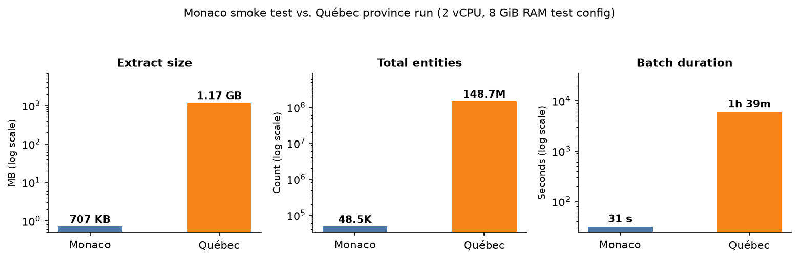
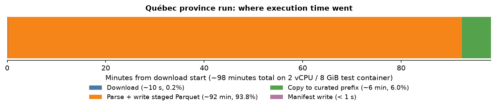
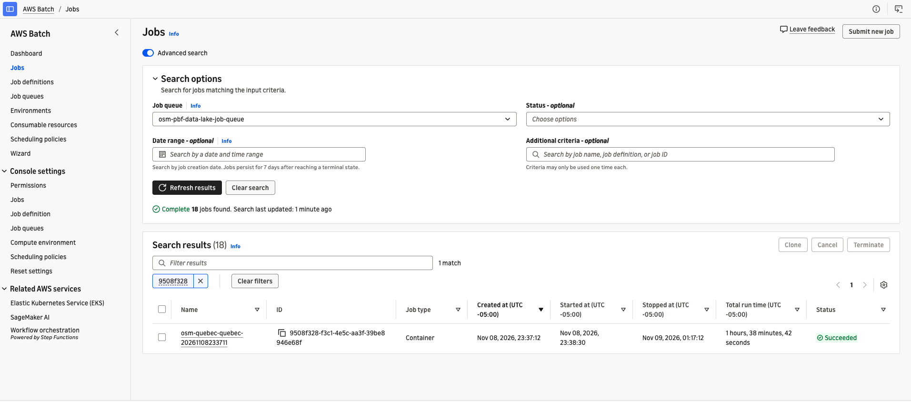
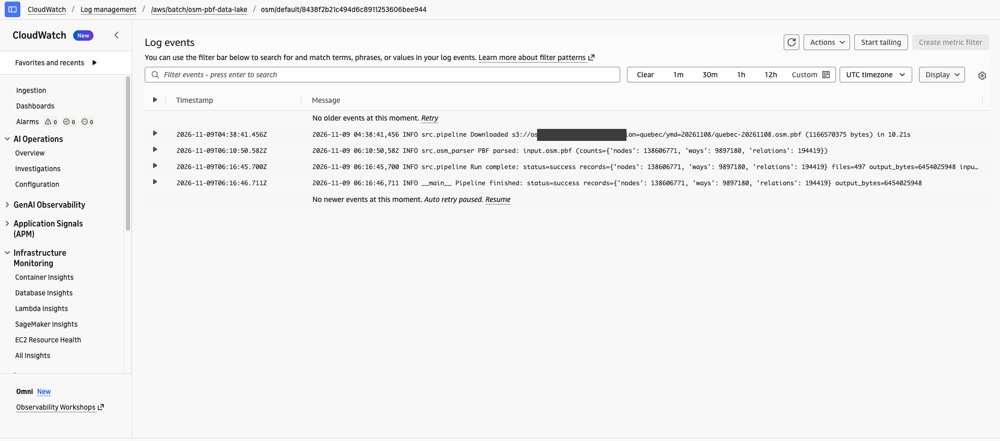
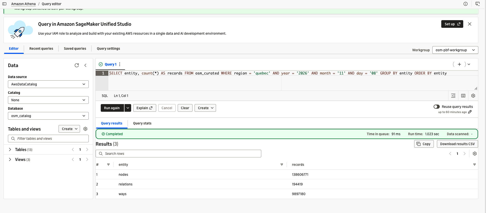
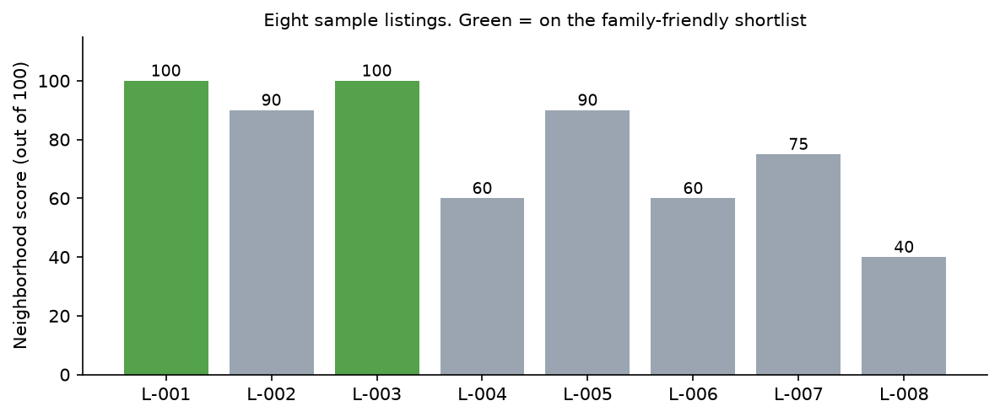
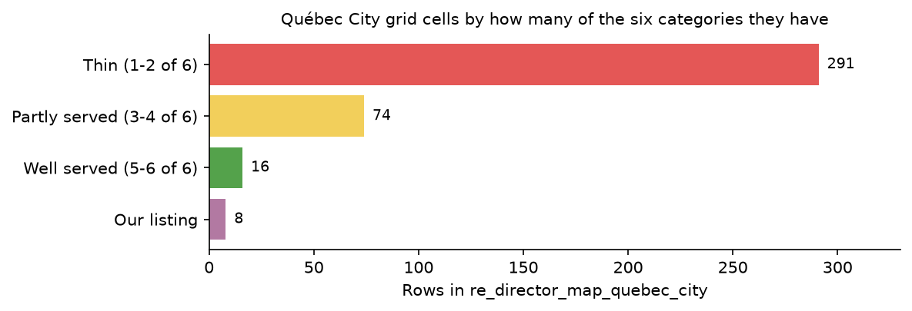

# What's Around This House? Querying OpenStreetMap with SQL on AWS

> **Repository:** https://github.com/aarigonimi/aws-pbf-dataparser (processor, Dockerfile, Terraform, SQL and operating guide)

## What the brokerage needs to know

Picture a Québec City brokerage with a few hundred listings, a marketing team, an analyst and one data engineer: me. Three questions keep coming back to the analyst:

- Agents ask how their listings compare for nearby schools, parks and transit.
- Marketing wants the homes with three bedrooms or more that have a school and a park within 800 m.
- The director wants to know which parts of the city are well served, and where the brokerage is thin on listings.

OpenStreetMap (OSM) maps all of those amenities across the province. I want the people asking to answer these questions themselves with SQL, so the goal of this project is straightforward: when a new OSM extract for the province of Québec lands in S3, convert it into tables an analyst can query in Athena without anyone running a script by hand.

That takes two steps:

1. When the extract lands in the raw S3 bucket, an EventBridge rule submits an AWS Batch job on Fargate that converts the PBF file into partitioned Parquet.
2. In Athena, five SQL queries narrow the province to Québec City, join the points of interest with the brokerage's listings and publish one view per team.

My work ends at the datasets. The analyst queries the views in Athena, exports CSVs or connects a BI tool later. The brokerage and the eight listings in the repo are an example, while the Batch runs, Athena numbers and deployment issues below come straight from my AWS account.

## Why bother with SQL at all?

An analyst lives in SQL and spreadsheets. They don't know what an OpenStreetMap `.osm.pbf` binary file is, and they shouldn't have to. When raw map data stays in its native format, every ad-hoc question ("which listings are within 500 m of a pharmacy?") becomes a ticket for the data engineer. Once the extract is in S3 as Parquet and registered in the Glue Data Catalog, "what's near this house" is a standard SQL join that an analyst can read, audit and adjust in minutes.

You could query the public Overpass API for a single address, but Overpass is a shared community service with rate limits, not something to point a monthly batch refresh at. Instead, you download a regional extract from [Geofabrik](https://download.geofabrik.de/). There is no extract for Québec City alone; the smallest file that covers it is the province of Québec, a 1.17 GB PBF file.

A PBF file isn't a flat table. It stores three kinds of objects:

- **Nodes:** single points with an ID, latitude, longitude and tags (a bus stop, a convenience store, a bench).
- **Ways:** ordered lists of node IDs that form a line or boundary (a street, a park perimeter, a school building). A way does not store coordinates of its own; its coordinates live in the nodes it references.
- **Relations:** groups of nodes, ways and other relations (a bus route, a large park with inner clearings, a city boundary).

Athena cannot query a PBF file directly. The Batch processor streams through the file with PyOsmium, indexes node coordinates on local disk so ways can resolve their geometries, and writes Snappy-compressed Parquet files partitioned by `region`, `year`, `month`, `day` and `entity`.

If an existing public OSM dataset already fits your workflow, you may not need your own ingestion pipeline. I built this one because I wanted dated regional snapshots, a fixed schema I control and repeatable monthly refreshes.

## Picking the services

PyOsmium reads a PBF extract sequentially, and PyArrow writes bounded Parquet batches to disk before uploading them to S3. Resolving way geometries also needs fast local storage for the node-location index. That points to a single long-lived container rather than a distributed cluster or short-lived functions:

- **AWS Lambda** caps invocations at 15 minutes and 10 GB of ephemeral storage. Streaming a provincial PBF extract and indexing its node coordinates is a long-running sequential pass that outgrows both limits, and splitting a single PBF stream across invocations would require a different design for resolving node references.
- **AWS Glue or Amazon EMR** shine when work splits across executors, but a PBF file is read as a single stream. Paying for a Spark cluster while one reader does the work buys nothing.
- **Amazon ECS on Fargate** runs the exact same container, but you have to wire up job queueing and retry classification yourself.
- **AWS Batch on Fargate** gives you a managed queue, exit-code retry rules and zero EC2 instances to patch. The catch is VPC networking, which cost me the most debugging time.

I also skipped two Batch features on purpose. **Array jobs** fan work out across containers, which only helps if you first split the PBF into overlapping geographic tiles. **Fargate Spot** is cheaper, but an interruption mid-parse loses the entire run. For a job that runs once a month and costs about twenty cents on demand, paying the on-demand rate is a better trade than restarting a long-running job from scratch. If you run small extracts where restarts are cheap, the repo also supports EC2 Spot (`batch_compute_type = "EC2"`, `batch_use_spot = true`).

On the query side, the Parquet files stay in S3, registered in the **Glue Data Catalog** using partition projection and queried with **Amazon Athena**. Because the heavy scoring queries run once a month when a new snapshot arrives, there is no reason to pay for an always-on database. The analyst queries plain views in an Athena workgroup with a 10 GiB per-query scan cap.

For this walkthrough test, I sized the container at 2 vCPU, 8 GiB of memory and 100 GiB of ephemeral storage. That is a small starting configuration rather than a fixed ceiling - the downloaded PBF, staged Parquet files and node-location index share that scratch disk, and you can step up the vCPUs, memory or disk to match larger extracts or faster runtimes.

## A new file starts the conversion


When a monthly delivery writes a `.osm.pbf` object under `region=quebec/YYYY/MM/DD/` in the raw S3 bucket, S3 sends an `Object Created` event to Amazon EventBridge. A rule in [`infra/trigger.tf`](../../infra/trigger.tf) matches the `.osm.pbf` suffix and submits the Batch job directly:

```hcl
event_pattern = jsonencode({
  source        = ["aws.s3"]
  "detail-type" = ["Object Created"]
  detail = {
    bucket = { name = [aws_s3_bucket.raw.id] }
    object = { key = [{ suffix = ".osm.pbf" }] }
  }
})
...
batch_target {
  job_definition = aws_batch_job_definition.osm_job["event"].arn_prefix
  job_name       = "osm-event-extract"
}
input_transformer {
  input_paths    = { raw_key = "$.detail.object.key" }
  input_template = "{\"Parameters\": {\"raw_key\": <raw_key>}}"
}
```

The input transformer maps `$.detail.object.key` into Batch `Parameters.raw_key`. The `event` job definition passes `--raw-key Ref::raw_key` to the container entrypoint, which reads the region and snapshot date from the S3 key itself. There is no Lambda function or Step Functions state machine in the middle because Batch already handles queuing and retries.

To keep the scope clear before you deploy, here is what the repository leaves out by design:

- It does not schedule the Geofabrik download; `make run` downloads and uploads the extract from your workstation.
- It does not trigger the Athena SQL scripts automatically after conversion; refreshing the brokerage tables is a separate step.
- It does not deploy a BI dashboard; the Athena views are the handoff point.
- It uses SSE-S3 encryption with a TLS-only bucket policy rather than customer-managed KMS keys.
- It converts ways into WKT `LINESTRING` geometries when way geometry is enabled, while relations keep their member list rather than reconstructed multipolygons.

## Deploy the stack

You need an AWS account, AWS CLI v2, Terraform 1.10+, Docker, Python 3.12, `make` and a default VPC in `us-east-1`.

Before deploying, check `include_way_geometry = true` in `infra/terraform.tfvars`. What is **way geometry**? Because an OpenStreetMap *way* (such as a park boundary or a school building) only stores a list of node IDs without coordinates, turning on way geometry tells the parser to look up each referenced node's latitude and longitude on disk and write a WKT `LINESTRING(...)` string into the `geometry` column. That allows Athena to compute centroids for ways, not just point nodes. EventBridge-triggered jobs read this setting from the Terraform job definition.

```bash
git clone https://github.com/aarigonimi/aws-pbf-dataparser.git
cd aws-pbf-dataparser
python3.12 -m venv .venv && source .venv/bin/activate
make install

cp -n infra/terraform.tfvars.example infra/terraform.tfvars
aws sts get-caller-identity   # check active AWS account
make deploy                   # terraform plan and apply
make build                    # build and push image to ECR
```

The default configuration deploys to `us-east-1` with the S3 trigger enabled (`s3_trigger_enabled = false` turns it off). To keep container traffic inside the AWS network without public IPs or a NAT gateway, the stack creates four VPC endpoints:

1. **`ecr.api` (Interface endpoint):** lets Fargate call the ECR control plane (`GetAuthorizationToken`) to authenticate before pulling the container image.
2. **`ecr.dkr` (Interface endpoint):** lets Fargate reach the Docker registry data plane to pull the image manifest.
3. **`logs` (Interface endpoint):** lets the Fargate task send container logs to CloudWatch Logs privately.
4. **`s3` (Gateway endpoint, free):** lets Fargate download the PBF, write Parquet to S3 and fetch ECR's Docker image layers from S3 at no hourly charge.

Why three interface endpoints instead of one? AWS PrivateLink puts each service under its own endpoint name (`com.amazonaws.us-east-1.ecr.api`, `ecr.dkr` and `logs`), and each interface endpoint bills \$0.01 per hour (about \$0.72 per day total for all three).

## Drop an extract in the bucket

Start with Monaco. The extract is 707 KB, so if an IAM permission or VPC endpoint is misconfigured you find out in thirty seconds instead of waiting on a provincial file:

```bash
make run          # defaults: REGION=monaco YMD=20261108
make logs
make verify
```

Once Monaco writes its `_manifest.json`, run the province of Québec:

```bash
make run REGION=quebec YMD=20261108 GEOFABRIK_AREA=north-america/canada
make logs
make verify REGION=quebec YMD=20261108   # check files and manifest
```

`make run` downloads `quebec-261108.osm.pbf` from Geofabrik and uploads it to `s3://<raw-bucket>/region=quebec/2026/11/08/quebec-20261108.osm.pbf`. That upload triggers the Batch job. `make verify` checks that the Parquet files and `_manifest.json` landed in the curated bucket; the real data validation happens next in Athena.

### What the runs did

Both runs used the 2 vCPU, 8 GiB RAM test configuration on Fargate:

- **Monaco smoke test:** Uploading the 707 KB extract triggered EventBridge and submitted `osm-event-extract`. The container downloaded the file in under 0.1 s, parsed **48.5K entities** (41.8K nodes, 6.3K ways and 351 relations) in 2.8 s, wrote 3 Parquet files totaling **3.1 MB** and finished in **31 s** of Batch wall-clock time (nearly 28 s of which was Fargate task startup).
- **Québec provincial run:** Processing the **1.17 GB** provincial extract read **148.7M entities** in a single pass (**138.6M nodes**, **9.9M ways** and **194K relations**). It wrote **497 Parquet files** (463 for nodes, 33 for ways and 1 for relations) totaling **6.45 GB** and completed in **1 h 39 m** of Batch wall-clock time.



Where did the execution time go during the Québec run? The CloudWatch logs split the ~98 minutes of application runtime into four stages:



- **Download from S3 (~10 s, 0.2%):** pulling the 1.17 GB PBF over the S3 gateway endpoint into container scratch storage.
- **Stream parse and write staged Parquet (~92 min, 93.8%):** streaming 148.7M entities through PyOsmium, flushing 300K-row PyArrow batches to local Parquet files and uploading each part to a temporary `_staging/` prefix in S3.
- **Publish copy to curated prefix (~6 min, 6.0%):** copying all 497 Parquet parts from `_staging/` into `curated/region=quebec/2026/11/08/` before writing `_manifest.json` last, so Athena queries never see a half-written partition.
- **Manifest write and exit (< 1 s):** writing `_manifest.json` and exiting with code 0.





## Check the output in Athena

Before building any downstream tables, verify in Athena (`osm-pbf-workgroup`) that the table row counts match `_manifest.json`:

```sql
SELECT entity, count(*) AS records
FROM osm_catalog.osm_curated
WHERE region = 'quebec' AND year = '2026' AND month = '11' AND day = '08'
GROUP BY entity
ORDER BY entity;
```

Because `osm_curated` uses Glue partition projection, every query must include equality filters on `region`, `year`, `month` and `day`. Athena returned **138.6M** nodes, **9.9M** ways and **194K** relations (**148.7M** total), matching the manifest down to the last record. And because `count(*)` grouped only by a partition column is answered from Parquet footers, Athena scanned **0 bytes** and finished in 1.0 s.



Matching row counts don't prove the coordinates are usable, so run a quick geometry audit on the nodes and ways:

```sql
SELECT count(*) AS ways,
       count_if(geometry IS NOT NULL) AS ways_with_geometry
FROM osm_catalog.osm_curated
WHERE region = 'quebec' AND year = '2026' AND month = '11' AND day = '08'
  AND entity = 'ways';
```

Auditing all 138.6M nodes (2.73 GB scanned in 2.0 s) found **0** nodes missing coordinates and **0** outside valid latitude/longitude bounds. On the ways side, this historical Québec snapshot was produced before way-geometry reconstruction was turned on by default, so `ways_with_geometry` is 0 and every feature in the Québec City tables below comes from OSM nodes. When you run with the current repo default (`include_way_geometry = true`), parks and school grounds mapped as closed ways also contribute their line centroids.

## Issues to watch out for

Getting a container to parse a file locally is easy. Getting AWS Batch on Fargate to pull the image privately inside a VPC and handle retries cleanly is where things break.

### The job never starts, and there are no logs

My first Québec Batch job sat in `STARTING` for minutes, failed and retried. The CloudWatch log group was completely empty because the container never started. Inspecting `attempts[].statusReason` with `aws batch describe-jobs` showed the real cause:

```text
ResourceInitializationError: unable to pull secrets or registry auth: ...
There is a connection issue between the task and Amazon ECR. ... i/o timeout
```

By default, an AWS Batch Fargate compute environment does not assign a public IP to tasks (`assignPublicIp = DISABLED`), even when launching into a default VPC's subnets. Keeping public IPs disabled is good practice - a backend batch job has no reason to be on the public internet - but without a NAT gateway, the Fargate network interface had no route to Amazon ECR or CloudWatch Logs.

Adding the three interface endpoints (`ecr.api`, `ecr.dkr` and `logs`) plus the `s3` gateway endpoint in [`infra/endpoints.tf`](../../infra/endpoints.tf) fixed it while keeping all traffic on the AWS private network. **Do not skip the S3 gateway endpoint:** ECR authenticates over the interface endpoints, but Docker image layers live in S3. Without the S3 gateway endpoint attached to the subnet's route table, `GetAuthorizationToken` succeeds and the layer download times out.

Once all four endpoints were `available`, the next attempt pulled the image in seconds and ran to completion.

### Retry only what a retry can fix

If you enable retries in AWS Batch without exit-code rules, Batch retries *every* non-zero exit code up to `attempts`. If a job fails because a partition was already published or a config variable is wrong, retrying three times on a Fargate container just burns money for the exact same failure.

The Python processor maps exceptions to distinct exit codes, and [`infra/batch.tf`](../../infra/batch.tf) pairs them with `evaluate_on_exit` rules:

```hcl
retry_strategy {
  attempts = var.batch_retry_attempts
  evaluate_on_exit {              # 75: transient S3/network or SIGTERM
    on_exit_code = "75"
    action       = "RETRY"
  }
  evaluate_on_exit {              # EC2 host reclaimed (EC2 mode)
    on_status_reason = "Host EC2*"
    action           = "RETRY"
  }
  evaluate_on_exit {              # image pull failed before start
    on_status_reason = "ResourceInitializationError*"
    action           = "RETRY"
  }
  evaluate_on_exit {              # 5: IAM denial, do not retry
    on_exit_code = "5"
    action       = "EXIT"
  }
  evaluate_on_exit {              # 2 config, 3 input, 4 output exists
    on_exit_code = "*"
    action       = "EXIT"
  }
}
```

Two details matter here:

1. **The final `on_exit_code = "*"` with `action = "EXIT"` is required.** Without a catch-all `EXIT` rule, Batch falls back to retrying any unmatched exit code - including exit code `2` (bad config), `3` (corrupt input) and `4` (`OutputConflictError` when `_manifest.json` or an active `_lock.json` claim already exists for that partition). I verified this on Monaco by uploading the same PBF file a second time: EventBridge submitted a second `osm-event-extract` job, which saw the existing `_manifest.json`, logged `OutputConflictError` and exited with code `4` after one attempt and zero retries, leaving the published partition untouched.
2. **Don't swallow transient S3 errors inside a broad `except` block.** An early version of `process_pbf()` caught every exception during parsing and wrapped it in `InputFileError` (exit code `3`). Because Parquet parts upload *during* parsing, a transient S3 throttle would have exited with code `3` and skipped the retry rule. Raising `TransientError` (exit code `75`) before the generic catch block keeps S3 transport errors retryable.

## From Parquet to datasets

Once `_manifest.json` is present, the five SQL scripts in `sql/athena/real_estate/` turn the provincial partition into the brokerage's three datasets. Replace `<curated-bucket>` with your curated bucket name and run the statements in order.

**1. Filter to Québec City points of interest.** `01_create_neighborhood_pois.sql` scans the `quebec` partition once and writes a small table (`re_pois_quebec_city_20261108`) containing only the six amenity categories inside the Québec City bounding box:

```sql
CASE
  WHEN amenity IN ('school', 'kindergarten') THEN 'school'
  WHEN shop IN ('supermarket', 'convenience', 'greengrocer', 'bakery')
    THEN 'grocery'
  WHEN amenity = 'pharmacy' THEN 'pharmacy'
  WHEN amenity IN ('hospital', 'clinic', 'doctors') THEN 'healthcare'
  WHEN json_extract_scalar(tags, '$.leisure')
    IN ('park', 'playground', 'garden') THEN 'green_space'
  WHEN highway = 'bus_stop'
    OR json_extract_scalar(tags, '$.public_transport') = 'platform'
    OR json_extract_scalar(tags, '$.railway') = 'station' THEN 'transit'
END AS category
...
COALESCE(
  latitude,
  TRY(ST_Y(ST_Centroid(ST_GeometryFromText(geometry))))
) AS lat
...
-- Québec City bounding box + ~800 m padding
WHERE lat BETWEEN 46.72 AND 46.99
  AND lon BETWEEN -71.56 AND -71.12
```

This CTAS scanned 1.80 GB in 8.7 s and wrote **~3K POIs** (2,332 transit stops, 283 grocery stores, 165 green spaces, 118 pharmacies, 59 healthcare facilities and 37 schools) into a 50 KB Parquet table. Every downstream query reads this 50 KB table instead of rescanning the 6.45 GB province partition.

**2. Register the brokerage listings.** Upload the sample CSV and run `02_create_listings.sql` to register `osm_catalog.re_listings`:

```bash
source scripts/env.sh
aws s3 cp sql/athena/real_estate/sample_listings.csv \
  "s3://${OUTPUT_BUCKET}/derived/re_listings/"
```

**3. Score each listing by 800 m proximity.** `03_score_listings.sql` joins `re_listings` against `re_pois_quebec_city_20261108`. It pre-filters with a bounding box (widening the longitude window by `cos(radians(lat))` since longitude degrees narrow going north) before computing exact great-circle distance:

```sql
JOIN osm_catalog.re_pois_quebec_city_20261108 p
  -- ~800 m latitude and longitude pre-filter
  ON p.lat BETWEEN l.lat - 0.0072 AND l.lat + 0.0072
 AND p.lon BETWEEN l.lon - 0.0072 / cos(radians(l.lat))
               AND l.lon + 0.0072 / cos(radians(l.lat))
WHERE great_circle_distance(l.lat, l.lon, p.lat, p.lon) <= 0.8
```

Each category awards points once if at least one feature sits within 800 m (school 25, grocery 20, transit 20, green space 15, healthcare 10, pharmacy 10), so ten bus stops don't outweigh a missing school. The query scanned just **81 KB** and finished in 1.6 s.

**4. Create the agent and marketing views.** `04_create_marketing_views.sql` defines `re_agent_fact_sheet_quebec_city` (one summary row per listing with nearest distances and names) and `re_family_friendly_quebec_city` (listings with 3+ bedrooms and both a school and green space within 800 m).

**5. Build the director's coverage grid.** `05_area_coverage.sql` buckets the POIs into 0.01° latitude/longitude cells (roughly 1.1 km × 0.76 km) and counts how many of the six amenity categories each cell contains (50 KB scanned in 1.7 s). It then creates `re_director_map_quebec_city`, combining the grid cells and the brokerage's listings into one view with a `map_layer` column.

**6. Audit the results against the map.** Never trust a spatial score without inspecting the features behind at least one listing:

```sql
SELECT p.category, p.osm_id, p.name,
       round(
         great_circle_distance(l.lat, l.lon, p.lat, p.lon) * 1000
       ) AS distance_m
FROM osm_catalog.re_listings l
CROSS JOIN osm_catalog.re_pois_quebec_city_20261108 p
WHERE l.listing_id = 'L-001'
  AND great_circle_distance(l.lat, l.lon, p.lat, p.lon) <= 0.8
ORDER BY distance_m;
```

### What the datasets showed

Querying `re_agent_fact_sheet_quebec_city` (< 1 KB scanned in 0.7 s) gives agents a single line per property:

- **L-001 (73 Rue des Jardins, 3 bd, \$449K):** score **100** - `school 783 m; park 170 m; grocery 115 m; transit 64 m` (nearest school: *CPE Les Petits Cheminots*; nearest park: *unnamed*).
- **L-003 (118 Avenue Cartier, 4 bd, \$589K):** score **100** - `school 489 m; park 241 m; grocery 300 m; transit 113 m` (nearest school: *CPE Les Petits Cheminots*; nearest park: *Parc Gilles-Lamontagne*).
- **L-004 (515 Chemin Sainte-Foy, 5 bd, \$749K):** score **60** - `grocery 332 m; transit 182 m` (no school or park within 800 m).



Querying `re_family_friendly_quebec_city` (< 1 KB scanned) narrows the eight properties to the two that fit the family campaign: **L-001** and **L-003**. L-004 has five bedrooms but lacks a nearby school or park, and three-bedroom L-007 (score 75) has a school at 452 m (*École secondaire Samuel-De Champlain*) but no park within 800 m.

When I ran the audit query on **L-001**, the raw OSM features showed three real-world quirks worth knowing:

1. **Tag semantics matter:** L-001's only school-category feature within 800 m is *CPE Les Petits Cheminots* at 783 m. In Québec, a CPE (*Centre de la petite enfance*) is an early-childhood daycare tagged `amenity=kindergarten`. Because `01_create_neighborhood_pois.sql` groups `school` and `kindergarten` together, it qualifies. If marketing means elementary and high schools only, drop `kindergarten` from the `CASE` expression.
2. **Unnamed features are real places:** L-001's nearest green space at 170 m has `name = NULL` in OpenStreetMap (followed by *Place de l'Assemblée-Nationale* at 620 m and *Parc Gilles-Lamontagne* at 800 m). Using `coalesce(nearest_green_name, 'unnamed')` in the view makes missing OSM names explicit rather than silently dropping the row.
3. **Chains vs. private access:** Repeat names across the city are retail chains rather than duplicate nodes (32 *Couche-Tard*, 22 *Familiprix*, 19 *Jean Coutu*), which is why scoring presence-once per category works better than raw counts. Meanwhile, 5 POI nodes in the bounding box carry `access=private` in their JSON tags; filtering out `json_extract_scalar(tags, '$.access') = 'private'` in step 1 is a one-line tightening if you want strictly public amenities.

## Hand the datasets to the analyst

Once the views exist in `osm_catalog`, the analyst works inside `osm-pbf-workgroup` (which enforces a 10 GiB scan limit per query) and queries three views:

- `osm_catalog.re_agent_fact_sheet_quebec_city` - one row per listing with scores, distances and amenity names.
- `osm_catalog.re_family_friendly_quebec_city` - the filtered 3+ bedroom family campaign shortlist.
- `osm_catalog.re_director_map_quebec_city` - one row per 0.01° grid cell or listing with `lat`, `lon` and `map_layer`.

Running the director's summary query in Athena:

```sql
SELECT map_layer, count(*) AS points
FROM osm_catalog.re_director_map_quebec_city
GROUP BY map_layer
ORDER BY points DESC;
```



The query scanned **0.68 KB** and returned **381 grid cells** across the city (`16` well served with 5-6 categories, `74` partly served with 3-4 categories and `291` thin with 1-2 categories) alongside the **8 listings**.


Because the views sit on top of the small derived Parquet tables in `derived/`, routine analyst queries scan kilobytes and cost fractions of a cent. If the brokerage later connects Amazon Quick Sight or another BI tool to Athena, `re_director_map_quebec_city` already has `lat`, `lon` and `map_layer` columns ready for a point map. Any map or report built from these tables must display the credit *"© OpenStreetMap contributors"*.

## What it cost me

Here is the cost summary from my measured runtimes and `us-east-1` public pricing ([Fargate](https://aws.amazon.com/fargate/pricing/), [PrivateLink](https://aws.amazon.com/privatelink/pricing/) and [Athena](https://aws.amazon.com/athena/pricing/)):

| Component | Measured usage | Unit rate (`us-east-1`) | Cost | Billing model |
|---|---|---|---|---|
| **Batch on Fargate (Québec)** | 1 h 39 m on 2 vCPU, 8 GiB RAM, 100 GiB disk | ~\$0.125 / hour | **\$0.21** | Per second while the container runs |
| **Batch on Fargate (Monaco)** | 31 s on 2 vCPU, 8 GiB RAM, 100 GiB disk | ~\$0.125 / hour | **\$0.001** | Smoke test run |
| **Athena queries** | ~11.9 GB scanned across all verification and CTAS queries | \$5.00 / TB scanned | **\$0.06** | Per query; analyst views scan < 1 KB |
| **3 VPC interface endpoints** | 1 day (24 hours) for `ecr.api`, `ecr.dkr`, `logs` | \$0.01 / endpoint-hour (\$0.03 / hr total) | **\$0.72 / day** | Hourly while deployed (~\$22 / month) |
| **S3 gateway endpoint + storage** | 7.6 GB total (1.17 GB PBF + 6.45 GB Parquet) | Gateway free; \$0.023 / GB-month | **< \$0.18 / mo** | Storage bills while objects remain in S3 |

The takeaway is simple: **converting 148.7M OpenStreetMap entities on Fargate and building the Athena datasets cost \$0.27 in compute and queries.** The only ongoing hourly charge comes from the three VPC interface endpoints (\$0.72 per day), which is why tearing down the stack after a test matters.

## Clean up

When you finish testing, drop the derived Athena views and tables listed in [`docs/cleanup.md`](../cleanup.md). Because the S3 buckets have versioning enabled, `aws s3 rm --recursive` leaves object versions behind; run the cleanup script or `make destroy` to empty all versions and destroy the Terraform stack:

```bash
make destroy                                   # empty buckets and destroy stack
terraform -chdir=infra state list              # expect no resources
aws ec2 describe-vpc-endpoints \
  --filters Name=tag:Project,Values=osm-pbf-data-lake \
  --query 'VpcEndpoints[].VpcEndpointId'       # expect []
```

Always run that final `describe-vpc-endpoints` check to confirm the interface endpoints are gone.

## Wrapping up

We started with three business questions from a real estate brokerage and a 1.17 GB binary OpenStreetMap extract that no SQL analyst could query directly. By pairing an EventBridge S3 trigger with AWS Batch on Fargate, the raw PBF converts itself into partitioned Parquet for twenty-one cents, and five Athena queries turn 148.7M provincial map entities into sub-kilobyte views for agents, marketing and leadership.

Once the VPC endpoints and Batch retry rules are in place, the data engineer gets out of the way - and the analyst can answer the next neighborhood question with a `SELECT`.

---

*Map data © OpenStreetMap contributors, available under the [Open Database License](https://www.openstreetmap.org/copyright).*

**References:** [Lambda quotas](https://docs.aws.amazon.com/lambda/latest/dg/gettingstarted-limits.html) · [Batch on Fargate](https://docs.aws.amazon.com/batch/latest/userguide/fargate-compute-environments.html) · [EventBridge Batch targets](https://docs.aws.amazon.com/eventbridge/latest/userguide/eb-targets.html#targets-specifics-batch) · [Batch retry strategy](https://docs.aws.amazon.com/batch/latest/userguide/job_definition_parameters.html) · [ECR VPC endpoints](https://docs.aws.amazon.com/AmazonECR/latest/userguide/vpc-endpoints.html) · [S3 conditional writes](https://docs.aws.amazon.com/AmazonS3/latest/userguide/conditional-writes.html) · [Athena partition projection](https://docs.aws.amazon.com/athena/latest/ug/partition-projection.html) · [Athena workgroup data usage controls](https://docs.aws.amazon.com/athena/latest/ug/workgroups-setting-control-limits-cloudwatch.html)
