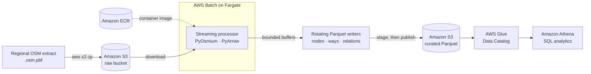

OpenStreetMap is one of the richest open geographic datasets available, but in its distributed form it is closed to SQL. This is the story of turning a regional extract into queryable Parquet — and of the two production incidents that taught me more than the parsing ever did.

## 1. The challenge: making OpenStreetMap data analytics-ready

OpenStreetMap provides rich geographic data in PBF (Protocolbuffer Binary Format). While this format is efficient for data distribution, it is not directly queryable through services such as Amazon Athena.

The goal was to build a pipeline that transforms a regional OSM extract into structured, compressed Parquet files stored in Amazon S3, ready for SQL analytics.

Rather than loading the entire dataset into memory, the processor uses PyOsmium to stream entities and PyArrow to write Parquet incrementally.

The main challenge was not simply parsing the data. It was building a reliable pipeline capable of handling a large extract, managing failures and publishing consistent output.

## 2. The architecture

The solution combines a small set of AWS services:

- **AWS Batch on Fargate** runs the containerized processing workload.
- **Amazon S3** stores the original PBF file, intermediate files and final Parquet datasets.
- **Amazon ECR** stores the Docker image.
- **AWS Glue Data Catalog** provides table metadata.
- **Amazon Athena** enables SQL queries over the resulting dataset.
- **Terraform** provisions the infrastructure.

The processing flow is straightforward:

```text
OSM PBF → S3 → AWS Batch → PyOsmium → PyArrow → Parquet → S3 → Glue → Athena
```



The application streams nodes, ways and relations into separate Parquet outputs. It uses explicit schemas, Snappy compression and bounded writer buffers.

AWS Batch was selected because the workload can run for more than an hour. [Lambda's 15-minute execution limit](https://docs.aws.amazon.com/lambda/latest/dg/gettingstarted-limits.html) makes it unsuitable for this particular processing configuration.

## 3. Two engineering problems worth sharing

### Problem 1: Fargate could not pull the Docker image

The first deployment failed before the application even started.

AWS Batch reported a `ResourceInitializationError` while trying to retrieve the ECR authorization token. The task had no public IP and no NAT gateway, so it could not reach the public ECR API.

The solution was to provide private connectivity through [VPC endpoints](https://docs.aws.amazon.com/AmazonECR/latest/userguide/vpc-endpoints.html):

```text
ECR API · ECR Docker Registry · S3 gateway endpoint · CloudWatch Logs
```

This was a useful reminder: when a Fargate task fails before application startup, investigate the execution environment and image-pull dependencies before debugging application code.

### Problem 2: two jobs processed the same partition

A second issue appeared during execution.

Two AWS Batch jobs processed the same region/date partition concurrently. Both passed the initial output-existence check and proceeded to publish data.

This exposed an important design flaw: checking whether an S3 object exists is not a distributed lock.

The repository now implements a [conditional S3 write](https://docs.aws.amazon.com/AmazonS3/latest/userguide/conditional-writes.html) claim using `If-None-Match: *`, with a second output check after acquiring the claim:

```python
# src/s3_utils.py — exactly one concurrent run can acquire the claim
kwargs = {
    "Bucket": bucket,
    "Key": key,
    "Body": body,
}
if if_none_match:
    kwargs["IfNoneMatch"] = "*"
try:
    self._client.put_object(**kwargs)
except ClientError as exc:
    if _error_code(exc) in _PRECONDITION_FAILED_CODES or _http_status(exc) == 412:
        return False  # the claim is already held by another run
```

This improves concurrency control, but ownership-safe recovery and release still require additional hardening and AWS validation. The publication process also remains non-atomic: the manifest is written last, and consumers must check it before reading a partition.

## 4. The benchmark: 148 million entities

The main benchmark used a Quebec OpenStreetMap extract.

| Metric | Result |
| --- | --- |
| Input PBF | 1.17 GB |
| Total entities | 148,698,370 |
| Nodes | 138,606,771 |
| Ways | 9,897,180 |
| Relations | 194,419 |
| Parquet files | 497 |
| Parquet output | 6.45 GB |
| Parse and write time | 92.2 minutes |
| AWS Batch runtime | 98.7 minutes |
| Compute | 2 vCPU / 8 GiB RAM |

The workload ran with Snappy compression and way geometry disabled.

The entity counts matched the historical manifest and the results from the crawler-created Glue tables.

A few observations stood out:

- Parsing and writing dominated the execution time.
- The Parquet representation was larger than the compressed PBF input, trading compactness for queryability.
- The average Parquet file was approximately 13 MB, leaving room to investigate file sizing and query efficiency.

These figures come from one historical execution, not a controlled performance study. Peak memory and actual AWS cost were not captured. The historical run also used an older writer configuration, so these results should not be treated as a benchmark of the current code.

## 5. What I learned

This project reinforced several practical engineering lessons:

- **Design for infrastructure failures.** A container can fail before your application gets a chance to run.
- **Do not confuse existence checks with concurrency control.** Concurrent jobs need an explicit coordination mechanism.
- **Make publication semantics clear.** Writing a manifest last is a completion convention, not an S3 transaction.
- **Measure what matters.** Processing time alone is not enough. Future benchmarks should capture CPU, peak memory, image digest and actual cost.
- **Keep infrastructure reproducible.** Terraform, immutable image references and explicit configuration make it easier to understand what was actually deployed.

## 6. What's next?

The next experiments will focus on:

- Comparing 1, 2 and 4 vCPU configurations.
- Testing Snappy against Zstandard.
- Improving Parquet file sizing.
- Capturing peak memory and AWS cost.
- Hardening partition-claim ownership and recovery.
- Exploring GeoParquet and relation geometry.

## Conclusion

Building this pipeline was a useful exercise in combining data engineering with AWS infrastructure design.

The interesting part was not just converting 148 million OpenStreetMap entities into Parquet. It was discovering how networking, concurrency, retries and publication semantics affect the reliability of a real data pipeline.

**Repository:** [github.com/aarigonimi/aws-pbf-dataparser](https://github.com/aarigonimi/aws-pbf-dataparser)

---

> **Technical note:** The Quebec benchmark reflects the historical deployment. Several reliability improvements described above are implemented in the repository but have not yet been validated in AWS. The current S3 claim mechanism also needs further ownership and recovery hardening before being described as fully production-safe.

*OpenStreetMap data © OpenStreetMap contributors, available under the Open Database License (ODbL).*
